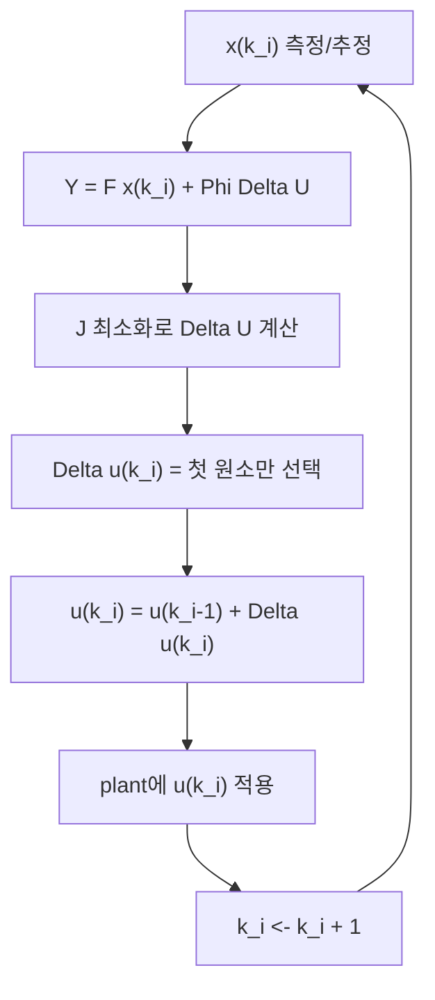

# Receding Horizon Control

[[03_One_Window_Optimization|한 최적화 창]]에서 구한 $\Delta U$는 미래 입력 변화량의 전체 궤적이다. 그러나 실제 구현에서는 첫 번째 샘플 $\Delta u(k_i)$만 plant에 넣는다. 다음 샘플이 오면 최신 측정값으로 다시 최적화한다.

## 알고리즘

## 상태피드백 형태

최적 제어열은

$$
\Delta U=(\Phi^T\Phi+\bar R)^{-1}(\Phi^T\bar R_s r(k_i)-\Phi^TFx(k_i))
$$

로 쓸 수 있다. 첫 원소만 선택하면,

$$
\Delta u(k_i)
=K_y r(k_i)-K_{mpc}x(k_i)
$$

가 된다.

$K_y$는 reference에 대한 feedforward 성분이고, $K_{mpc}$는 augmented state에 대한 feedback gain이다.

구체적으로

$$
K_y=
\begin{bmatrix}
1 & 0 & \cdots & 0
\end{bmatrix}
(\Phi^T\Phi+\bar R)^{-1}\Phi^T\bar R_s
$$

$$
K_{mpc}=
\begin{bmatrix}
1 & 0 & \cdots & 0
\end{bmatrix}
(\Phi^T\Phi+\bar R)^{-1}\Phi^TF
$$

이다.

## 폐루프 모델

augmented model

$$
x(k+1)=Ax(k)+B\Delta u(k)
$$

에 $\Delta u(k)=K_yr(k)-K_{mpc}x(k)$를 대입하면,

$$
x(k+1)=(A-BK_{mpc})x(k)+BK_yr(k)
$$

가 된다. 폐루프 eigenvalue는

$$
\det[\lambda I-(A-BK_{mpc})]=0
$$

으로 확인한다.

## $r_w$와 폐루프 속도

Example 1.5의 메시지는 단순하다.

- $r_w=0$: $K_y=10$, $K_{mpc}=[8,10]$, 폐루프 pole이 거의 원점에 있어 매우 빠르다.
- $r_w=10$: $K_y=0.2453$, $K_{mpc}=[0.6939,0.2453]$, pole이 $0.8530 \pm j0.0542$ 근처가 되어 훨씬 느리다.

입력 변화량을 강하게 벌점화할수록 응답이 부드러워지고 느려진다.

## Prediction horizon의 수치 민감도

Example 1.6은 $N_p$가 커지면 Hessian

$$
\Phi^T\Phi+\bar R
$$

의 condition number가 커질 수 있음을 보여준다. 긴 horizon은 안정성/성능 측면에서 유리할 수 있지만, 수치적으로 민감해질 수 있다. 따라서 $N_p$, $N_c$, $r_w$는 함께 조정해야 한다.

## 1장의 실무적 결론

- $\Delta U$ 전체는 "계획"이고, $\Delta u(k_i)$는 "실행"이다.
- feedback은 새 측정값으로 매 샘플 최적화를 다시 풀기 때문에 자연스럽게 들어온다.
- 폐루프 안정성은 $A-BK_{mpc}$의 eigenvalue로 확인한다.
- 작은 $N_p$, $N_c$ 선택은 계산을 줄이지만 안정성을 자동 보장하지 않는다.

## 연결

- 이전: [[03_One_Window_Optimization|한 최적화 창에서의 예측제어]]
- MIMO 확장: [[05_MIMO_MPC|MIMO 예측제어]]
- 구현 루프: [[09_MATLAB_Workflows|MATLAB 구현 흐름]]

