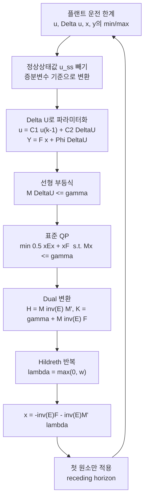

# MPC 2장 - Discrete-time MPC with Constraints

한 문장으로 정리하면, 2장은 1장에서 얻은 닫힌형 해 $\Delta U=(\Phi^T\Phi+\bar R)^{-1}\Phi^T(R_s-Fx(k_i))$ 를 버리고, 매 샘플마다 선형 부등식 제약 $M\Delta U\le\gamma$ 아래에서 같은 비용함수를 최소화하는 **이차계획법(QP)** 문제를 푸는 방법을 다룬다.

## 2장 학습 지도

## 노트 목록

- [[01_Motivational_Examples|01. 동기부여 예제 - 포화가 성능을 망치는 방식]]
- [[02_Constraint_Formulation|02. 운전 제약의 종류와 수식화]]
- [[03_Constrained_MPC_Problem|03. 제약 있는 MPC 문제의 최종 형태]]
- [[04_QP_Equality_Constraints|04. 등식제약 QP와 Lagrange 승수]]
- [[05_QP_Inequality_KKT_ActiveSet|05. 부등식제약, KKT 조건, Active Set]]
- [[06_Primal_Dual_Method|06. Primal-Dual 방법]]
- [[07_Hildreth_QP|07. Hildreth 이차계획법]]
- [[08_MATLAB_QPhild|08. MATLAB 구현 - QPhild.m]]
- [[09_Closed_Form_Active_Set|09. 활성집합을 알 때의 닫힌형 해]]
- [[10_Constraints_on_Rate_of_Change|10. 변화율 제약 예측제어]]
- [[11_Constraints_on_Amplitude|11. 진폭 제약 예측제어]]
- [[12_Amplitude_and_Rate|12. 진폭과 변화율 동시 제약]]
- [[13_Output_Constraints|13. 출력 제약과 제약 충돌]]
- [[14_Key_Equations|14. 핵심 수식 정리]]
- [[15_Problems_Roadmap|15. 연습문제 로드맵]]
- [[MPC2_Glossary|MPC 2장 용어집]]
- [[_작성_유의사항|작성 유의사항 (수식·마크다운)]]

## 1장에서 그대로 가져오는 것

2장은 1장 결과를 이미 안다고 가정하고 $\Phi^T\Phi$, $\Phi^TF$ 같은 기호를 바로 쓴다. 아래 세 노트를 먼저 확인하면 2장의 기호가 전부 이해된다.

- [[02_Augmented_State_Space_Model|증분 상태공간 모델]]: 왜 결정변수가 $u$ 가 아니라 $\Delta u$ 인가. 이 사실이 2장 전체를 지배한다.
- [[03_One_Window_Optimization|한 최적화 창에서의 예측제어]]: $Y=Fx(k_i)+\Phi\Delta U$ 와 비용함수 $J$.
- [[08_Key_Equations|1장 핵심 수식 정리]]: $F$, $\Phi$, $K_y$, $K_{mpc}$ 의 정의.

바뀌는 것은 딱 하나다. 비용함수는 그대로 두고, 닫힌형 해 대신 매 샘플마다 QP를 푼다.

## 2장에서 반드시 잡을 개념

- [[Constrained Control]]: 운전 한계를 설계 단계에서 최적화 문제 안에 넣는다.
- [[Decision Variable]] $\Delta U$: 모든 제약을 이 하나의 벡터에 대한 선형 부등식으로 번역한다.
- [[Active Constraint]]: $M_ix=\gamma_i$ 로 등호가 성립하는 제약. 이것만 알면 닫힌형 해가 나온다.
- [[Kuhn-Tucker Conditions]]: 활성/비활성 제약을 Lagrange 승수의 부호로 판별하는 필요조건.
- [[Hildreth QP]]: 역행렬 없이 성분별로 $\lambda$ 를 갱신하는 실시간용 알고리즘.
- [[Constraint Conflict]]: 입력 제약과 출력 제약이 동시에 활성이 되어 선형 종속이 되는 상황.

## 읽는 순서

1. [[01_Motivational_Examples|동기부여 예제]]에서 "포화를 무시하면 무슨 일이 일어나는가"를 눈으로 확인한다.
2. [[02_Constraint_Formulation|제약 수식화]]에서 $u$ 제약을 $\Delta U$ 의 함수로 번역하는 법을 익힌다.
3. [[03_Constrained_MPC_Problem|최종 형태]]에서 $M$, $\gamma$ 데이터 행렬을 조립한다.
4. [[04_QP_Equality_Constraints|등식제약 QP]] → [[05_QP_Inequality_KKT_ActiveSet|부등식제약과 KKT]] 순으로 최적화 이론을 쌓는다.
5. [[06_Primal_Dual_Method|Dual 변환]] → [[07_Hildreth_QP|Hildreth]] → [[08_MATLAB_QPhild|QPhild.m]] 으로 실제 푸는 도구를 만든다.
6. [[10_Constraints_on_Rate_of_Change|변화율]], [[11_Constraints_on_Amplitude|진폭]], [[12_Amplitude_and_Rate|동시]], [[13_Output_Constraints|출력]] 순으로 적용 예제를 본다.

## 기억할 결론

제약이 부등식으로 표현되기 때문에 일반적으로 닫힌형 해가 없다. 다만 **활성 제약 집합을 알면** 닫힌형 해가 존재한다.

$$
\lambda^*_{act}=-(M_{act}E^{-1}M_{act}^T)^{-1}(\gamma_{act}+M_{act}E^{-1}F)
$$

$$
x=-E^{-1}F-E^{-1}M_{act}^T\lambda^*_{act}
$$

이 장이 택한 방법은 활성집합을 primal 쪽에서 찾는 대신, dual 변수 $\lambda$ 를 반복적으로 구해 자동으로 식별하는 Hildreth 절차다. 핵심 장점은 **행렬 역변환이 없다**는 것이고, 그 덕분에 제약 충돌 상황에서도 수치적으로 터지지 않고 타협된 준최적해를 내놓는다. 실시간 구현에서는 이 성질이 최적성보다 중요하다.

## 실무 규칙 요약

- $u$ 제약은 정상상태값을 빼서 증분변수로 변환한다. 밸브가 15~80%이고 정상값이 30%면 $u^{min}=-15$, $u^{max}=50$ 이다.
- 등식제약 개수는 결정변수 개수 이하여야 한다. 초과하면 실행 불가능이다.
- 활성 제약은 선형 독립이어야 하고, 개수가 결정변수 개수 이하여야 한다.
- $\lambda_i<0$ 이 나오면 그 제약은 비활성이므로 작업집합에서 뺀다.
- 출력 제약은 슬랙 변수를 쓴 소프트 제약으로 둔다. 안 그러면 입력 제약과 충돌한다.
- 진폭 제약은 $u(k_i-1)$ 이 우변에 들어가므로 매 샘플 갱신해야 한다.
- 미래 전 구간에 제약을 걸어도 성능 이득은 미미하고 계산량만 $N_c$ 배가 된다.
