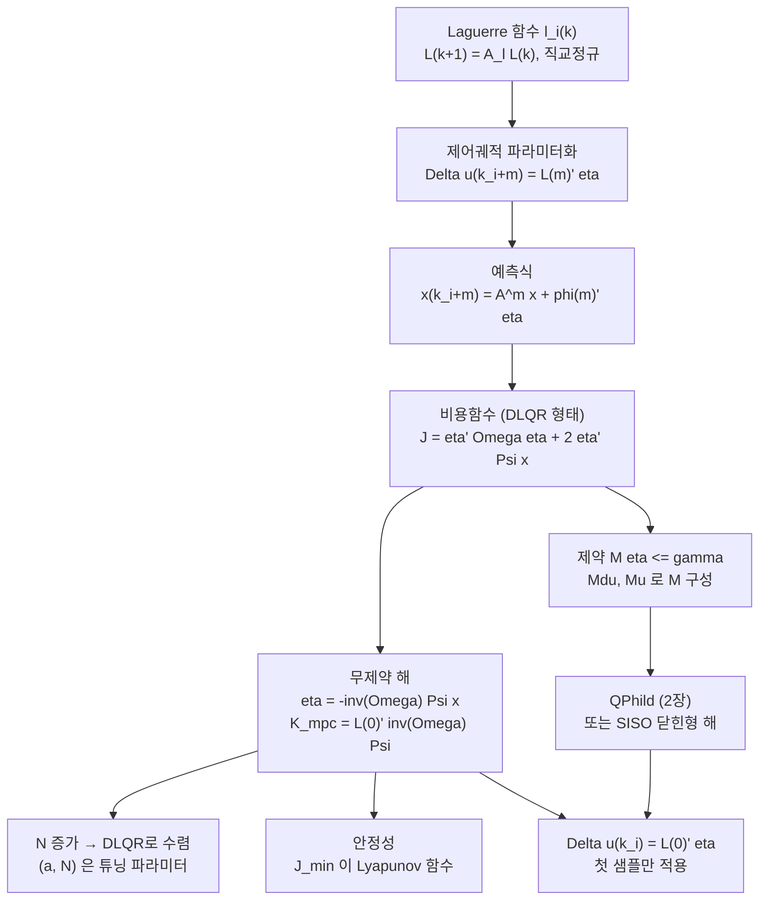

# MPC 3장 - Discrete-time MPC Using Laguerre Functions

한 문장으로 정리하면, 3장은 미래 증분 제어궤적 $\Delta u(k_i+m)$ 을 $N_c$ 개의 펄스 대신 **직교정규 Laguerre 함수의 전개** $\Delta u(k_i+m)=L(m)^T\eta$ 로 표현해서, 긴 제어구간을 적은 파라미터로 실현하고 $(a,N)$ 이라는 튜닝 손잡이를 얻으며, $N$ 을 키우면 같은 $(Q,R)$ 의 DLQR로 수렴함을 보이는 장이다. 제약은 2장의 QP를 결정변수 $\eta$ 에 대해 그대로 쓴다.

## 3장 학습 지도

## 노트 목록

- [[01_Laguerre_Functions|01. 이산시간 Laguerre 함수 - 정의, 상태공간, 직교정규성]]
- [[02_Laguerre_System_Modelling|02. Laguerre 네트워크를 이용한 시스템 표현과 lagd.m]]
- [[03_Design_Framework_and_Cost|03. 설계 프레임워크와 비용함수]]
- [[04_Minimization_and_Convolution_Sum|04. 비용함수 최소화, 합성곱 합, 이동구간 제어]]
- [[05_Optimal_Trajectory_and_DLQR|05. 최적 궤적과 DLQR로의 수렴, 튜닝 파라미터 (a, N)]]
- [[06_MIMO_Extension|06. MIMO 시스템으로의 확장]]
- [[07_MATLAB_dmpc|07. MATLAB 구현 - dmpc.m 과 testexa.m]]
- [[08_MATLAB_Simulation|08. MATLAB 구현 - 폐루프 시뮬레이션 simuuc.m / simuob.m]]
- [[09_Constraints_on_Delta_u|09. 제어 증분 Δu 에 대한 제약과 Mdu.m]]
- [[10_Constraints_on_u|10. 제어 진폭 u 에 대한 제약, Mu.m, 제약 충돌]]
- [[11_Stability_Analysis|11. 안정성 해석 - 종단 상태 제약과 Lyapunov]]
- [[12_Closed_Form_SISO|12. SISO 제약 제어의 닫힌형 해와 제약 순위]]
- [[13_MATLAB_DC_Motor|13. MATLAB 튜토리얼 - DC 모터의 닫힌형 제약 제어]]
- [[14_Key_Equations_MPC3|14. 핵심 수식 정리]]
- [[15_Problems_Roadmap_MPC3|15. 연습문제 로드맵]]
- [[MPC3_Glossary|MPC 3장 용어집]]
- [[_작성_유의사항|작성 유의사항 (수식·마크다운)]]

## 1장과 2장에서 그대로 가져오는 것

- [[02_Augmented_State_Space_Model|증분 상태공간 모델]]: 증강 모델 $(A,B,C)$ 와 결정변수가 $\Delta u$ 인 이유. 3장의 예측식은 이 모델에 $\Delta u=L(i)^T\eta$ 를 넣은 것이다.
- [[04_Receding_Horizon_Control|이동구간 제어]]: 첫 샘플만 적용한다는 원리. 3장에서는 $\Delta u(k_i)=L(0)^T\eta$ 다.
- [[03_Constrained_MPC_Problem|제약 있는 MPC 문제]], [[07_Hildreth_QP|Hildreth QP]], [[08_MATLAB_QPhild|QPhild.m]]: 제약 제어의 도구. 3장은 $E=\Omega$, $F=\Psi x$, $M$ 만 바꿔 그대로 호출한다.
- [[09_Closed_Form_Active_Set|활성집합을 알 때의 닫힌형 해]]: 3장 SISO 닫힌형 해의 뿌리.

바뀌는 것은 결정변수다. $\Delta U$ ($N_c$ 차원) 대신 $\eta$ ($N$ 차원)를 최적화하고, $F$, $\Phi$ 대신 $\Omega$, $\Psi$ 를 합성곱 합 재귀로 만든다.

## 3장에서 반드시 잡을 개념

- [[Laguerre 함수]]: 극점 $a$ 와 항 수 $N$ 으로 정해지는 직교정규 기저. $a=0$ 이면 펄스로 퇴화해 1·2장과 같아진다.
- [[직교정규성]]: $\Delta U^T\bar R\Delta U=\eta^TR_L\eta$ 를 가능하게 하는 성질. 유한합에서 성립하려면 $N_p$ 가 감쇠 구간보다 길어야 한다.
- [[합성곱 합 재귀]]: $S_c(m)=AS_c(m-1)+S_c(1)(A_l^{m-1})^T$. 큰 행렬 없이 $\Omega$, $\Psi$ 를 누적하는 방법.
- [[DLQR로의 수렴]]: $(Q,R)$ 이 목표 궤적을 정하고 $(a,N)$ 은 근사 정확도를 정한다. $N$ 이 크면 DLQR, 작으면 $a$ 가 튜닝 손잡이.
- [[제약 시점 선택]]: $\Delta u(k_i+m)=L(m)^T\eta$ 가 임의 $m$ 에 대해 성립하므로 제약 위치를 고를 수 있다. 감쇠 덕분에 과도 구간에만 걸면 된다.
- [[종단 상태 제약과 Lyapunov]]: $J_{min}$ 을 Lyapunov 함수로 잡고 밀린 제어열의 실행 가능성으로 감소를 보인다.
- [[제약 순위]]: SISO에서 세 제약의 $M_{act}$ 가 모두 $L(0)^T$ 의 배수라 하나만 활성일 수 있다. $u$ > $\Delta u$ > $y$.

## 읽는 순서

1. [[01_Laguerre_Functions|Laguerre 함수]]에서 $A_l$, $L(0)$, 직교정규성을 익히고 Example 3.1로 감쇠 구간 감각을 잡는다.
2. [[02_Laguerre_System_Modelling|Tutorial 3.1]]로 `lagd.m` 을 만들고 임펄스 응답 근사에서 "적은 파라미터"의 의미를 눈으로 본다.
3. [[03_Design_Framework_and_Cost|설계 프레임워크]] → [[04_Minimization_and_Convolution_Sum|최소화와 합성곱 합]] 순으로 $\Omega$, $\Psi$, $K_{mpc}$ 를 유도한다.
4. [[05_Optimal_Trajectory_and_DLQR|Examples 3.2~3.5]]에서 $N$, $a$, $R$ 이 각각 무엇을 바꾸는지 표로 확인한다.
5. [[06_MIMO_Extension|MIMO 확장]] → [[07_MATLAB_dmpc|dmpc.m]] → [[08_MATLAB_Simulation|simuuc.m / simuob.m]] 으로 도구를 완성하고 `dlqr` 과 비교해 검증한다.
6. [[09_Constraints_on_Delta_u|Δu 제약]] → [[10_Constraints_on_u|u 제약과 충돌]] 순으로 제약 예제를 본다. Example 3.8의 충돌 산수를 꼭 직접 해 본다.
7. [[11_Stability_Analysis|안정성]]에서 Theorem 3.1의 증명 흐름을 따라간다.
8. [[12_Closed_Form_SISO|SISO 닫힌형 해]] → [[13_MATLAB_DC_Motor|DC 모터 튜토리얼]]로 마이크로컨트롤러급 구현을 본다.

## 기억할 결론

Laguerre 함수는 $\Delta u$ 궤적을 표현하는 기저일 뿐이고, 무엇을 최적화하는가($Q$, $R$)는 바뀌지 않는다. 그래서 $N$ 을 늘리면 반드시 같은 $(Q,R)$ 의 DLQR 궤적으로 수렴한다. 임의의 지수함수 집합이 아니라 **직교정규 집합**을 썼기 때문에 이 수렴이 보장된다. 이것이 Gawthrop and Ronco (2002) 같은 다른 해석적 기저 접근과의 차이다.

$$
\eta=-\Omega^{-1}\Psi x(k_i),
\qquad
\Delta u(k_i)=L(0)^T\eta,
\qquad
K_{mpc}=L(0)^T\Omega^{-1}\Psi
$$

## 튜닝 절차 요약 (3.9절)

1. $Q=C^TC$ 로 두고 $R$ 을 대각행렬로 고른다. 작은 원소가 빠른 응답이다.
2. $(Q,R)$ 이 정해지면 목표 궤적이 고정된다. $a$ 는 폐루프 지배 고유값의 실수부 크기 정도로 잡고, $N$ 은 궤적이 더 이상 변하지 않을 때까지 늘린다.
3. 어려운 응용에서는 입력별 $(a_i,N_i)$ 로 미세조정한다. 큰 $a$ 와 작은 $N$ 은 느리게 감쇠하는 제어신호다.
4. $N_p$ 는 Laguerre 함수가 충분히 감쇠하는 범위를 포함하도록 잡는다. 너무 크면 수치 악조건이 생기며 4장에서 해결한다.

이 아이디어는 Kautz 함수 같은 다른 직교정규 함수에도 적용된다 (6장). Laguerre 함수의 장점은 프로그래밍이 단순하고, 원하는 폐루프 극점을 미리 알지 않아도 $a$ 와 $N$ 으로 튜닝할 수 있다는 점이다. 원 아이디어는 Wang (2001a, 2004)에 발표되었다.

## 실무 규칙 요약

- $a=0$, $N=N_c$ 로 두면 1·2장 설계와 같다. 새 코드가 옛 결과를 재현하는지 이것으로 먼저 확인한다.
- $N_p$ 는 $a$ 가 클수록 길게 잡는다. $a=0.5$ 는 약 15 샘플, $a=0.9$ 는 약 90 샘플이 필요하다.
- `dmpc.m` 의 검증은 `dlqr` 폐루프 고유값과의 비교로 한다. $a=0$ 에서 어긋나는 것은 정상이다.
- 진폭 제약의 우변에는 $u(k_i-1)$ 이 들어가므로 매 샘플 `gamma` 를 갱신한다.
- 진폭 제약과 증분 제약을 함께 걸 때는 첫 샘플에서 양립하는지 $|u^{lim}-u(k_i-1)|\le|\Delta u^{lim}|$ 로 먼저 산수한다. 충돌하면 승수가 발산한다.
- Laguerre 함수는 감쇠하므로 제약은 처음 몇 샘플에만 건다. MIMO에서는 특히 그렇다.
- 출력 제약은 조심해서 쓴다. 한계를 좁히면 제약 안에서 진동할 수 있다.
- SISO에 계산 여력이 없으면 QP 대신 닫힌형 해를 쓴다. 관측기 없는 상태 선택과 함께 쓰면 마이크로컨트롤러에 들어간다.

## → 검증

- 2장과 3장의 차이를 "결정변수"와 "데이터 행렬을 만드는 방식" 두 축으로 한 문장씩 말할 수 있는가?
- $(Q,R)$ 과 $(a,N)$ 의 역할 분담을 설명하고, 언제 $a$ 가 튜닝 손잡이가 되는지 답할 수 있는가?
- `lagd` → `dmpc` → `Mdu`/`Mu` → `QPhild` → `simuob` 의 데이터 흐름을 그릴 수 있는가?
