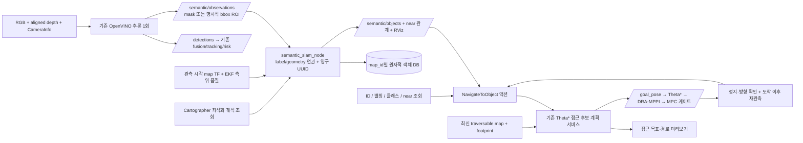
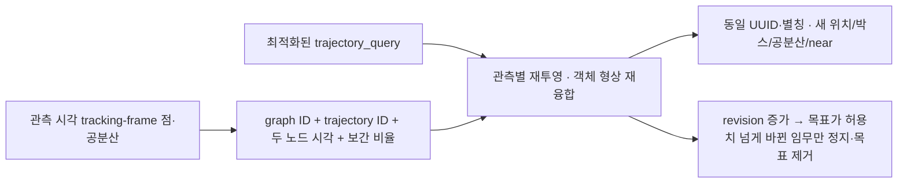

# AMR 객체 의미 지도와 객체 목표 주행

기존 RGB-D/OpenVINO 추론을 재사용하고, 고정된 기하 지도 옆에 객체 메모리를 둔다.
현재 첫 대상은 COCO `chair`(56), `dining table`(60)이다. `desk`와 `bookshelf`는
기본 모델의 별도 클래스가 아니다. 저장하는 점·박스는 **관측된 표면**이며,
완전한 부피, 정밀한 가구 윤곽, grasp pose를 보장하지 않는다.



## 데이터와 좌표

- `/detections`, `/detections_fused`, `/detections_tracking`, `/tracks`의 기존 계약은 유지한다.
  익명 LiDAR 장애물에 가구 이름을 붙이지 않는다. 이번 객체 지도는 RGB-D 관측을 입력으로 쓴다.
- `/semantic/observations`: capture stamp와 depth optical frame, confidence, 대표점,
  관측 박스, 최대 512개 점, 3×3 covariance, 유효 depth 비율, MASK/BBOX_ROI 구분.
  16UC1은 기본 mm, 32FC1은 m. 다른 인코딩·해상도 불일치·무효 내부 파라미터는 거부한다.
- 마스크를 제공하는 YOLO11 raw OpenVINO export는 클래스 점수와 mask coefficients를 분리해서
  해석한다. 마스크는 letterbox를 제거하고 원영상으로 복원한다. NMS 포함 export는 지원하지 않는다.
- mapper는 캡처 시각의 TF를 기다리는 bounded queue를 사용한다. 최신 TF로 대체하지 않는다.
  Cartographer+EKF의 `/odometry/map` 공분산·신선도와 `/initialpose` 이후 2초 안정화를 확인한다.
- `/tracks`의 DYNAMIC 트랙은 최근 `observation_max_age`+1초 이력으로 보관한다. 지연된 관측은
  같은 트랙의 가장 가까운 시각 샘플을 캡처 시각으로 등속 외삽해 비교한다. 게이트는
  0.5 m + 2σ(P_pp, P_pv, P_vv로 계산한 외삽 공분산의 최대 고유값)이며 최대 2 m다.
- 보정 모드에서는 capture-time `camera → Cartographer tracking_frame` 관측을 보존하고,
  `trajectory_query`의 최적화된 두 노드 pose 사이를 보간해 map에 놓는다. 객체 좌표의 기준은
  이 Cartographer 궤적이며 EKF 측위는 품질 검사·공분산·기존 주행 TF에 사용한다.
- 관측 시각에 가까운 측위 공분산을 객체 공분산에 더한다. 위치뿐 아니라 yaw 오차에 따른
  거리별 위치 오차도 반영한다. 깊이 표면 분산은 픽셀 수로 나누어 과도하게 줄이지 않는다.
- 반복 관측 3회로 확정한다. 클래스/거리 기반 one-to-one 연관에서 유사 후보가 겹치면
  그 관측을 보류한다. 객체 UUID와 별칭은 재시작 후 유지한다. 보이지 않는 확정 객체는
  삭제하지 않고 STALE로 유지한다. 이동 증거가 반복되면 MOVING으로 표시하고 목적지 조회에서 제외한다.
- 마지막 관측 후 `odom_association_window`(5초) 안의 연관과 이동 판정은 capture-time
  `odom ← camera`로 계산한 odom 위치로 한다. odom에는 map→odom 보정 계단이 없다. odom에서는
  그대로인데 map 위치만 0.2 m 넘게 바뀌면 이동이 아니라 map 재정렬로 보고, 이전 정렬의 점군을
  버리고 새 위치로 다시 놓는다. odom 위치는 저장하지 않는다(재시작하면 odom 원점이 바뀐다).
  DYNAMIC 트랙과 겹친 관측은 버리지만, 저장된 객체를 MOVING으로 바꾸는 것은 트랙의 외삽 위치가
  관측 점군의 XY 박스 ± 0.1 m 안에 있을 때뿐이다. 옆을 지나가는 사람은 객체를 MOVING으로 만들지 않는다.
- 고정 지도 모드에서는 창 밖(가려진 동안)의 map→odom 점프로 다시 생성된 객체를 병합한다.
  새로 확정된 객체와 같은 클래스이고 `duplicate_merge_distance`(1.5 m) 안에 있으며, 새 객체가
  처음 보이기 전에 마지막으로 관측된 확정 객체가 정확히 하나이면 원래 UUID·별칭으로 합치고
  기하는 최신 정렬의 새 객체를 따른다. 한 프레임에서 함께 보인 적이 있거나 번갈아 보인 두 객체,
  서로 다른 별칭을 가진 두 객체는 합치지 않는다. 후보가 둘 이상이면 보류한다. 반대로, 한 번도
  함께 보이지 않은 서로 다른 두 객체가 1.5 m 안에 있으면 잘못 합칠 수 있다. 0으로 끈다.
  보정 모드는 그래프 재투영이 좌표를 맞추므로 병합하지 않는다.
- `near`는 XY 거리 2 m 이내의 기하 관계다. CLIP/LLM 관계 추론은 넣지 않았다.
- `map_id`는 예: `lab-map-20261006-v1`. 맵 원점·지도 버전이 바뀌면 새 ID와 DB를 사용한다.
  다른 ID의 DB 재사용은 오류로 거부한다. 두 mapper가 같은 DB를 쓰지 못하도록 파일 잠금을 둔다.

## 빌드와 기존 스택 연결

NUC의 별도 개발 checkout에서 ROS 2 Jazzy 환경을 source하고 빌드한다.
Mac develop에서 만든 변경은 현재 차량 wp3에 자동 반영되지 않는다.

```bash
source /opt/ros/jazzy/setup.bash
colcon build  # 새 amr_interfaces를 사용하는 소비 패키지까지 함께 재빌드
source install/setup.bash
```

`autonomy.launch.py`에서 한 인자로 객체 의미 지도·접근 미리보기를 켤 수 있다.
기본은 `false`이며 실행 시 선택한다. 켜면 기존 RGB-D 추론이 관측도 발행하고, mapper와
의미 내비게이션을 한 번씩 실행한다. 별도의 semantic launch를 함께 실행하지 않는다.

```bash
# 기존 주행만 사용 (기본값)
ros2 launch stack_master autonomy.launch.py map:=smoc_lab use_semantic_navigation:=false

# 의미 지도 + 객체 목표 미리보기 시험
ros2 launch stack_master autonomy.launch.py map:=smoc_lab use_semantic_navigation:=true

# 실제 /goal_pose 발행도 허용. 기존 게이트의 수동 arm은 별도로 필요.
ros2 launch stack_master autonomy.launch.py map:=smoc_lab \
  use_semantic_navigation:=true semantic_goal_dispatch:=true
```

켜면 기본 추론 상한은 5 Hz다. `inference_hz:=3.0`처럼 바꿀 수 있다. `use_perception:=true`가
필요하고, false와 동시에 켜면 어떤 로봇 프로세스도 시작하기 전에 명확한 오류로 중단한다.
RGB/정렬 depth 크기를 유지하기 위해 RealSense decimation을 끄고, 카메라 점군과
`depth_preprocess_node`를 켜 traversable map의 depth-band 신선도 입력을 공급한다.
`use_voxel_3d:=true`이면 그 launch의 기존 전처리를 재사용한다. OctoMap은 이 스위치만으로
추가 실행하지 않는다. 기본 RViz도 객체 박스·접근 미리보기를 포함한 프로필로 바뀐다.
`rviz_config:=...`로 직접 지정한 설정은 유지한다. 전체 리소스·영상 정렬은 실기 확인이 필요하다.

autonomy는 YAML·지도 이미지·pbstream 내용의 SHA-256에서 `map_id`를 만들고, 보정 모드에서는
실행마다 새 UUID 기반 `graph_id`를 만든다. DB는 `~/.ros/amr/semantic/`에 map/session별로
저장하고, 해결된 ID와 전체 경로를 시작 로그에 표시한다. 사용자가 ID를 매번 입력할 필요는 없다.
같은 파일 내용은 같은 map ID를 쓰고, 지도 파일이 바뀌면 새 map ID를 쓴다. 보정 모드의
새 실행은 새 DB를 사용한다. Cartographer 재시작을 넘는 객체 기억 통합은 아직 하지 않는다.

| autonomy 인자 | 기본값과 용도 |
|---|---|
| `use_semantic_navigation` | `false`: 객체 지도·의미 액션을 함께 켜는 스위치 |
| `semantic_cartographer_correction` | `true`: 과거 관측의 궤적 보정. `false`면 고정 지도 방식 |
| `semantic_goal_dispatch` | `false`: 미리보기만 허용. `true`여도 자동 arm하지 않음 |
| `semantic_map_id` | 비어 있으면 지도 파일에서 계산. 수동 지도 버전도 지정 가능 |
| `semantic_graph_id` | 비어 있으면 새 실행 ID. 동일 저장 graph를 복원했을 때만 이전 ID 사용 |
| `semantic_database_path` | 비어 있으면 map/session별 DB 경로. 복원할 DB를 직접 지정 가능 |
| `semantic_config` | mapper·의미 내비게이션 설정 YAML |

보정을 끈 고정 지도 방식은 동일 지도에서 기본 DB 경로가 실행 사이에도 유지된다.
보정을 켠 DB와 끈 DB는 분리한다. `publish_semantic`은 기존 저수준 관측 발행 옵션이며,
통합 기능을 켜면 자동으로 true를 전달한다. 통합 기능이 꺼져 있을 때는 기존 설정을 그대로 쓴다.

이미 autonomy가 실행 중인 상태에 별도로 붙이는 기존 방법도 지원한다. 이때는 autonomy의
`use_semantic_navigation`을 끄고 `publish_semantic:=true inference_hz:=5.0`로 관측만 켠 후,
다른 터미널에서 다음을 실행한다.

```bash
ros2 launch amr_perception_bringup semantic_navigation.launch.py \
  map_id:=lab-map-20261006-v1 \
  graph_id:=lab-carto-20261007-run1 \
  database_path:=$HOME/.ros/amr/lab-carto-20261007-run1-objects.json
```

`start_detector:=false`가 기본이므로 YOLO를 중복 실행하지 않는다. 기존 스택 없이 인지 시험만
할 때는 `start_detector:=true yolo_model_path:=<OpenVINO 디렉터리>`를 지정한다.
카메라·TF·기존 측위는 별도로 실행해야 한다. 측위 상태 없이 bag 시험을 할 때만 복사한 config에서
두 노드의 `require_localization: false`를 명시한다. 캡처 시각 TF 요구는 그대로 유지된다.
`perception_stack use_semantic_slam:=true`와 이 launch의 mapper를 함께 띄우지 않는다.

보정 ON에서 `graph_id`가 비어 있거나 공백뿐이면 모든 노드를 시작하기 전에 오류로 중단한다.
보정 OFF에서는 graph ID가 필요 없다. `map_id`는 두 모드 모두 비어 있으면 안 된다.
`perception_stack.launch.py`의 mapper도 `semantic_config` YAML을 읽는다(기본: 이 패키지의
`config/semantic.yaml`). 이 경로의 보정 기본값은 계속 OFF이며,
`enable_cartographer_correction:=true`로 켜면 `semantic_graph_id`가 필요하다.
`semantic_map_id`, `semantic_database_path`로 지도 ID와 DB 경로를 지정한다.
mapper가 꺼져 있으면 semantic 설정 파일을 조회하지 않으며, detector의
`publish_semantic:=false`, `inference_hz:=0.0` 기본값도 유지한다.

모델의 첫 시험은 현재 `yolo11n_openvino_model`로 가능하다. 마스크로 확장할 때:

```bash
python3 src/amr_basic_stack/perception/sensor_fusion/scripts/export_yolo_openvino.py \
  --model yolo11n-seg.pt --imgsz 640
# 기존 추론의 yolo_model_path를 생성한 yolo11n-seg_openvino_model로 지정
```

export는 ultralytics/OpenVINO가 설치된 변환 환경에서 한 번 수행한다. 탐지 모델의 기존
INT8 벤치마크 결과는 세그멘테이션 처리량을 증명하지 않는다. 5 Hz·8 객체·512점은 첫 설정이며,
실제 동시 주행 CPU/GPU/RAM·depth 오검출과 지연을 측정해 조정한다.

## 확인·별칭·미리보기

Mac에서는 `mamba activate ros_jazzy` 후 같은 ROS domain/peer 설정과 새 인터페이스 overlay를
사용한다. ROS CLI가 커스텀 메시지를 읽으려면 Mac에도 `amr_interfaces`를 빌드·source해야 한다.

```bash
ros2 topic echo /semantic/objects
ros2 topic hz /semantic/observations
rviz2 -d <semantic_slam share 경로>/rviz/semantic.rviz
ros2 service call /semantic/set_alias amr_interfaces/srv/SetObjectAlias \
  "{object_id: '<전체 UUID>', alias: '창가 의자'}"
ros2 action send_goal /semantic/navigate_to_object amr_interfaces/action/NavigateToObject \
  "{alias: '창가 의자', preview_only: true, timeout: 15.0}" --feedback
```

`PREVIEWED`는 경로 검증 성공이며 도착 성공이 아니다. `/semantic/approach_goal`,
`/semantic/approach_path`에 표시된다. 의자 여러 개일 때 클래스만으로 조회하면 모호하다고
실패하므로 ID/별칭 또는 `near_object_id`를 사용한다. 가장 가까운 의자를 임의로 선택하지 않는다.

## 실제 객체 목표 이동

autonomy에서는 `semantic_goal_dispatch:=true`, 별도 의미 launch에서는
`enable_goal_dispatch:=true`로 시작하고 기존 조작 절차로 MPC 게이트를 수동 arm한다.
액션은 자동 arm하지 않는다. 위치 초기화·최신 localization TF·측위 상태·odom·traversable sensor data,
기존 계획기의 새 서비스가 모두 필요하다.

```bash
ros2 action send_goal /semantic/navigate_to_object amr_interfaces/action/NavigateToObject \
  "{object_id: '<전체 UUID>', preview_only: false, timeout: 120.0}" --feedback
```

물체 중심에 `/goal_pose`를 발행하지 않는다. 주변 16개 후보 중 footprint/unknown/경로/시선/
표면 이격 거리를 통과한 경로를 고른다. 기존 계획기가 후보를 snap하면 **변경된 좌표**에서
이 조건을 재검사한다. 현재 Theta*와 같은 지도 좌표·inflation을 사용한다.
Theta*는 접근 서비스가 검증한 끝점과 정확히 같은 `/goal_pose`(검증 후 `verified_goal_ttl`
10초 이내, 1회)를 받으면 최초 계획과 이후 재계획 모두 unknown을 장애물로 계산한다.
RViz에서 찍은 일반 목표는 기존 `traversable_unknown_is_obstacle` 정책을 그대로 따른다.
경로 계획 응답을 받으면 미리보기·발행 전에 목표를 다시 검증한다. 사라지거나 MOVING이 되면
`TARGET_CHANGED`로 중단하고, 위치·박스(0.1 m 초과)·공분산·신선도가 바뀌면 다시 선택해
재계획한다(최대 3회, 초과 시 `TARGET_UNSTABLE`).
계획·정지 서비스가 응답하지 않은 채 임무가 끝나면 미완료 요청을 클라이언트에서 제거하고 취소한다.
이동 중 맵/TF/odom이 오래되거나 목표가 움직이면 중단한다. 목표 위치·방향에서 정지한 후
그 위치에 도착한 시각보다 나중의 관측으로 같은 객체를 재확인해야 `SUCCEEDED`가 된다.
취소·시간 초과·실패·완료에서는 `/mpc/arm=false`와 `/global_planner/cancel_goal`을 사용해
잔류 목표·재계획도 지운다. 종료 시에도 disarm한다. 의미 임무 중 RViz의 새 이동 목표나
`/initialpose`는 임무를 중단한다. `/goal_pose`를 공동 임무 큐로 사용하는 구조는 아니다.

`allow_search:true`는 config의 `search_viewpoints`에 측량한 `x,y,yaw` triples가 있을 때만
최대 3곳에서 관측을 시도한다. 기본 sentinel `[0.0]`은 search 비활성이다. 과거 위치를
신선한 위치로 간주하지 않는다. 탐색 관측 뒤에도 최종 객체 접근과 재확인을 수행한다.

## Cartographer 최적화 후 과거 객체 보정

의미 launch는 기본으로 보정을 켠다. autonomy에서는 `semantic_cartographer_correction`으로
선택한다. `/get_trajectory_states`에서 하나의 ACTIVE 궤적을
선택하고 `/trajectory_query`에서 최적화된 노드 pose를 비동기로 조회한다. ACTIVE가 여러 개면
config의 `cartographer_trajectory_id`를 명시해야 한다. 기존 객체가 참조한 FINISHED/FROZEN
궤적도 조회한다. ACTIVE가 없을 때(`finish_trajectory` 직후 등)도 참조 궤적의 최종 최적화
결과는 계속 재투영·저장하지만, `pose_graph_ready=false`이므로 새 관측 연결과 임무는 거부한다.
DELETED(또는 Cartographer에 없는) 궤적의 앵커는 조회하지 않고 `graph_max_trajectories`에도
세지 않는다. 다른 앵커가 남은 객체에서는 제거하고, 모든 앵커를 잃은 객체는 STALE로 남긴다.
조회 가능한 궤적이 용량을 넘으면 ACTIVE와 최근 관측 궤적을 우선 조회하고, 나머지 객체만
지원 불가(STALE)로 격리한다. 과거 객체 때문에 현재 궤적 처리가 멈추지 않는다. tracking frame은 현재 측위 설정의 `camera_gyro_frame`이며,
매핑 설정은 `camera_imu_optical_frame`이므로 복사한 config에서 반드시 맞춘다.



노드 시각은 관측 시각을 앞뒤에서 감싸야 하며 기본 최대 간격은 1초다. 위치는 선형 보간,
회전은 quaternion SLERP를 쓴다. 범위 밖 외삽이나 최신 pose로 과거 데이터를 이동시키는
대체 동작은 하지 않는다. 관측 대기 시간은 기본 2초다. 두 노드 간 실제 운동이 빠르거나
복잡하면 보간 오차가 생기므로 bag으로 위치 오차를 확인해야 한다.

보정은 원본 관측에서 다시 계산하므로 반복해도 오차를 누적시키지 않는다. UUID·별칭·확정 횟수·
`last_seen`을 유지하고, 보정을 새로운 관측이나 물체 이동으로 세지 않는다. geometry가
재투영되거나 anchor가 무효화되면 `/semantic/objects.revision`이 증가한다. 측위 중 정상
최적화(약 2 s 주기, mm~cm)도 revision을 올리므로, 이동 중 임무는 revision 자체가 아니라
**목표 객체**의 위치·박스 변화가 `target_change_tolerance`(기본 0.1 m)를 넘을 때만
`MAP_REPROJECTED`로 끝나고 disarm과 잔류 계획 제거를 수행한다. 다른 객체의 보정은 무시한다.
발행 전(PLANNING)에는 응답 수락 직전 재검증이 같은 허용치를 쓴다. 중단 후에는 새 revision으로
임무를 다시 요청해야 하며 자동 arm하지 않는다. 서비스 실패·시간 초과·stale 궤적에서는
`pose_graph_ready=false`를 발행하고 `POSE_GRAPH_UNAVAILABLE`로 임무를 중단한다.

원본 증거는 객체당 최근 16개 관측, 관측당 최대 512점으로 제한한다. 오래된 관측을 버리면
형상에서도 그 증거를 제거한다. 전체 무제한 RGB-D 이력을 저장하는 구조는 아니다. 변경 없는
궤적 조회에서는 형상을 다시 융합하지 않는다. DB schema 3 이상에 anchor와 revision을 원자적으로 저장한다.

### 객체 DB 저장 형식과 복구

`database_path`는 그대로 사용한다. 확장자가 `.json`이어도 새로 저장한 파일은
**ZIP_STORED(비압축) 컨테이너**다. 내용으로 형식을 판별해 기존 schema 1/2 JSON도 읽는다.
읽기만 해서는 변환하지 않으며, 이후 dirty 상태를 저장할 때 현재 schema(4)로 기록한다.
구버전 프로그램은 schema 3을 읽지 못하므로 실제 DB를 전환하기 전 코드와 DB를 함께 백업해야 한다.
schema 4는 객체의 `first_seen`(처음 관측 시각)을 추가한다. 새로 저장하는 DB는 schema 4이고, schema 3 이하는
그대로 읽는다. 읽어 온 객체의 `first_seen`은 모름(0)으로 두며, history로 추정하지 않는다. history는 최근
8개만 남아 있어 추정값이 실제보다 늦기 때문이다. 그래서 이런 객체는 중복 병합에서 새 객체로 취급하지 않는다.
더 높은 schema나 그 schema가 모르는 객체 필드가 있으면 키 이름을 밝히고 거부한다. 모르는 필드를 버린 채
다시 저장하면 새 버전의 정보가 사라지기 때문이다. schema 3만 아는 프로그램은 schema 4 DB를 schema 불일치로
거부한다.

- `metadata.json`: schema, 저장 generation UUID, map/graph ID, revision, 객체/앵커 메타데이터.
  각 점 배열은 byte offset, count, `[N, 3]` shape, `<f8` dtype으로 참조한다.
- `points.bin`: 객체 표면점과 앵커 원본 점을 little-endian float64로 연속 저장한다.
  좌표를 float32로 양자화하지 않는다. pose·공분산·시각은 JSON 메타데이터에 남긴다.
- ZIP CRC-32, 바이트 길이, 연속 offset, shape/dtype, 유한값, 객체/앵커 수와 identity를 검증한다.
  SHA-256이나 pickle은 사용하지 않는다. 전체 검증 후에만 메모리 객체와 revision을 교체한다.
  손상 파일이나 알 수 없는 schema를 빈 지도처럼 처리하지 않는다.

저장은 기존 DB lock과 싱글 스레드 executor 아래에서 동기 실행한다. 별도 저장 스레드는 없다.
대용량 점 목록에 `asdict()` 재귀 복사를 적용하지 않는다. 같은 디렉터리의 `<database_path>.tmp`
파일 하나를 열어 새로 기록하고, 파일 flush/fsync → `os.replace` → 부모 디렉터리 fsync를 수행한다.
전부 성공해야 dirty를 해제한다. 실패하면 오류를 보고하고 dirty를 유지하며, 이번 저장이 만든
이름의 임시 파일을 이번 저장이 열었을 때만 정리한다. 교체 후 디렉터리 fsync 실패 시 완전한 새 파일이 보일 수 있지만 성공으로
보고하지 않는다. 이 절차는 프로세스 중단 시 두 엔트리의 세대 혼합을 막으며, 실제 전원 손실의
내구성은 운영체제·파일시스템·저장장치의 flush 보장에 달려 있다.

크래시로 기존 `.tmp`가 남아 있어도 배타 DB lock을 가진 writer가 truncate하고 다시 기록한다.
따라서 고아 임시 파일 때문에 이후 저장이 차단되지 않는다. `.tmp`를 정식 DB로 자동 승격하거나
다른 DB의 임시 파일을 탐색·삭제하지 않는다. `ObjectMap.save()`의 직접 호출자도 단일 writer를
보장해야 한다. 근접 노드에 스냅된 앵커는 bind와 같은 1e-7초 미만 허용 범위로 검증하며,
원래 캡처 시각은 유지한다. 별칭 변경 후 저장만 실패하면 서비스가
`alias set, not persisted: …`와 `success=false`를 반환하고 dirty 상태로 재시도한다.

`save_period_sec`는 시작 시 설정하는 유한한 양수이며 기본값은 **10.0초**다.
기존 2초 저장 타이머를 대체한다. 별칭 변경과 정상 종료의 즉시 저장은 유지한다.
비정상 종료 시 미저장 관측이 손실될 수 있고, executor 지연이나 I/O 실패가 있으면
손실 구간이 10초보다 길어질 수 있다. 바이너리화해도 개별 동기 저장 중 콜백 지연은 남는다.

재현 벤치 도구는 `tools/bench_save.py`, `tools/bench_graph_poll.py`다. 실행 위치와 무관하게
도구 옆 저장소의 모듈을 읽으며, NumPy·표준 라이브러리와 그래프 도구의 rclpy/ROS 메시지 타입을 사용한다.
그래프 도구는 DDS context를 생성하거나 실제 서비스를 호출하지 않는다.
두 도구 모두 JSON 원자료와 사람이 읽는 한 줄 요약을 출력한다. 저장 벤치는 매 반복 dirty를
설정하고 fsync까지 측정한다. 그래프 벤치는 역직렬화·응답 변환·graph 검증/교체·재투영을
분리하고 모든 앵커의 support를 확인한다. 20,001개 노드는 기본 상한 초과 거부 케이스다.
RSS는 프로세스의 누적 high-water mark이며 현재 RSS나 특정 함수만의 최대 메모리가 아니다.

`bench_graph_poll.py`의 `total`은 **동일 반복의 시작부터 끝까지** 측정한 시간이다.
단계별 중앙값을 더한 수치와 구분한다. `--max-total-ms 1000`을 지정하면 측정된
전체 그래프 처리 중 한 번이라도 1초를 초과할 때 실패한다. 노드·객체·앵커·점군 상한과
잘못된 입력 거부 조건은 성능 최적화 이후에도 유지한다.

`tools/soak_graph.py`는 NUC/Linux에서 설치본을 검증하는 장시간 도구다. 실행 전에
검증할 ROS overlay를 source한다. 그래프 응답 역직렬화부터 실제 adapter의 원자적
스냅샷 검증·교체와 모든 객체 재투영, 객체/RViz 메시지 생성·CDR 직렬화까지 매회 측정한다.
10초마다 dirty DB를 동기 저장하며 그 회차의 전체 시간에도 저장 비용을 포함한다.
60초마다 별도 프로세스에서 ID·별칭·원본 점군 해시를 확인한다. 300회마다 잘못된
quaternion을 주입해 이전 그래프 보존과 readiness 해제, 다음 정상 응답의 복구를 확인한다.
매회 좌표를 독립적으로 계산한 값과 비교하며 현재 RSS와 지연 원자료를 JSONL로 남긴다.

```bash
python3 /path/to/semantic_slam/tools/soak_graph.py \
  --duration 1800 --objects 200 --nodes 20000 --anchors 16 --points 512 \
  --max-total-ms 1000 --work-dir /tmp/semantic-soak-new --output /tmp/semantic-soak.json
```

`work-dir`는 새 경로여야 한다. 이 도구는 DDS context·실제 ROS 서비스·모터 연결을
생성하지 않는다. 타이밍에는 카메라 추론, 외부 Cartographer 최적화/서비스 대기,
DDS 전송/수신 시간이 포함되지 않는다. 단계별 `graph`, `publish`, `save`와 실제 동일
회차의 `total`을 구분한다. 한 번이라도 예산을 초과하면 최종 `passed=false`와 실패
종료 코드를 반환하지만, 장시간 결과를 모으기 위해 시간 초과만으로 조기 중단하지 않는다.
따라서 이 결과만으로 실제 센서부터 최종 메시지까지의 지연이 1초 이내라고 판단하지 않는다.

원본 앵커 점군은 변경할 수 없는 `FrozenPoints`에 보관한다. 기존 JSON 점군과 같은
좌표를 저장하며, 검증된 float64 배열을 읽기 전용으로 재사용한다. 외부 입력의 후속
수정이나 배열 writeable 설정으로 원본을 바꿀 수 없다. 재투영 결과와 UUID·별칭·DB
schema는 유지한다. 발행용 Point32는 mapper 내부에서 재사용하되 매회 모든 좌표를
갱신하고 삭제된 객체의 캐시는 제거한다. rclpy의 동기 직렬화 이후 다음 회차에서 재사용한다.

일반 크기의 voxel 키는 `_voxel` C 확장의 충돌 검사를 갖춘 해시 테이블로 처리한다.
동일 voxel에서는 원래 입력 순서상 첫 번째 점을 그대로 선택한다. 넓은 좌표 범위는
기존 NumPy 경로로 처리한다. `colcon build --packages-select semantic_slam`은 확장도
빌드하므로 C 컴파일러와 Python 개발 헤더가 필요하다. 설치본에서
`python3 -c 'import semantic_slam._voxel; print(semantic_slam._voxel.__file__)'`로 확인한다.
소스만 읽는 환경에서는 NumPy 대체 경로가 동작하지만 NUC의 최종 성능 수치를 적용할 수 없다.

`graph_id`는 지도 이름과 별개인 **Cartographer 저장 상태/세션의 ID**다. 같은 지도라도
새 Cartographer 실행에서 궤적 번호가 재사용될 수 있으므로 새 graph ID와 DB를 사용한다.
같은 graph ID를 재사용하는 것은 동일한 저장 graph와 노드 시각을 복원했을 때만 허용한다.
이전 DB는 카메라 원본/anchor가 없어 보정 모드로 전환할 수 없다. 새 DB에서 다시 관측한다.

현재 순수 측위 설정은 `pure_localization_trimmer`로 오래된 노드/서브맵을 삭제한다.
Cartographer는 잘라낸 노드를 다시 최적화하지 않으므로, 궤적 **앞부분**이 잘린 앵커는 마지막으로
조회한 보정 pose를 최종값으로 고정(`frozen`)하고 계속 근거로 쓴다(측위 중 자리를 떴다가 돌아와도
객체가 STALE로 묶이지 않는다). 직전 스냅샷과 이어지지 않는 궤적(재시작), 중간 노드 누락,
DELETED 궤적은 고정하지 않고 지원 불가(STALE)로 처리한다. 앵커 노드가 직전 스냅샷 안에 있었을 때만
trim으로 인정하므로, 재시작된 궤적을 다시 폴링해도 과거 증거가 되살아나지 않는다. 불연속이 생기면
그 궤적의 epoch를 기록하고 이전 고정 앵커도 무효로 한다. 장시간 연결이 끊겨 직전 스냅샷과 겹치지 않으면
trim과 재시작을 구분할 수 없어 보수적으로 무효 처리한다. 잔여 오차: Cartographer는 최적화 후 trim하므로,
두 폴링 사이의 마지막 최적화 한 번(실측 계단 수 mm~2 cm 수준)은 고정 pose에 반영되지 않을 수 있다.
이번 구현은 trimmer 설정을 바꾸지 않는다. 온라인 매핑에서 의미 객체가 보정되어도 기존
traversability의 과거 누적 점 전체까지 재투영하는 것은 별도 작업이다.

Cartographer 궤적 조회 없이 기존 고정 TF 방식으로 시험하려면 autonomy의
`semantic_cartographer_correction:=false` 또는 별도 의미 launch의
`enable_cartographer_correction:=false`와 별도의 고정 지도 DB를 사용한다.
근거: [Cartographer ROS API](https://google-cartographer-ros.readthedocs.io/en/latest/ros_api.html),
[ROS 2 trajectory query 구현](https://github.com/ros2/cartographer_ros/tree/ros2).

## 검증 범위와 다음 실험

2026-10-13 NUC Jazzy 설치본 검증: 회귀·ROS 통합·lint **131개 통과, 1개 skip**.
기본 상한인 객체 200개·노드 20,000개·객체당 앵커 16개·앵커당 점 512개로
`soak_graph.py`를 30분 실행했다. 1,801회 전체 처리의 중앙값 730.7ms,
95백분위 850.8ms, 최대 909.3ms이며 1,000ms 초과와 주기 마감 누락은 0회였다.
그래프 처리·객체/RViz 메시지 생성 및 직렬화·저장이 필요한 회차의 동기 저장을 포함한
동일 회차 측정값이다. 단계별 중앙값의 합이 아니다.
저장 167회, DB 재로딩 검증 29회, 비정상 quaternion 거부 6회가 기록됐다.
UUID·별칭·원본 점군 해시와 독립 좌표 비교가 통과했고, post-warm-up RSS 증가량은
약 0.96MiB였다. DDS context·모터 I/O 없이 격리된 임시 NUC 설치본에서 실행했다.
카메라 추론·Cartographer 자체 계산·서비스 대기·DDS 전송을 포함한 실센서 지연은 별도다.

2026-10-07 Mac `develop` 검증 기록:

| 항목 | 결과와 범위 |
|---|---|
| 빌드 | vision_msgs·cartographer_ros_msgs와 관련 패키지, 총 10개 빌드. 임시 native ROS overlay 사용 |
| 회귀·통합 시험 | `tools/run_tests.sh`: 128개 통과, lark의 Python deprecation 경고 2개 |
| ROS 파이프라인 | 실제 메시지·TF·mapper·Theta* 서비스·액션 사용. 카메라 추론 텐서와 로봇 이동은 fixture |
| 임무 조건 | 미리보기, 도착 후 새 관측, 취소, 제한된 탐색, 시간 초과, 측위·센서 신선도·목표 불확실성, 종료 정리 검증 |
| 보정 | 실제 ROS 궤적 서비스 fixture, 원본 재투영·회전·구간별 보정·UUID/별칭·DB 복원·보정 후 임무 중단·서비스 실패/timeout/부분 응답/노드 삭제 검증 |
| launch 연결 | 실제 하위 launch를 전개하며 프로세스 실행을 차단. OFF 기존 동작, ON 단일 추론/mapper/nav/depth, typed 인자·scoping·지도 해시/세션·수동 override 검증 |
| 정적 확인 | semantic_slam flake8 15개 파일 통과, 핵심 모듈 pep257 및 `git diff --check` 통과 |
| launch | mapper와 navigation 설치본 기동 및 SIGINT 정상 종료 확인. 별도 ROS domain 97 사용 |
| 실기 | NUC 세그멘테이션 추론·실제 depth·가구 ID·차량 접근은 미검증. 차량 배포하지 않음 |

테스트는 mask letterbox/깊이 단위, 다중 객체 연관·모호성·영구 저장,
접근 후보와 실제 Theta* 서비스, ROS 액션의 미리보기·도착 후 재관측·취소를 검증한다.
합성 ROS 시험은 차량 domain 13과 분리한 domain에서 실행하며 실제 모터에 연결하지 않는다.

이 구현은 객체 의미 기억과 탐색 목표 및 보존된 궤적 노드에 대한 객체 재투영을 제공한다.
완전한 ConceptGraphs 모델, 책장 추가 학습, 물체 집기는 별도 확장이다.
가구의 일부 표면 때문에 두 객체가 합쳐지거나 분할되는지를 RViz와 debug image로 먼저 점검하고,
오검출·ID 유지율·위치 오차·도착 재확인율 및 전체 스택 리소스를 실험 기록으로 남긴다.

측위 상태의 기본 입력은 `/odometry/map`(Odometry), 정지 판단은 `/odometry/filtered`다.
AMCL을 사용하는 다른 스택에서는 config의 `localization_topic: /amcl_pose`,
`localization_is_odometry: false`로 변경할 수 있다. 기본은 현재 autonomy의 Cartographer+EKF 구성이다.
`TraversableMap.sensor_watermark`는 활성 센서별 최근 캡처 시각 중 가장 오래된 값이다.
메모리의 시작을 나타내는 기존 `oldest_observation`과 구분하며, 의미 접근은 이 값이 2초 이내인지 확인한다.
인터페이스가 확장되었으므로 모든 `amr_interfaces` 소비 패키지를 재빌드해야 한다. 기존 차량 overlay와
새 Mac overlay의 타입을 혼합하지 않는다.

### 테스트 재실행

새 인터페이스 overlay를 source한 상태에서 실행한다. pytest·NumPy·SciPy·Pillow·OpenCV와
ROS RGB-D/TF 패키지와 `cartographer_ros_msgs`가 필요하다. 추론 텐서는 테스트 fixture로 제공한다.
실제 Cartographer 최적화 실행 대신 ROS
서비스 fixture에서 알려진 궤적 보정을 제공해 연결·좌표·임무 중단을 검증한다.
OpenVINO의 NUC 실행 속도·실제 카메라 검출 정확도는 이 테스트가 검증하지 않는다.

```bash
bash src/amr_basic_stack/perception/semantic_slam/tools/run_tests.sh
```

스크립트는 ROS domain 83/LOCALHOST로 실행한다. 기존 domain 13 차량 노드에 명령을 보내지 않는다.
이번 Mac 검증은 기존 Conda ROS 환경의 컴파일러가 현재 SDK와 맞지 않아
`-DCMAKE_C_COMPILER=/usr/bin/clang -DCMAKE_CXX_COMPILER=/usr/bin/clang++`를 사용했다.
누락된 vision_msgs는 upstream Jazzy 소스를 임시 경로에서 빌드했고, SciPy도 임시 경로에 두었다.
재설치 시 ROS Python extension의 rpath가 제거되는 문제도 있어 최종 Mac 빌드에는
`CMAKE_INSTALL_RPATH`에 amr_interfaces/vision_msgs/cartographer_ros_msgs/Conda lib 경로를 명시했다.
테스트 스크립트는 Mac에서 overlay의 lib 경로를 `DYLD_FALLBACK_LIBRARY_PATH`에 추가한다.
보정 검증용 overlay는 `/tmp/amr-semantic-graph-install/setup.bash`다. ROS 2 Cartographer의
공식 메시지 소스(ros2 branch, `743345256b43a7fd95765d40c7332b6f31ab66bb`)만 임시 빌드했다.
Cartographer 자체의 실기·bag 최적화는 아직 실행하지 않았으며 차량 배포와 별개다.

### 실제 연구실 시험에서 기록할 값

- 고정 위치 기준 객체 위치 오차와 두 의자의 ID 혼동·분할 횟수
- 같은 구간 재방문 및 재시작 후 UUID·별칭 유지율
- 영상부터 의미 관측까지 지연, 전체 스택 CPU/iGPU/RAM·swap, 30분 연속 구동
- 접근 계획 성공률, 최종 yaw·정지 상태, 도착 후 새 관측 성공률

관측 표면의 bbox/거리 연관 문턱과 covariance 제한은 초기 설정이다. 표면 가림·시점 변화가
심한 책상/의자는 실제 bag으로 값을 조정하고, 필요하면 RGB crop 특징을 추가한다.
