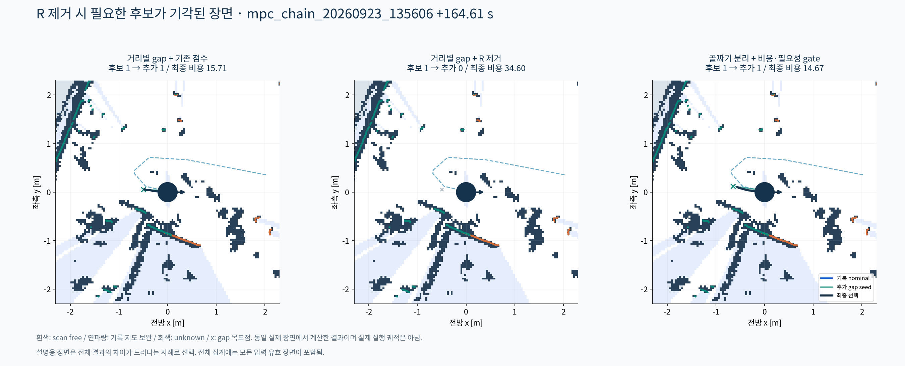
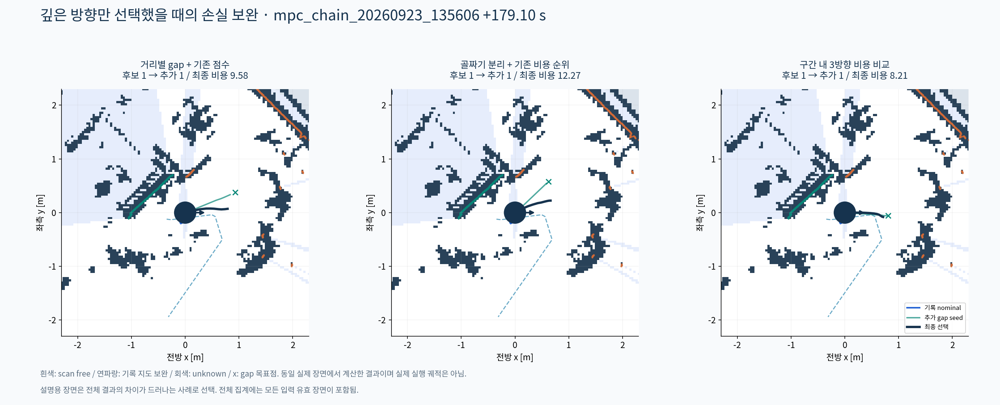
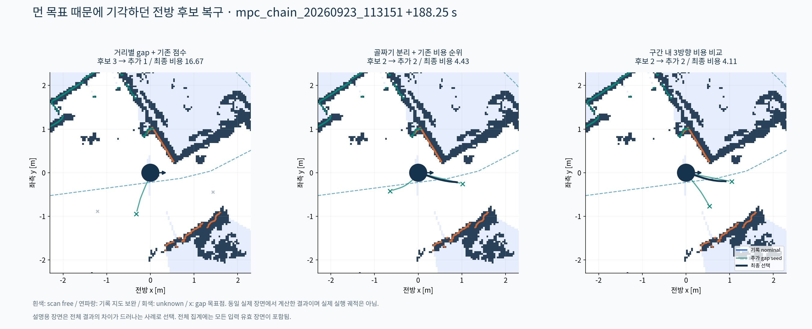
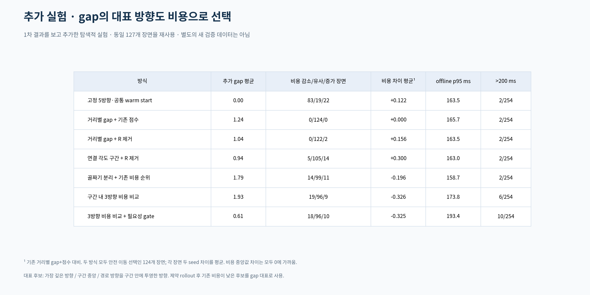
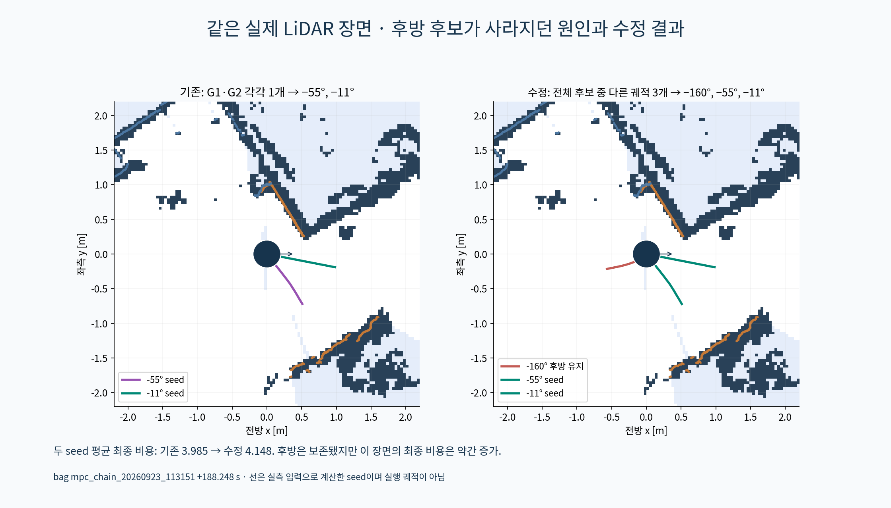
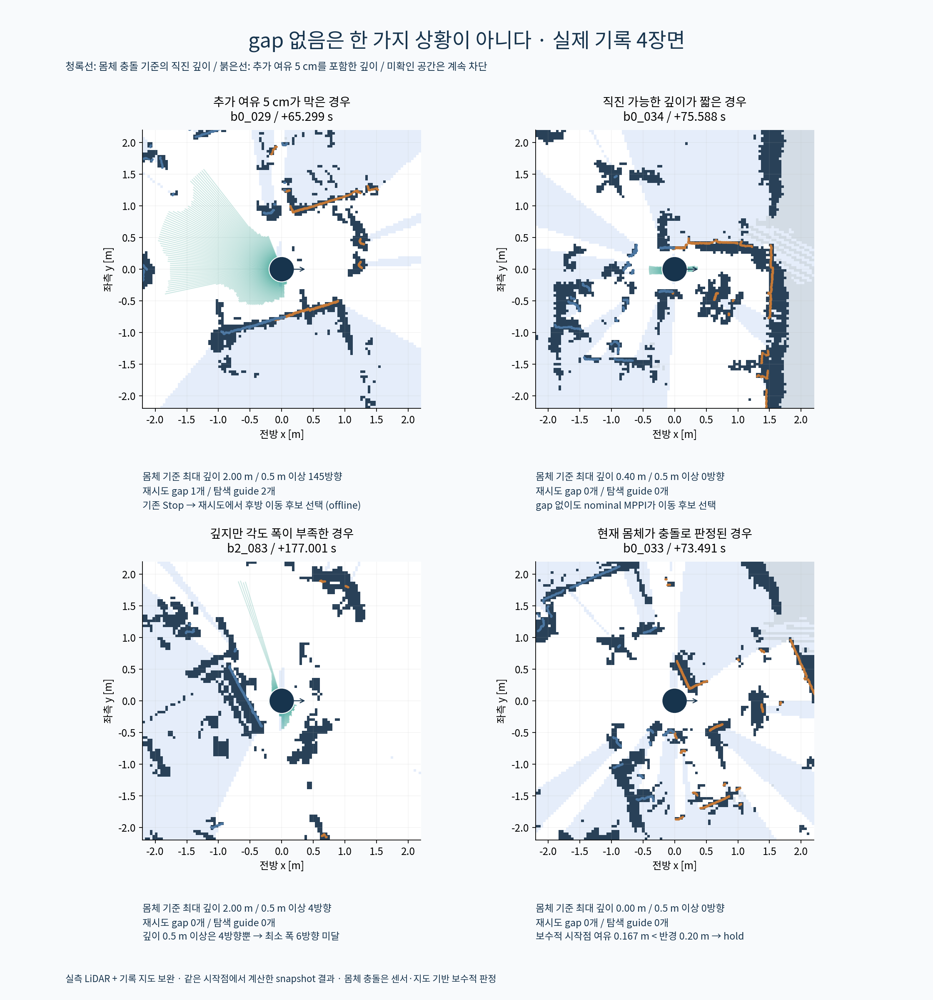

# 실험을 바탕으로 한 설계 판단

**현재 구현 기준은 [Gap 분할·탐색 후보 선택 확정안 v1](GAP_DESIGN_V1.md)이다.** [설정 명세 JSON](gap_design_v1.json)도 함께 고정했다. 아래 내용은 실험 경과이며, gap당 대표 하나·필요성 gate·공통 비용 최적화 seed 등 과거 권고와 충돌하면 v1을 따른다. v1은 전체 gap seed에서 기존 비용과 궤적 차이로 최대 3개를 선택하고, raw gap이 없을 때만 추가 여유를 제외해 한 번 재시도한다. 공통 비용을 별도 수치 최적화한 seed는 v1에 포함하지 않는다.

**후속 확인 — 후방 후보와 gap 없음:** 아래 초기 비교 이후 동일 127장면에서 508회를 추가 실행했다. gap당 대표 하나라는 제한을 풀면 후방 seed 보유 장면은 74→99개로 늘지만, 최종 비용은 3개 개선/111개 유사/10개 악화였다. gap이 처음부터 없는 장면은 8개였고, 후보 생성의 추가 5 cm 여유만 제외하는 재시도로 3개에서 후보가 복구됐다. [후속 결과 PNG](diversity_and_empty_gap/01_summary.png), [원인별 실제 장면](diversity_and_empty_gap/03_empty_gap_examples.png), [상세 수치](diversity_and_empty_gap/summary.json). 상세 판단은 이 문서 마지막 절에 추가했다.

**권고 후보는 “깊이 골짜기로 나눈 각도 구간 + 구간 내 여러 대표 방향의 기존 비용 비교 + 도달 가능한 목표 거리”다.** 별도 경로 근접성 R은 기존 MPPI 경로 비용을 사용하는 selector로 대체할 수 있다. 다만 이번 결과로 운영 기본값을 바꾸거나 실시간 5 Hz 통과를 선언할 근거는 아직 부족하다.

## 실험량과 한계

세 실제 bag, 약 2초 간격 후보 363개 중 입력 유효 127개. 최초 9방식×2개 제어 noise seed=2,286회, 추가 2방식×2개 seed=508회, 합계 **2,794회**다. 기준 방식과 안전 이동 후보를 함께 얻은 비용 비교 장면은 124개다. 나머지는 공통 hold/stop 등으로 비용 우열 표에서 제외하되 전체 상태/시간에는 포함했다.

첫 9방식은 결과 확인 전에 설정을 고정했다. 추가 2방식은 1차 결과의 실패 사례를 보고 만든 **탐색적 후속 실험**이며 같은 bag을 재사용했다. 추가 두 bag에서도 결과를 나누어 표시했지만 후속 방법에 대해서는 그 bag들이 더 이상 완전히 손대지 않은 검증 집합이 아니다. 새로운 독립 bag의 검증이 필요하다.

이번은 같은 기록 pose에서 새 제어 후보를 계산한 snapshot 비교다. 실제 주행 성공률, 교착 탈출률, 충돌률을 측정하지 않았다.

## 1. “거리 분할을 없애면 R은 필요 없다”는 인과관계는 성립하지 않았다

기존 거리별 후보에서 R 항만 빼고 다른 가중치 및 V≥0.25를 유지하자 후보 집합이 **24/127장면**에서 달라졌다. 비용 비교 가능한 124개 중 0개 개선, 2개 악화, 122개 유사(장면 평균 비용차 ±0.1)였다.

특히 `135606` bag **164.607초**에서 유용한 174° gap의 점수가 R 포함 0.366 → R 제거 0.236으로 떨어져 0.25 기준에 못 미쳤다. 그 gap의 seed 기존 비용은 15.762로 기록 nominal의 43.743보다 좋았다.

- 기존 방식 최종 비용: 두 seed 평균 **15.732**.
- R만 제거: **34.745**.
- 구간 대표 방향도 기존 비용으로 선택: **14.423**.

이 사례는 R 자체가 필수라는 증거가 아니다. R 제거 시 threshold를 그대로 둔 것이 기각을 일으켰다. **경로 관련 판단이 필요하며, 그것을 수작업 R 점수로 할지 기존 MPPI 비용으로 할지가 설계 선택**이라는 뜻이다. 후보 수를 맞춘 threshold 재조정 실험까지 한 것은 아니다.

## 2. 거리별 후보 반복은 줄이되, 큰 열린 각도 구간 하나로 뭉치지는 않는 편이 좋다

연결 각도 구간만 사용한 방식은 후보를 단순화했지만 기준보다 5장면 개선/14장면 악화였다. 가까운 범위에서 연결돼 있어도 먼 곳에서 서로 다른 통로로 나뉘는 방향을 하나의 중앙 방향으로 압축할 수 있다.

반면 d_free의 큰 골짜기로 열린 방향을 구분한 방식은 13장면 개선/11장면 악화였다. raw gap 평균은 기존 **2.76 → 2.30개**였다. 수치 차이는 작고 대부분 장면의 최종 결과는 비슷했다.

따라서 거리 값을 버리는 것이 아니라 **거리를 방향별 깊이 profile로 사용**하는 것을 제안한다. 0.5/1.0/1.5 m별로 같은 공간을 후보로 복제하지 않고, 깊이가 뚜렷하게 낮아지는 방향을 경계로 둔다. 현재 실험값은 최소 접근 깊이 0.5 m, peak prominence 0.25 m, 방향 간격 20°, 최소 구간 폭 6°다. 이 숫자들이 최적이라는 근거는 없다.

## 3. gap 중앙이나 가장 깊은 방향 하나만 고정하지 않는 편이 낫다

1차 골짜기 방식은 각 gap의 가장 깊은 방향을 대표로 사용했다. `135606` bag **179.100초**에서는 43°가 대표가 되어, 기준 22° 후보보다 경로 비용이 커졌다.

같은 gap 안에서 **가장 깊은 방향, 각도 중앙, 기록 경로 방향을 gap 안으로 투영한 방향**을 비교하는 후속 실험을 했다. 각 방향에 대해 제약을 지키는 2초 seed를 만들고, 충돌/중복/도달 조건을 통과한 것 중 기존 `common_costs+static cost`가 낮은 것을 대표로 남겼다. 한 gap당 MPPI를 세 개 돌린 것이 아니라, 저렴한 seed 평가를 최대 세 번 한 뒤 MPPI는 대표 하나에 배정했다.

179.100초 장면의 실제 seed 후보:

| 방향 | 기존 seed 비용 | 목표 오차 m |
|---|---:|---:|
| 43° | 21.670 | 0.050 |
| 25° | 14.380 | 0.059 |
| -4° | 9.110 | 0.034 |

같은 장면의 최종 MPPI 비용(두 seed 평균):

- 기존 거리별 방식: **9.485**.
- 가장 깊은 방향 하나: **11.989**.
- 구간 내 방향을 비용으로 비교: **8.423**.

먼 목표의 도달 조건 때문에 좋은 전방 방향을 버리는 문제도 있었다. `113151` bag **188.248초**에서는 기존 -17°/1.5 m seed가 목표 도달 부족으로 제외됐다. 목표 거리를 2초 접근 가능 범위로 조절하고 구간 안에서 방향을 비교하자 최종 비용 평균이 **16.605 → 3.985**로 줄었다.

## 4. 탐색 가치는 별도 가중치 합보다 기존 비용과 nominal 상태를 활용하는 방향을 권한다

실험에서 사용한 절차:

1. nominal을 한 번 rollout하고 정적 충돌, 2초 경로 arc 진행, 사람 예측 envelope와의 겹침을 확인한다.
2. 열린 각도 구간별로 최대 세 seed를 만들고, 실제 제약을 적용한다.
3. nominal 또는 이미 채택한 seed와 중복되는 후보를 제외한다.
4. 충돌 없고 접근 가능한 seed를 기존 MPPI 공통 비용+정적 비용으로 순위 매긴다. 기존 비용 안에 경로 오차·진행·heading·속도·입력 변화량이 있으므로 별도 R 항을 추가하지 않는다.
5. nominal이 정상적으로 진행하면 `J_seed < J_nominal - max(0.5, 0.05|J_nominal|)`인 후보만 추가한다. nominal이 막히거나 2초 arc 진행<0.15 m이거나 사람의 2σ envelope와 겹치면 이 개선 조건을 해제하고 최대 3개를 탐색한다.
6. 선택한 seed 주변에 MPPI sampling을 배정하고, 기존 MC 및 최종 공통 안전 재평가를 유지한다.

2σ envelope는 탐색 확장 신호이며 안전 확률을 보장하지 않는다. seed 비용이 높은 방향도 sampling 후 개선될 수 있으므로 5의 gate는 탐색 기회를 놓칠 수 있다. 이번 결과만으로 강한 기각 규칙의 보편성을 주장하지 않는다.

후속 실험의 실제 결과:

| 방식 | 추가 gap 평균 | 기준 대비 개선/유사/악화 장면 | 비용 차이 평균 | offline p95 ms | >200 ms |
|---|---:|---:|---:|---:|---:|
| 구간 내 방향 비용 비교 | 1.93 | 19/96/9 | -0.326 | 173.8 | 6/254 |
| 위 방식 + 필요성 gate | 0.61 | 18/96/10 | -0.325 | 193.4 | 10/254 |

gate 전후 직접 비교에서는 비용 감소/유사/증가 장면이 **0/122/2개**였다. 후보 수는 줄었지만 모든 남는 예산을 nominal에 다시 배정했으므로 rollout 총량은 여전히 500개다. 따라서 후보 수 감소가 속도 향상으로 이어진다고 판단하면 안 된다. 이번 gate 구현은 후보를 모두 만든 뒤 거르는 구조이므로 후보 생성 시간도 줄이지 않는다.

## 5. 현재 권고의 강도와 다음 작업

**우선 개발할 설계:** 각도 구간을 깊이 골짜기로 분리하고, 목표 거리는 horizon 도달성으로 조절하며, 구간 내 대표 방향과 탐색 우선순위는 기존 MPPI 비용으로 정한다. 정상 진행/정체·위험 상태에 따라 추가 탐색을 다르게 허용하는 gate는 유망하지만, 놓치는 후보와 시간 효과를 별도로 검증해야 한다.

**아직 운영 대체를 권하지 않는 이유:** 후속 방식도 9~10개 장면에서는 기준보다 비용이 나빠졌고 대부분 장면의 차이는 작았다. 고정 5방향 참고 기준과 구간 내 방향 비용 비교를 직접 비교하면 새 방식의 개선/유사/악화는 27/19/78개였고, 비용 차이 중앙값은 +0.154, 평균은 -0.448였다. 일부 큰 개선과 다수 작은 악화가 섞여 있다. 초기 warm start 조건이 달라 완전한 우열 비교도 아니다. 모든 방식의 전체 안전 이동 선택은 대체로 동일했다. 폐루프 탈출/도달 성능이 개선됐다는 증거는 없다.

**5 Hz:** 대표 방향 비용 비교 방식도 offline 측정에서 254회 중 6회, gate 방식은 10회가 200 ms를 넘었다. ROS/full-stack 부하는 포함하지 않았다. 현재 Python prototype이 안정적으로 5 Hz를 만족한다고 말할 수 없다. 동일 조건에서 초기화/입력 cache와 persistent worker를 실제 노드 구조로 옮긴 뒤 전체 callback과 발행 간격을 다시 측정해야 한다.

새 bag에서 독립 검증할 항목은 열린 공간, 좁은 문, 양쪽 우회, nominal 정체, 보행자 횡단, 후진이 필요한 장면이다. gap ID의 시간 연결과 제어주기 수준의 후보 전환 안정성도 아직 구현·평가하지 않았다.

## 상세 기록

- [1차 전체 프로토콜과 결과](README.md)
- [1차 전체 비교 PNG](01_method_comparison.png)
- [후속 비교 PNG](refinement/01_refinement_comparison.png)
- `refinement/protocol.json`: 후속 실험의 사후 설계 여부와 고정 조건.
- `refinement/trials.jsonl`, `refinement/scene_audit.jsonl`, `refinement/summary.json`: 추가 508회 전체 결과.

## 후속 판단: gap과 탐색 guide를 분리하고, gap 없음은 원인을 구분한다

위의 구간 내 대표 방향 실험 이후, 사용자 지적에 따라 후방 seed 소실 원인과 빈 gap을 추가 조사했다. 같은 127장면·noise seed 7/23·총 500 rollout에서 두 방식을 각각 254회 실행했다. 새 독립 검증이나 폐루프 주행은 아니다. 운영 노드 및 설정은 수정하지 않았다.

### 후방 후보: 공간 구간 하나가 움직임 하나를 뜻하지 않는다

개발안에서는 **gap은 기하학적 열린 구간으로 유지하되, gap당 guide 하나라는 제한은 없앤다.** 각 gap의 최대 깊이/중앙/경로 방향 seed 전체를 모아 실행 불가·nominal 중복을 제거하고, 기존 seed 비용 순으로 선택한다. 이미 선택한 궤적과 위치 RMS 차이가 0.25 m 미만이면 중복 제외하며, 전체 추가 guide 상한은 3개다. 후방이라는 이유로 무조건 보존하거나 배제하지 않는다. 같은 gap에서 서로 다른 궤적 두 개가 남을 수 있다. 별도 R 점수나 nominal 대비 개선량 강제 gate는 사용하지 않았다.

실제 b1_088(+188.248 s)에서 기존 −55°/−11°에 후방 −160° seed가 추가됐다. 전체 127장면의 후방 seed 보유는 74→99개였다. 후방 정의는 현재 로봇 좌표에서 seed 종점 x<−0.05 m다. 그러나 양쪽 모두 안전 이동인 124장면의 최종 비용은 3개 개선/111개 유사/10개 악화(±0.1 유사), 평균 변화 +0.0108이었다. b1_088의 두 seed 평균 비용도 3.985→4.148로 조금 나빠졌다. **탐색 방향 보존을 개선한 것이며, 비용이나 실제 탈출 성능 향상을 입증한 것은 아니다.** 추가 guide 수에 따라 nominal의 rollout 배정도 바뀌므로 방향 추가 효과만 분리한 비교는 아니다. 이 결과로 운영 기본값 교체를 정당화하지 않는다.

### gap 없음: 8/127장면, 필터링 후 전부 소실된 장면은 0개

기존 방식에서 추가 후보가 없는 8장면은 모두 raw gap 자체가 0개였다. raw gap이 존재했는데 이후 충돌/도달성/중복 필터로 전부 없어지는 경우는 이 유효 장면 집합에서는 없었다. 입력 유효성 검사에서 제외한 236장면을 gap 없음으로 집계하지 않았다.

추가 5 cm 여유를 제외한 진입 깊이도 계산하여, 그 기준에서도 남는 제한으로 원인을 구분했다. 여러 제한이 동시에 걸릴 수 있으며 아래 표는 그중 남는 제한을 우선해 분류한 것이다.

| 원인 | 장면 수 | 실제 확인 |
|---|---:|---|
| 후보 생성용 추가 여유 5 cm가 막음 | 3 | b0_029, b2_050, b2_086. 기존 몸체 기준으로 재시도하면 gap 복구 |
| 직진 가능한 최대 깊이가 0.5 m 미만 | 2 | b0_034: 0.40 m, b0_035: 0.28 m |
| 깊게 열린 방향은 있지만 폭 부족 | 1 | b2_083: 0.5 m 이상인 방향이 총 4개, 최소 6개에 미달 |
| 시작 몸체가 보수적 충돌 검사에 걸림 | 2 | b0_033, b2_082. 보정된 시작점 clearance가 각각 0.167/0.177 m로 반경 0.20 m 미달 |

기존 d_free는 시작점부터 직선 전체가 `반경 + 추가 여유`를 만족해야 한다. 따라서 시작점 하나가 추가 여유 조건에 걸리면 모든 방향의 깊이가 0이 될 수 있다. **d_free=0을 주변에 공간이 전혀 없다는 의미로 해석하면 안 된다.** 원시 지도의 EDT, 격자 대각선 및 sweep 보수성을 적용한 뒤의 수치이며 실제 물리적 충돌을 독립적으로 확인한 것은 아니다.

### gap이 없을 때의 개발 규칙

1. 추가 여유 5 cm를 포함한 현재 기준으로 gap을 찾는다.
2. raw gap이 0개이면 후보 생성에 한해서 추가 5 cm를 제외하고 한 번 다시 찾는다. 로봇 반경, 격자/sweep 보수성, 미확인 영역 차단, 기존 궤적 충돌 검사, MC 기준은 유지한다. 안전 기준의 일반적인 완화가 아니라 후보 생성 기준과 기존 실행 검사의 불일치를 줄이는 실험이다.
3. 그래도 추가 후보가 없으면 nominal에 500 rollout을 배정한다. gap 없음 자체를 정지 조건으로 쓰지 않는다.
4. 최종 안전 이동 후보가 없으면 기존 Stop/hold 처리를 따른다. 시작점이 이미 충돌로 판정된 경우 `no_safe_candidate_hold`를 안전한 Stop 통과와 혼동하지 않는다. 이때 센서·지도·좌표 정합성 확인도 필요하다.

재시도는 8개 중 3개에서 추가 guide를 복구하여 추가 후보 없음이 8→5개가 됐다. b0_029에서는 기존 Stop 대신 후방 이동 후보가 선택됐으나, 이는 같은 시작점의 오프라인 계산이며 실제 교착 탈출을 확인한 결과가 아니다. 전체 안전 이동 선택 trial은 248→250/254, 안전 판정 통과는 두 방식 모두 250/254였다. 시작점 충돌 두 장면×두 seed의 hold는 그대로 남았다.

전체 후보 방식과 재시도 포함 방식의 offline p95는 각각 168.9/167.9 ms, 200 ms 초과는 7/254와 6/254였다. 입력 준비/후보 생성 시간 일부를 공유한 snapshot 측정이며 ROS/full-stack 5 Hz 검증이 아니다. 새로운 독립 bag 및 폐루프에서 탐색 이득·후보 전환 안정성·시간을 검증해야 한다.

추가 기록: `diversity_and_empty_gap/protocol.json`, `scene_audit.jsonl`, `trials.jsonl`, `summary.json`, `run_summary.json`, `scenes/*.npz`. 동일 제어 후보를 유지한 194 trial은 기존 결과와 비용 일치까지 확인했다. [실험 자료 ZIP](diversity_and_empty_gap/results.zip).

## 후속 10장면: 충돌 비용을 제외한 공통 목적함수 최적화 seed

사용자 제안에 따라 경로·진행·terminal·heading·속도·입력 변화량의 기존 `common_costs`만 최소화했다. seed 생성에서는 정적 soft cost/충돌 기각 및 동적 위험 항을 제외했다. 속도 box, 축별 가속도, 휠 L1 제약과 기존 비선형 rollout은 유지했다. 공통 비용 코드의 SHA256은 현재 구현과 동일하며, 가중치는 앞선 실험의 frozen YAML을 사용했다.

정상 진행·정체·gap 없음·시작점 충돌을 포함한 10개 진단 장면을 최적화 전에 선정했다. SLSQP에 nominal, braking, path guide, gap seed 등 서로 다른 초기값을 주어 총 48회 풀었고 모두 수렴했다. 각 장면의 초기값별 최종 비용 차이는 최대 3.19e-8이었다. 그러나 비선형 문제이므로 **구한 값은 수렴한 수치해이며 전역 최적 보장은 없다.** 10장면 모두 공통 비용은 기록 nominal보다 낮았다.

[10장면 궤적 PNG](common_objective_seed_10_scenes/00_ten_scenes_overview.png), [개별 10장면 PNG·수치·코드 ZIP](common_objective_seed_10_scenes/ten_scene_paths.zip), [상세 결과](common_objective_seed_10_scenes/RESULTS.txt).

### seed 자체의 충돌과 sampling 결과의 안전은 구분해야 한다

최적화 seed 자체는 7장면에서 정적 몸체 충돌 판정, 그중 1장면은 동적 MC 기준도 초과했다. 나머지 3장면은 정적/동적 검사를 통과했지만 nominal과의 RMS 차이가 작았다. 종전 gap seed처럼 충돌·중복을 생성 직후 기각하면 10개 모두 추가 seed에서 제외된다. 이것만으로 해당 sampling 중심의 유용성을 부정할 수 없다.

따라서 10장면 모두에서 **충돌·중복 여부로 중심을 기각하지 않고** 공통 비용 최적화 seed를 실제 MPPI guide로 추가했다. 기존 rollout 정적 검사·동적 MC·최종 공통 안전 재평가는 그대로 유지했다. 비교 기준은 바로 앞 실험의 `all_options_hard_fallback`이며, 고정 5방향과 직접 비교한 결과는 아니다.

nominal + 공통 최적화 seed 1개 + 기존 비용순 gap 최대 2개로 구성했다. 공통 seed와 각 gap에 100 rollout씩 배정하고 나머지는 nominal에 주어 총 500개를 유지했다. seed 7/23으로 총 20회 실제 MPPI를 실행했다. 기존 gap이 3개인 장면은 낮은 우선순위 gap을 대체하므로, 최적화 중심 변경 외에 allocation/후보 구성 효과도 포함된다.

- 양쪽 모두 안전 이동인 9장면: **7개 비용 개선 / 2개 유사 / 0개 악화**. 각 장면 두 seed 평균, ±0.1 유사.
- 나머지 b0_033: 두 방식 모두 시작 몸체 충돌 판정으로 안전 후보 없음.
- 추가한 공통 seed 그룹이 14/20 trial에서 최종 선택됐다.
- seed 중심 자체가 정적 충돌했던 4장면에서도, 주변 sampling 및 최적화 후 안전 기준을 통과한 대표가 선택됐다.
- b1_088 최종 비용 평균: **4.148 → 1.931**.
- b2_084 최종 비용 평균: **8.423 → 3.112**.

별도로 정적 통과 3장면에서 공통 seed를 nominal 초기값으로 대체한 6회도 모두 비용이 감소했다. 하지만 추가 seed를 직접 시험한 결과를 고려하면, 단순 중복 gate로 제외하기보다 **목표 추종을 개선하는 guide 하나와 gap 탐색 guide의 역할을 구분**하는 개발안이 더 적절하다. seed는 실행 궤적이 아니므로 원본 seed의 충돌 판정만으로 유용성을 결정하지 않되, 실제 실행 후보의 충돌·MC 기준은 유지해야 한다.

### 시간과 적용 범위

다중 초기값 최적화만 152~383 ms(중앙값 277 ms)였다. path guide 하나에서 시작한 최적화는 21~73 ms(중앙값 54 ms)였으며, 이 10장면에서는 같은 수준의 비용에 수렴했다. 다중 초기값 최적화를 매 주기 추가할 수 있다는 5 Hz 근거는 없고, 단일 초기값/제한 반복 버전도 전체 노드 주기에서 별도 검증해야 한다.

이번 10개는 실패 모드와 정상 장면을 섞은 진단 집합이며 같은 기존 데이터를 재사용했다. 전체 127장면, 새로운 bag, 폐루프 주행 성능으로 일반화하지 않는다. 운영 코드에는 적용하지 않았다. `common_objective_seed_10_scenes/scene_results.jsonl`에는 공통 비용 수치, solver 수렴·제약 오차, 사후 검사, 각 초기값의 시간이 있고, `raw_seed_trials.jsonl`에는 seed를 직접 추가한 20회 결과가 있다.
