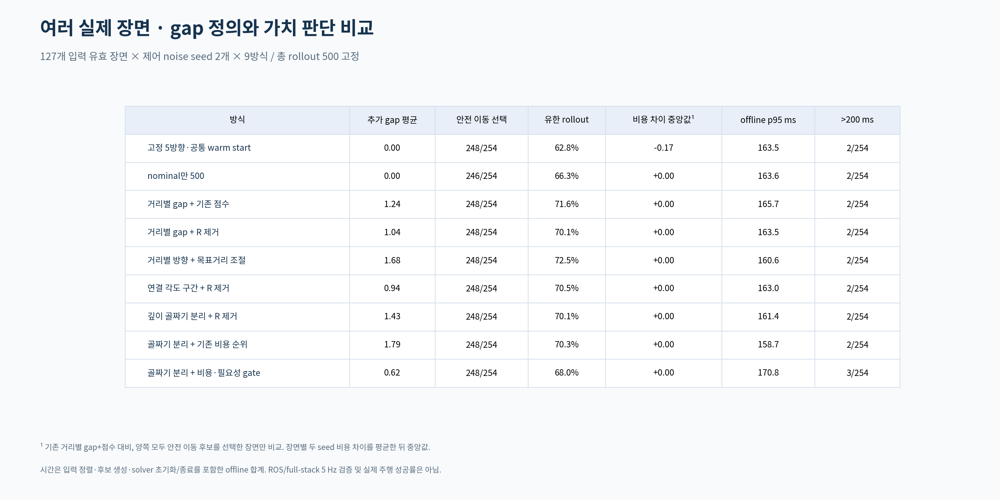
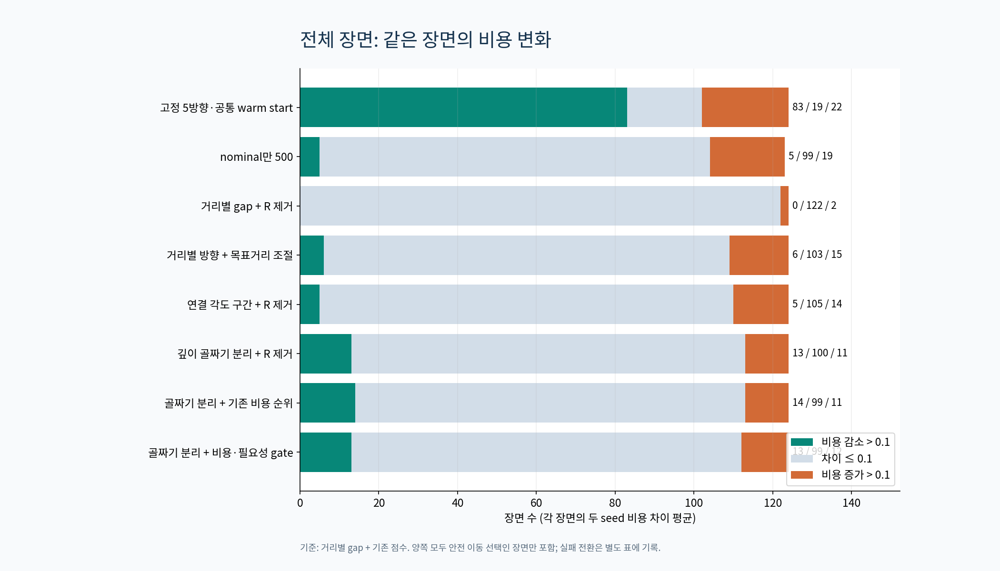
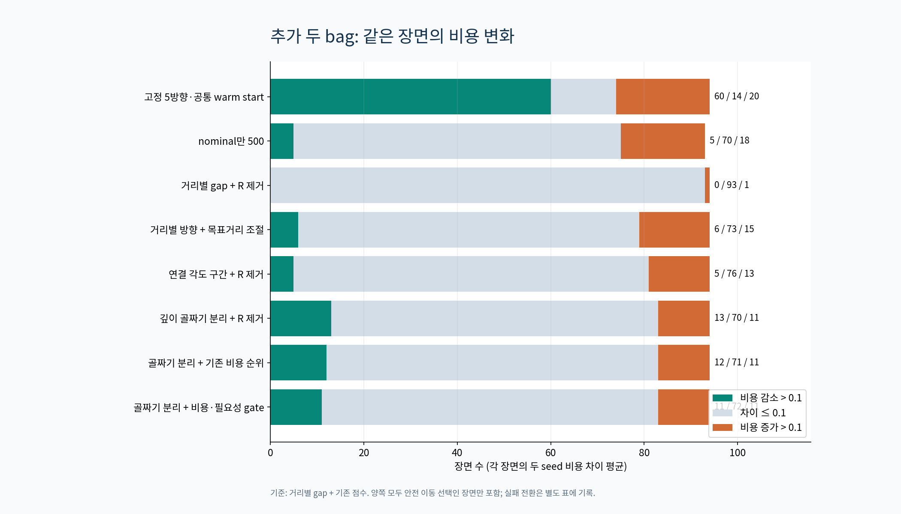
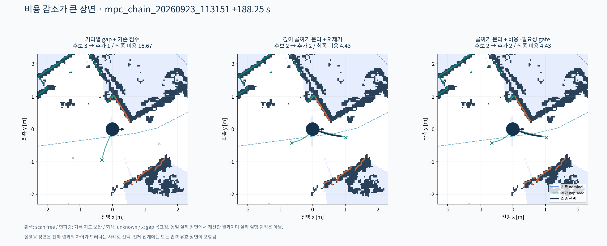
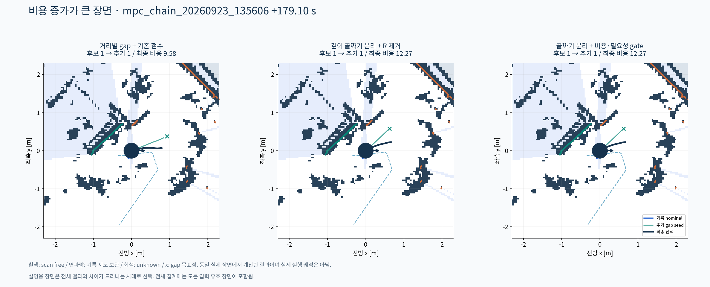
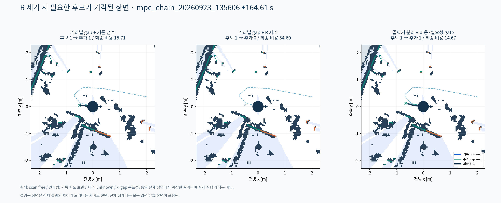
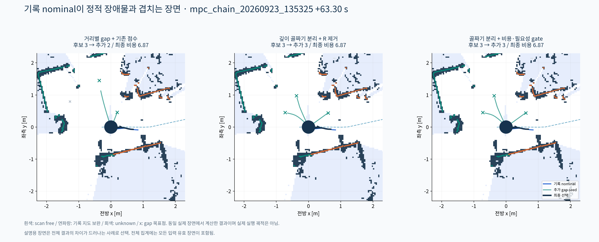

# 실제 여러 장면에서의 gap 정의·탐색 가치 비교

핵심 결론과 후속 대표 방향 비교는 [실험을 바탕으로 한 설계 판단](FINDINGS.md)을 먼저 읽으면 된다.

2026-11-04. **실측 LiDAR·지도·reference·person 예측을 입력으로 사용한 단일 snapshot 최적화 비교**다. 원래 기록의 로봇 pose는 각 장면에서 동일하다. 새 제어를 실제 실행하거나 새로운 궤적을 따라 LiDAR를 다시 관측한 폐루프 실험이 아니다.

## 입력과 실험 범위

원본 세 bag에서 +5초 이후 약 2초 간격으로 후보 snapshot **363개**를 읽었다. 결과를 보고 장면을 골라 집계하지 않았다. 입력 검사 통과 **127개**, 제외 **236개**다.

- `mpc_chain_20260923_135325`: 32장면
- `mpc_chain_20260923_113151`: 44장면
- `mpc_chain_20260923_135606`: 51장면

첫 bag `135325`는 앞선 설계 예제와 같은 기록이다. 나머지 `113151`, `135606`은 이번에 처음 같은 설정을 적용한 추가 두 bag이다. 모든 설정을 `protocol.json`에 먼저 고정했고, 추가 bag 결과를 보고 파라미터를 바꾸지 않았다. 세 bag이 같은 날짜·환경의 연속된 데이터일 수 있으므로 서로 독립적인 환경 일반화 증거는 아니다.

각 장면에 제어 noise seed 7/23, 9방식을 모두 적용했다. 총 **2286회**이며 각 회는 K=500, horizon=2초, 기존 cost 및 8배 MC 설정을 유지했다. 이 반복들은 독립적인 주행 성공률 표본이 아니다.

제외 내역:

- 예측 입력 오래됨 또는 유효 person 예측 소실: 35장면
- 남은 경로 없음 또는 terminal 구간: 72장면
- 기록 reference 오래됨: 8장면
- 기록 global path 비어 있음 (원본 재확인): 70장면
- 기록 지도 오래됨: 4장면
- 앞·뒤 scan 시각 차이 > 50 ms: 47장면

통과 장면 중 기록 nominal의 정적 충돌이 27개, escape trigger가 51개, person 예측이 있는 장면이 30개다. 최대 예측 객체 수는 4개다. 제외된 장면은 실제 운용에서 안전 입력 문제에 따른 hold 또는 terminal 처리가 필요하며, 비교 성공 장면으로 세지 않았다.

LiDAR 시간 정렬·scan free-space·기록 지도 보완은 앞선 예제와 같다. 그림의 연파란 부분은 scan 직접 관측이 아니라 기록 지도에서 보완한 free space다. 동일한 입력을 모든 방식에 제공했다. snapshot 동안 scan hit를 정적으로 두므로 움직이는 사람의 현재 위치가 정적/동적 비용에 함께 들어갈 수 있다.

## 비교한 정의

1. **기존 거리별 gap:** d_free가 0.5/1.0/1.5 m 이상인 각도 구간을 각각 만든다. 12° 이내 중앙 방향의 중복을 합친다.
2. **거리별 방향 + 적응 목표 거리:** 1의 방향 후보는 유지하되, 목표를 실제 2초 제약 rollout으로 접근할 수 있는 거리로 당긴다. 거리 분할과 도달성 기각의 영향을 분리한다.
3. **연결 각도 구간:** d_free≥0.5 m인 연속 방향을 하나의 gap으로 만든다. 같은 공간을 여러 깊이별 후보로 복제하지 않는다. 넓은 구간의 중앙을 쓴다.
4. **깊이 골짜기로 분리한 각도 구간:** 3의 구간 내부에서도 d_free의 큰 골짜기로 나뉘는 열린 방향들을 분리한다. 각도 profile을 2° sigma로 평활화하고 prominence≥0.25 m, peak 간격≥20°로 peak를 찾는다. 대표 방향은 각 구간의 깊은 peak다. 평활화는 경계/대표 검출에만 쓰며 실제 clearance와 충돌 검사는 원래 데이터로 한다.

모든 구간 최소 각도 폭은 6°다. '거리로 분할하지 않는다'는 거리를 버린다는 뜻이 아니다. 깊이는 열린 방향의 구분과 목표 도달 거리를 정하는 데 필요하며, 0.5/1.0/1.5 m별로 후보를 반복 생성하는 것을 없앴다는 뜻이다.

적응 목표 거리: 먼저 가능한 깊이에서 0.10 m를 빼고, 그 목표에 대한 2초 제약 rollout의 방향 성분 도달 거리를 계산한다. 목표는 그 도달 거리의 90%로 줄이며 가용 깊이를 넘지 않는다. 목표 하한 0.25 m도 가용 깊이를 넘을 수 없다.

## 탐색 가치 비교

- **기존 점수:** V=0.40P+0.25C+0.20D+0.15R, V≥0.25. 정의는 앞선 예제와 동일하다.
- **R 제거:** 다른 가중치와 threshold를 고정하고 0.15R 항만 제거했다. 따라서 점수 순위뿐 아니라 threshold 통과 여부도 달라질 수 있다. 단순히 비중을 다른 항목에 재분배한 실험은 아니다.
- **기존 비용 순위:** seed의 기존 `common_costs + static cost`가 낮은 순서로 최대 3개를 채택한다. 별도의 P/C/D/R 가중치와 V threshold는 없다. 경로 추종/진행 비용은 기존 MPPI 비용 안에 남는다. 즉 별도 경로 근접성 R을 없애도 경로 관련 정보 자체를 없앤 것은 아니다.
- **필요성 gate 추가:** nominal이 건강하면 seed가 nominal 비용보다 `max(0.5, 5% × |nominal cost|)` 이상 낮을 때만 추가한다. nominal이 정적 충돌, 2초 arc 진행<0.15 m, 또는 사람의 2σ envelope와 겹치면 escape로 보고 이 개선 조건을 해제한다. 2σ envelope는 탐색을 넓히는 trigger이며 확률 안전판정이 아니다.

공통으로 nominal과 seed의 RMS<0.22 m 및 후반 차이<0.30 m이면 중복 제외한다. nominal이 정적 충돌하면 이 제거를 해제한다. seed 충돌 및 목표 오차>0.35 m를 제외한다. 새 seed끼리 RMS<0.25 m이면 중복 제외하고 최대 3개를 남긴다.

추가 gap당 100개, nominal은 `500-100×gap수`개다. nominal만 남으면 500개를 받는다. 선택된 후보는 안정적인 ID 순서로 solver에 전달하여 점수 순서만 바뀐 경우 random stream이 바뀌지 않도록 했다. R 제거 전후 같은 후보 집합이면 비용이 동일한지 **202개 trial에서 확인**했다.

고정 5방향 비교는 각 guide의 warm start를 같은 기록 reference로 초기화한 뒤 기존 0.25 anchor blend를 사용한다. 당시 독립 guide별 내부 상태를 복원한 비교가 아니므로 gap 정의의 직접적인 우열 근거보다는 참고 기준이다.

## 전체 결과



| 방식 | 추가 gap 평균 | 안전 이동 선택 | 유한 rollout | 비용 차이 중앙값 | 비용 감소/유사/증가 장면 | offline p95 ms | >200 ms 회수 |
|---|---:|---:|---:|---:|---:|---:|---:|
| 고정 5방향·공통 warm start | 0.00 | 248/254 | 62.8% | -0.166 | 83/19/22 | 163.5 | 2 |
| nominal만 500 | 0.00 | 246/254 | 66.3% | +0.000 | 5/99/19 | 163.6 | 2 |
| 거리별 gap + 기존 점수 | 1.24 | 248/254 | 71.6% | +0.000 | 0/124/0 | 165.7 | 2 |
| 거리별 gap + R 제거 | 1.04 | 248/254 | 70.1% | +0.000 | 0/122/2 | 163.5 | 2 |
| 거리별 방향 + 목표거리 조절 | 1.68 | 248/254 | 72.5% | +0.000 | 6/103/15 | 160.6 | 2 |
| 연결 각도 구간 + R 제거 | 0.94 | 248/254 | 70.5% | +0.000 | 5/105/14 | 163.0 | 2 |
| 깊이 골짜기 분리 + R 제거 | 1.43 | 248/254 | 70.1% | +0.000 | 13/100/11 | 161.4 | 2 |
| 골짜기 분리 + 기존 비용 순위 | 1.79 | 248/254 | 70.3% | +0.000 | 14/99/11 | 158.7 | 2 |
| 골짜기 분리 + 비용·필요성 gate | 0.62 | 248/254 | 68.0% | +0.000 | 13/99/12 | 170.8 | 3 |

비용 차이 기준은 기존 거리별 gap+점수다. 양쪽 모두 안전 이동 후보를 선택한 trial에서 장면별 두 seed 차이를 평균하고, 장면들을 집계했다. ±0.1 이하는 유사로 세었다. 안전 이동 여부가 달라지는 trial은 비용 차이에서 제외하고 회복/손실로 별도 기록했다. 유한 rollout 비율은 정적 invalid 제거율과 관련된 진단이며, 그 자체로 실제 충돌률이나 최종 후보의 동적 안전 비율이 아니다.




### design

| 방법 | 비교 장면 | 비용 감소/유사/증가 | 비용 차이 중앙값 | 안전 이동 회복/손실 trial |
|---|---:|---:|---:|---:|
| 고정 5방향·공통 warm start | 30 | 23/5/2 | -0.381 | 0/0 |
| nominal만 500 | 30 | 0/29/1 | +0.000 | 0/0 |
| 거리별 gap + 기존 점수 | 30 | 0/30/0 | +0.000 | 0/0 |
| 거리별 gap + R 제거 | 30 | 0/29/1 | +0.000 | 0/0 |
| 거리별 방향 + 목표거리 조절 | 30 | 0/30/0 | +0.000 | 0/0 |
| 연결 각도 구간 + R 제거 | 30 | 0/29/1 | +0.000 | 0/0 |
| 깊이 골짜기 분리 + R 제거 | 30 | 0/30/0 | +0.000 | 0/0 |
| 골짜기 분리 + 기존 비용 순위 | 30 | 2/28/0 | +0.000 | 0/0 |
| 골짜기 분리 + 비용·필요성 gate | 30 | 2/27/1 | +0.000 | 0/0 |

### holdout

| 방법 | 비교 장면 | 비용 감소/유사/증가 | 비용 차이 중앙값 | 안전 이동 회복/손실 trial |
|---|---:|---:|---:|---:|
| 고정 5방향·공통 warm start | 94 | 60/14/20 | -0.142 | 0/0 |
| nominal만 500 | 93 | 5/70/18 | +0.000 | 0/2 |
| 거리별 gap + 기존 점수 | 94 | 0/94/0 | +0.000 | 0/0 |
| 거리별 gap + R 제거 | 94 | 0/93/1 | +0.000 | 0/0 |
| 거리별 방향 + 목표거리 조절 | 94 | 6/73/15 | +0.002 | 0/0 |
| 연결 각도 구간 + R 제거 | 94 | 5/76/13 | +0.000 | 0/0 |
| 깊이 골짜기 분리 + R 제거 | 94 | 13/70/11 | +0.000 | 0/0 |
| 골짜기 분리 + 기존 비용 순위 | 94 | 12/71/11 | +0.000 | 0/0 |
| 골짜기 분리 + 비용·필요성 gate | 94 | 11/72/11 | +0.000 | 0/0 |




## R 항 제거로 실제 달라진 것

추가 후보 집합이 달라진 장면은 **24/127개**다. 앞선 bag 11개, 추가 두 bag 13개다. 변화 내역은 `summary.json`의 `R_ablation.details`, 후보별 수치/기각 이유는 `scene_audit.jsonl`에 모두 기록했다.

R 제거 여부와 gap 정의는 별개의 축이다. 거리별 중복을 없애도 서로 다른 방향의 후보는 경로에서 멀어질 수 있다. 별도 R의 필요성을 판단하려면 경로 정보를 다른 비용/진행 기준이 이미 충분히 제공하는지를 함께 봐야 한다.

## 실제 장면 그림

아래 사례는 차이를 설명하기 위해 전체 결과에서 선택했다. 비용 차이가 큰 사례는 두 seed 평균으로 골랐고 그림은 seed 7의 실제 결과를 보여준다. 전체 통계의 장면 선택에는 영향을 주지 않았다.



b1_088: 비용 감소가 큰 장면.



b2_084: 비용 증가가 큰 장면.



b2_077: R 제거 시 필요한 후보가 기각된 장면.



b0_028: 기록 nominal이 정적 장애물과 겹치는 장면.


## 시간과 해석 범위

시간은 단일 snapshot의 입력 정렬·필드 생성·nominal/prediction 준비, 해당 방식의 seed pool/선정, controller 초기화, solver와 worker 종료 wall을 합쳤다. 공유 입력을 한 번 계산해 각 방식에 동일하게 더했고, 관련 없는 다른 방식의 pool 계산은 포함하지 않았다. 각 방식 실행 순서는 장면마다 회전했다. 두 seed는 제어 sampling seed이며 MC 설정은 고정했다.

cache/코어 경쟁·ROS 입력 callback·TF 서비스·publish·전체 인지/MPC 부하는 재현하지 않았다. **offline p95가 200 ms 미만이어도 실제 5 Hz 통과가 아니다.** 원본 운영 timeout 0.18초 대신 계산 결과를 수집하기 위해 10초 timeout을 썼다. 느린 실행을 통계에서 숨기지 않았다. 표의 >200 ms는 offline 측정 구간 초과이며 실제 deadline miss 수가 아니다.

장면 간 로봇 pose/지도/예측은 원래 기록을 사용했다. 새 후보로 주행했을 때의 다음 관측이나 사람 반응을 생성하지 않았다. 그러므로 도착률, 교착 탈출률, 실제 충돌률, gap ID 안정성 및 5 Hz 실시간 동작은 아직 미검증이다. 권고는 이 범위에서의 후보 효율/목적함수 결과에 한정해야 한다.

## 재현과 파일

`source_snapshot/`에 이번 실험에 사용한 planner·설정·실험 코드를 고정해 보관했다. 현재 작업 중인 소스가 바뀌어도 이 복사본으로 같은 비교를 실행할 수 있다. 원본 bag은 수정하지 않는다.

```bash
source /opt/ros/jazzy/setup.bash
source /home/smoc/2026amr_ws/install/setup.bash
OPENBLAS_NUM_THREADS=1 OMP_NUM_THREADS=1 MKL_NUM_THREADS=1 /usr/bin/python3 \
  planner/local_planner/DRA_MPPI/docs/gap_multiscene_2026-11-04/source_snapshot/tools/experiment_gap_multiscene.py \
  --output /tmp/gap_multiscene_reproduction
/usr/bin/python3 planner/local_planner/DRA_MPPI/tools/summarize_gap_multiscene.py /tmp/gap_multiscene_reproduction
```

- `protocol.json`: 결과 확인 전에 고정한 조건과 비교 범위.
- `source_hashes.json`, `configuration.json`: 소스/설정 provenance.
- `scene_audit.jsonl`: 모든 snapshot의 포함/제외 이유와 모든 후보 수치.
- `trials.jsonl`, `trials.csv`: 전체 solver 결과와 시간.
- `summary.json`: 전체·bag별·추가 bag·nominal 상태별 결과와 paired 비교.
- `scenes/*.npz`: 장면별 실제 grid/scan point와 seed·최종 궤적.
