# Guide-only MPPI 구현·NUC 검증 — 2026-10-22

후속 최적화: 현재 YAML은 K500/`gaussian_disk`로 변경되었다.
[회귀 수정과 최신 측정](optimization_2026-10-22/results.md)을 참고한다.
아래의 K100/고밀도 MC 실패 수치는 변경 전 기록이다.

이 문서는 10월 20/21일 기록을 대체하는 현재 변경 설명이다. 이전 파일과 raw 자료는
보존했다. 최종 계측 표/그래프는 [이번 결과](validation_2026-10-22/results.md)에 있다.
실차 운용 승인이나 충돌 안전 인증이 아니다.

**판정: 구현·빌드·178개 테스트는 통과했으나 guide의 5Hz 목표는 미달했다.**
운영 설정(.18s timeout)의 장애물5개·3000 cycle에서 callback p99=204.92ms,
예정 시각→발행 p99=372.93ms, timeout 2992회/stale hold 8회, 200ms 초과197회였다.
발행 간격 p99=209.89ms/max=349.04ms이며 모두 hold였으므로 주행 성공으로 볼 수 없다.
장애물 없는 300 cycle은 정상300회, callback p99=16.65ms였다.
Standard의 동일 K100·장애물10개 100-cycle 추가 비교는 정상100회,
callback p99=152.21ms였다. 전략 우월성이나 실제 전체 stack의 장기5Hz 보장은 아니다.

추가 실험을 종료했다. 상세 결과·원시 CSV·그래프는 아래 결과 링크에 보존했다.

## 시작 상태와 범위

- 실제 checkout: `/home/smoc/2026amr_ws`, branch `fix/semantic-map-jump-dynamic-gate`,
  HEAD `2db9270505d5ec392cb2a2ec955be1c952810875`.
- 시작부터 DRA_MPPI 15개 tracked 파일과 공통 비용/계측/검증 도구에 미커밋 변경이
  있었다. `validation_2026-10-22/baseline`의 status, patch, source tar로 보존했다.
  이번 변경은 그 위에 적용했고, stack_master의 다른 작업과 zip은 건드리지 않았다.
- 저장소 및 상위 경로에 적용되는 AGENTS.md, workspace의 AMR_STACK_CONTEXT.md는
  없었다. home `.codex/AGENTS.md`는 저장소의 상위 지침 파일이 아니다.
- 실제 CPU Intel Core 5 210H, 12 logical CPU/8 cores, RAM 7.3 GiB,
  Ubuntu 24.04.5, ROS Jazzy, Python 3.12, NumPy 1.26.4/SciPy 1.11.4.
  NumPy OpenBLAS64 0.3.23.dev. 실제 버전·커널·부하·온도는 각 ROS environment.json,
  telemetry.json을 따른다. 음수 thermal sensor 값은 유효 온도로 해석하지 않는다.
- 시작 시 planner/MPC/driver launch 프로세스가 없었다. 설치 Python source hash는
  baseline/install_comparison.json에 보관했다. 운용 노드의 parameter dump는 노드가
  없어 얻을 수 없었다. 격리 ROS 노드의 실제 선언 파라미터는 매 run actual_parameters.yaml에 있다.
- autonomy launch에는 wheel_cpp/body/wheel 선택과 raw command→gate→구동 경로가 있다.
  autonomy 전체를 시작하지 않았다. 비교 도구는 domain 173, localhost,
  `/guide_validation/...`, publish_cmd_vel=false; fixture+planner+subscriber만 실행한다.
  실제 동시 perception/MPC 부하와 실차 폐루프는 검증 범위 밖이다.

## 조사한 흐름과 변경

```mermaid
flowchart LR
 G[Theta* global_path] --> S[odom / prediction / map snapshot]
 S --> A[기존 5방향 anchor]
 A --> W[guide별 shifted nominal + anchor + spline noise]
 W --> R[각 guide: 제약 / rollout / 공통 비용 / MC / 가중평균]
 R --> F[대표 제약 재적용 / rollout / 정적 swept / 공통 MC 재검사]
 F --> C[안전한 대표 하나 선택 + 전환 억제]
 C --> P[PlanarReferenceArray]
 P --> M[기존 하위 MPC / gate / RoboClaw]
```

기존: sampling/rollout/기하·정적 비용은 전체 batch, MC만 guide별 pool.
변경: anchors와 경로 시작 투영은 공통 전처리; 각 guide의 sampling, rollout,
전체 비용, MC, 가중평균은 독립 작업. final recost/선택/nominal commit/ROS publish는
호출 thread 한 곳에서 한다. `mppi.guide_evaluation=batch`는 같은 후보를 한 영역에서
평가하는 A 비교 경로, `split`은 B/C/D 및 운영 경로다. standard도 보존했다.

관련 파일:
- global_planner/rviz_theta_star_node.py: map/목표→Theta* 경로.
- dra_mppi_node.py: 입력/TF/예측 보간/terminal/발행/freshness/전체 wall 계측.
- guide_conditioned.py: anchor, 배분, 독립 작업, MPPI 평균, 대표 검사/선택.
- common_cost.py: 연속 polyline 투영과 공통 비용/각 raw·weighted 항.
- mppi_controller.py, mecanum_model.py: 공통 제약/rollout/standard/정적·동적 평가.
- dynamic_risk.py: 장애물별 혼합밀도 적분→독립 결합, sampler/cache/진단.
- grid_costmap.py: 불변 거리장, 상태 여유 거리와 swept footprint hard 검사.

Guide 각도 `[0,+45,+90,-45,-90]°`, 로봇 기준 ID, 각 cycle에서 world 병진 ray를
고정한다. **Anchor yaw는 경로 접선을 향해 회전한다**. heading cost만으로 방향이
결정되는 구조가 아니다. 각 guide는 vx/vy/omega 3자유도를 모두 가진다.
K는 전체 예산이며 최종 YAML은 K=100→20씩 배분한다(별도 Stop/대표 재검사 제외).
nominal shift와 anchor 혼합 .25, 4-knot Halton Gaussian spline noise
[.15,.12,.45], seed7+101+g를 보존했다. 기저 noise는 cycle마다 새로 만들지 않는다.
큰 yaw 변화(30° 초과)에서 nominal을 재초기화한다. 전환 penalty .25/hysteresis .10을
유지했다. Stop은 안전한 이동 대표가 없을 때만 fallback이다.

## 공통 비용과 단위

N=10, dt=.2 고정. 모든 항을 SI 단위 raw로 계산하며 hidden scale이나 /dt가 없다.

- path: `w_e mean(||p-P(s)||²) - w_p(s_N-s_0)`.
- static: `w_s mean(max(0,1-d/d_safe)²)` + swept 충돌 invalid.
- dynamic: `w_d mean(p_t) + w_h count(p_t>epsilon)`.
- heading: `w_psi mean(1-cos(psi-psi_path))`.
- motion: `mean(w_v(v_parallel-v_ref)² + w_omega omega² + duᵀ R_delta du)`.
- 별도 retained terminal: 시작 위치의 남은 arc와 목표 Euclidean 거리 모두 .5m
  이내일 때만 `24 ||p_N-goal||²`. 먼 local endpoint를 당기는 보상은 없다.
  최종 pose 정렬/settle/latch는 기존 ROS terminal controller가 담당한다.

기존 Huber/각도제곱/정규화 입력 변화율 파라미터를 제거했다. 이전 `input_rate_weight`
설정을 새로운 `input_delta_weight`와 혼용하면 안 된다. 본 비용은 요청서의 응용 설계다.
이번 보고서는 논문의 세부 수식이나 canonical MPPI 중요도 보정 정리를 인용하지 않는다.
기존 구현에 likelihood-ratio 항은 없었으며 제거한 중요도 항도 없다. 상관 spline,
clipping, guide 조건부 평균은 엄밀한 unbiased canonical MPPI라는 주장을 하지 않는다.

`u_t`는 `x_t→x_(t+1)`. 상태 항은 x1..xN, motion은 x0..x(N-1)의 yaw와
**동일 lookahead 경로 방향**으로 계산한다. 첫 du는 `/odometry/filtered`의
측정 body twist와 비교한다. MPC 출력이나 직전 reference로 취급하지 않는다.
추정기 noise에 민감하며 실제 estimator noise 측정 자료가 없어 물리적인 검증은 미완료다.
현재 twist 계약은 odometry child frame의 body vx/vy/omega이다.

v_ref는 cycle 시작 남은 거리 `max(remaining_arc, goal_distance)`에서 desired speed
×t의 공통 진행 시계를 빼고, `min(v_des,sqrt(2*a_min*remaining),remaining/dt)`로 만든다.
모든 후보가 동일 v_ref를 사용한다. 목표 근처 개별 후보 속도에 따라 목표를 낮추지 않는다.

투영은 선분 보간/누적 arc, 이전 s 주변 양방향 local window이다. 후진을 허용한다.
중복점 제거, 마지막 유효 접선 fallback, singleton heading=0. local search는
모든 자기 교차에서 전역 의도를 복원하는 보장은 아니다. cosine에는 wrap이 없고
anchor/terminal controller의 각도 오차 wrap은 유지한다.

## 지도·확률·실행 안전 계약

정적 ON을 유지한다. unknown/outside는 장애물, 누락/stale/TF 오류는 hold.
map publication와 sensor_watermark 모두 freshness 검사. EDT는 map callback에서
한 번 만들고 read-only로 공유한다. 입력 map inflation>0은 이중 inflation을 피하려고
거절한다. 실제 traversability YAML inflation=0. footprint는 기존 .2m 원이며
장착물 포함 실제 외곽 실측은 미완료다. soft d는 미래 상태의 보수적 footprint 여유,
hard 검사는 시작 footprint와 모든 구간의 half-cell 이하 sweep, cell/padding 포함.
정적 invalid를 낮은 다른 비용으로 상쇄할 수 없다.

동적 확률은 각 장애물 혼합분포를 각 반경(robot+obstacle) 원 내부에서 적분한 후
`1-product(1-p_o)`로 결합한다. 독립성 가정이며 밀도 자체를 확률로 결합하지 않는다.
균일 사각형/Halton 표본의 식은 `area(B)/M sum(1_C f_o)`이다. 원 안 표본 0개는
p=1, cap 때문에 요구 밀도를 못 채운 step도 p=1로 배제한다. cov 대칭/PSD,
finite 값/양의 가중치 합을 검증하고 sigma floor .08을 유지한다. 범위 clipping은
별도 count를 남긴다. 캐시는 동일 prediction 객체/반경/horizon과 영역 포함을 확인하며,
최종 guide 대표는 별도 공통 영역으로 새로 평가한다.

5개의 estimator/RNG/cache는 각각 한 worker 작업만 접근한다. PredictionSet은 복사 후
read-only, map은 immutable replacement, state/path/current도 cycle 복사본이다.
worker는 공유 nominal/ROS를 갱신하지 않는다. 재사용 ThreadPoolExecutor, seed별
독립 sampler, 결과 guide 순서 병합. 예외는 모든 future 종료 후 전파하고 warm start
초기화. timeout은 running thread를 죽이지 못하므로 drain 뒤 hold; 다음 cycle과
겹치거나 오래된 결과를 publish하지 않는다. ROS odom/pred subscription depth=1로
오래된 queue를 줄였고, 결과 발행 전에 odom freshness를 다시 확인한다.

ROS single-thread executor/default mutually exclusive callback으로 한 cycle 중 map/path/
pred callback이 입력을 바꾸지 않는다. 계산 API 자체도 non-reentry lock을 가진다.
한 worker CPU 시간들의 합과 병렬 wall 시간은 구분해서 기록한다.
BLAS/OMP/MKL/NUMEXPR thread=1은 launch와 재현 도구에 고정한다.
process IPC backend는 추가하지 않았다. 현 측정의 GIL/메모리/열 영향을 시간/스레드/
샘플 비교량으로 보고하며, GIL 자체의 정량 stall 분석이나 process 비교는 미측정이다.

/PlanarReferenceArray 인터페이스는 변경하지 않았다. planning_frame=odom,
references[i] 목표 시각=header.stamp+(i+1)*dt, [x,y,yaw,vx,vy,yaw_rate].
wheel_cpp reference.hpp와 Python MPC reference.py 모두 이 규약이다.
header는 publish 시각이며 optimizer 입력 취득 시각과의 계산 지연만큼 실제 추종 오차가
남을 수 있다. 이 지연 보상/MPC 재설계는 수행하지 않았다.
예측은 header age+(t+1)dt로 평균/공분산/가중치를 보간한다. 기본 필터 person,
STATIC/UNKNOWN/최근 LOST는 기존 stationary-disc 정책을 유지한다.
ε는 시점별 모델 확률의 기존 .05이며 운용 사고율 승인 기준이 아니다.
시간 간 충돌·예측 calibration·장애물 상관관계·실제 제동 안전을 보증하지 않는다.

## 선정 결과와 미완료 검증

상세 전후 값·단위·시험 범위·미탐색 항목은
[parameters.md](validation_2026-10-22/parameters.md)를 따른다. K100/250/500과
새 경로 가중치 8/32/64를 제한 비교했다. 최종 K100은 guide당20개이며,
경로 가중치64는 튜닝 7상황에서 7/7 도달, 평균 경로 오차 .060m였다.
기존 가중치8을 새 제곱식에 적용한 경우 .142m였다. noise/knots/blend와 적응 온도는
보존했다. 속도·회전·변화량 계수는 기존 정규화의 유효 계수를 SI 값으로 이전했다.
이를 전 파라미터의 공동 최적화로 해석하면 안 된다.

MC 사전 기준은 MAE≤.002, 절대오차 p95≤.005/max≤.015 및 reference≥ε+.01
그룹 false-safe 0건이었다. 이는 ε의 10~20% 수준 수치 오차를 제한하기 위한 공학적
검사이며 실제 충돌 위험의 승인 기준이 아니다. 밀도2048은 분리한 seed에서 max=.01838로
실패했고, 4096을 새로운 seed로 다시 확인했다. [수치 결과](validation_2026-10-22/results.md)에
고정 분포 및 실제 후보의 결과/분모를 모두 공개한다. 실제 후보의 ε 바로 근처에는
false-safe가 남았다. 최종 대표의 Monte Carlo 확률 추정도 보정된 안전 확률이 아니다.

전체 callback 100 cycle×3회 A/B/C/D 비교에서 장애물10개 조건의 p99는
A 283–292ms, B 272–317ms, C 241–264ms, D 267–286ms였다.
2 workers가 이 pilot에서 가장 낮았으나 **모두 200ms 목표를 실패했다**.
이 범위는 run별 p99의 범위이며 p99의 평균으로 판정하지 않았다.
운영 timeout .18s를 적용한 조건은 별도로 측정했다. 긴 실행도 timeout·hold를
제외해 통계를 낮추지 않는다. 가중치/표본 수/안전 검사를 줄여 통과로 만들지 않았다.

기능 suite는 20개 장면×3개 seed×두 전략, 위치 도달 48/60(guide),45/60(standard),
관측 충돌 0/60씩이었다. blocked 3회는 도달 불가능한 대조 조건이다. 넓은 분포와
다중 장애물, 일부 횡단에서 미도달/정체가 남았다. 20초 제한과 ideal kinematic
execution, 수동 scene, CV mode를 실제 위치로 삼은 synthetic truth라는 한계가 있다.
MPC 추종·구동/지연·센서 calibration을 포함한 폐루프 성공률이 아니다.

다음은 미완료다.

- 모든 조건에서 3000 cycle×3회 반복한 본 프로토콜. A/B/C/D는 100×3 pilot이며,
  운영 조건의 긴 1회 측정과 구별한다. 모든 비교 조건이 이미 deadline을 넘는 상태라
  안정된 장기 p99 통과 결론을 내리지 않았다. 긴 반복 재현 명령을 제공한다.
- 실제 센서·인지·추적·MPC를 함께 실행한 대표 부하. workspace와 알려진 bag 경로에서
  재생 가능한 db3/mcap을 찾지 못했고, motor를 포함하는 autonomy launch는 실행하지 않았다.
  전체 부하에서 5Hz를 달성했다고 주장하지 않는다.
- 실제 prediction calibration, 물리적 충돌/교착률, 최종 goal settle의 실차 검증,
  payload footprint 실측, estimator twist noise의 실측 영향.
- GIL stall이나 CPU cache/memory bandwidth의 profiler 분해, process IPC 대안의 실측,
  logger ON/OFF와 다중 BLAS thread의 대조 시험. NumPy worker의 실행 겹침과 실제
  1/2/5-worker end-to-end 결과는 측정했지만 이를 GIL stall 비율로 환산하지 않는다.
- callback 시간은 callback 진입→발행/visualization/후처리까지이고 recorder row 생성/queue
  비용은 별도 record_prepare_ms다. queue 호출 이후 Python return의 미소 비용과 TF/map 입력
  callback 자체의 계산 시간은 별도 executor 부하에 속한다. 지도 구축은 map callback에서
  수행되므로 control callback 비용으로 중복 합산하지 않는다. ROS publish 완료는 MPC 수신 완료가 아니다.
- timeout cycle은 전체 wall 통계/상태에 들어가지만 결과 객체가 없으므로 세부 비용/MC count
  일부가 null이다. 이 null을 0개 표본이나 빠른 성공으로 해석하면 안 된다.

병목은 고정밀 공간 MC의 density 계산·candidate/sample 비교와 공통 최종 재검사다.
예를 들어 A repeat0 계산 cycle mean primary MC=189ms/final MC=62ms,
C repeat0 최종 MC≈63ms였다. split의 primary_mc_ms는 worker 시간 합으로 wall과 다르다.
전체 guide 작업의 병렬 wall은 stage_ms.primary_wall을 사용해야 한다.
단순 worker 증가보다 확률 오차를 보존하는 적분 kernel/표본 재사용·영역 설계 개선,
상한이 있는 보수적 먼 장애물 제거, compiled evaluator가 다음 후보이다. 이 대안의
개선 폭을 실측 없이 보장하지 않는다. N/dt와 ε/정적 검사는 유지해야 한다.

## 실제 검증 명령과 파일

- workspace `colcon build --packages-select dra_mppi --event-handlers console_direct+` 성공:
  [build_workspace.txt](validation_2026-10-22/build_workspace.txt).
- `colcon test --packages-select dra_mppi`, `colcon test-result --test-result-base build/dra_mppi --verbose`:
  178 tests/0 errors/0 failures/0 skipped.
- source pytest 178 통과, 관련 syntax/undefined/import lint
  `flake8 --select E9,F63,F7,F82,F401,F811` 통과. 전체 PEP8/docstring lint를 통과했다는 뜻은 아니다.
- install/source 및 설치 YAML SHA가 일치한다:
  [install_final_comparison.json](validation_2026-10-22/install_final_comparison.json).
- 기존 사용자 변경과 이번 변경은 [baseline](validation_2026-10-22/baseline),
  [task_changes.patch](validation_2026-10-22/task_changes.patch),
  [changed_files.json](validation_2026-10-22/changed_files.json)으로 구분한다.
- [재현 스크립트](validation_2026-10-22/reproduce.sh), [계측 결과와 그래프](validation_2026-10-22/results.md),
  [최종 YAML](../config/dra_mppi.yaml). ROS run별 timing.csv, cycles.jsonl, receive.jsonl,
  requested/actual_parameters.yaml, source_sha256.json, environment.json, telemetry.json을 보존한다.

ROS 입력 계약상 stamp 없는 prediction은 기존 호환 동작대로 수신 시각을 기준으로 한다.
source timestamp가 없을 때 원본 capture freshness를 확인하지 못한다는 한계다.
유효 stamp의 미래 시각은 거절하고, moving prediction의 horizon이 query time을
포함하지 않으면 hold한다. odometry는 source stamp 누락/오래됨/미래 값을 거절하며,
control 진입 및 결과 발행 전에 source 나이와 수신 후 시간을 합쳐 확인한다.

실차 구동, arming, command gate 우회, controller 재설계는 수행하지 않았다.

최종 계측 보완: standard의 최종 MC 진단이 primary 진단으로 표시되던 문제를 수정하고
standard_dynamic10을 재측정했다. 이전 자료는 before_diagnostic_fix에 보존했다.
Guide의 계산 경로는 이 진단 수정으로 바뀌지 않았다.
Timeout 제한을 10초로 둔 warm-start 추가 pilot에서도 장애물5개 p99=201.87ms,
장애물10개 p99=245.72ms로 200ms를 넘었다. 5개 조건의 정상95/100은 운영 .18초
timeout 설정의 3000회 결과와 구분해야 한다.
Raw/weighted 항의 guide별 및 대표별 합은 cost_audit/cost_components.csv와 JSON에
저장하고 전체 비용 합과 대조했다. 합성 twist noise 민감도는 같은 폴더의
twist_noise_sensitivity.json에 있으며 실제 estimator noise 측정은 아니다.
