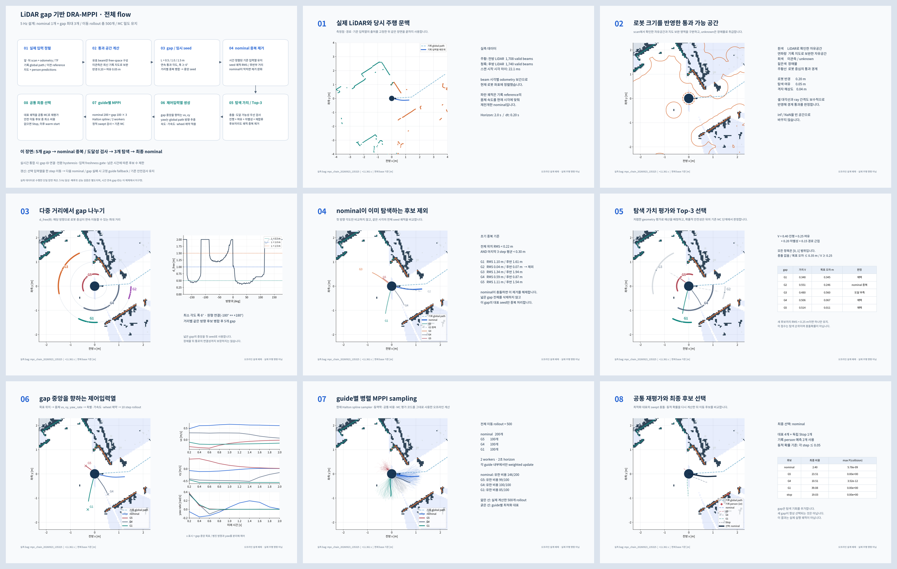

# LiDAR gap 기반 DRA-MPPI flow — 실제 기록 예제

2026-11-04 작성. 실제 bag `mpc_chain_20260923_135325`의 시작 후 **11.361초** 장면에서 계산했다. 모든 PNG는 수치 데이터로 그렸으며 장애물이나 gap을 그림용으로 추가하지 않았다. 원본 bag과 운영 planner는 수정하지 않았다.



## 파일

| PNG | 내용 |
|---|---|
| [00_overall_flow.png](00_overall_flow.png) | 전체 설계 flow와 실시간 통합 시 추가할 기능 |
| [01_recorded_lidar.png](01_recorded_lidar.png) | 실측 LiDAR·global path·기록 reference 기반 nominal |
| [02_free_space_and_clearance.png](02_free_space_and_clearance.png) | 자유공간·미관측·지도 보완·로봇 크기 |
| [03_multiscale_gaps.png](03_multiscale_gaps.png) | 다중 거리 gap과 방향별 도달 거리 |
| [04_nominal_deduplication.png](04_nominal_deduplication.png) | nominal과의 궤적 중복 제거 |
| [05_exploration_value.png](05_exploration_value.png) | 가치 점수와 후보 채택/제외 이유 |
| [06_control_sequence_seeds.png](06_control_sequence_seeds.png) | 실제 계산한 seed 궤적과 세 축 제어입력열 |
| [07_parallel_mppi_sampling.png](07_parallel_mppi_sampling.png) | 실제 500개 rollout과 guide별 대표 |
| [08_common_recheck_and_selection.png](08_common_recheck_and_selection.png) | 최종 공통 MC 재평가 및 선택 |
| [09_all_steps.png](09_all_steps.png) | 전체 그림 모아보기 |

## 1. 입력과 정렬

- 원본: `/home/smoc/2026amr_ws/bags/mpc_chain_20260923_135325`. record timestamp `1790139216947971159` ns.
- `/scan_front_carto`, `/scan_rear_carto`는 기록된 측정 range와 beam timing을 그대로 사용한다. 유효한 finite return만 사용하며 inf/NaN을 free로 채우지 않는다.
- 해당 snapshot까지 수신된 `/odometry/filtered`만 사용한다. 각 beam의 `header + index*time_increment`에 odometry를 보간하고 기록 TF로 sensor→base→odom→현재 base를 변환한다. 마지막 odometry 시각 뒤 beam은 버린다. odometry의 첫/끝 밖 값을 외삽해 살리지 않는다.
- 현재 속도 `[vx,vy,yaw_rate] = [0.0297, -0.0017, -0.094]`. 기준 pose epoch는 `1790139216.937768221` s이다.
- 기록 `/global_path`는 당시 map→odom TF로 정렬하고 가장 가까운 waypoint부터 최대 80점을 사용한다.
- 기록 `/dra_mppi/reference_trajectory`의 몸체 속도를 현재 horizon 시각으로 보간하고 운동 제약을 다시 적용한다. **이 nominal은 당시 planner 내부 warm start를 복원한 값이 아니다.** 저장된 외부 reference를 이용한 재구성이다. 기록 horizon 끝 뒤는 마지막 제어를 유지한다.

## 2. gap 정의

각 scan에서 연속 유효 beam 두 개 사이를 자유공간으로 rasterize한다. 두 range 차이가 0.25 m보다 크면 가림 경계로 보고 연결하지 않는다. 연결할 때 두 range 중 작은 값에서 0.04 m를 빼므로 장애물 뒤를 채우지 않는다. 8×8 m, 해상도 0.04 m grid에 finite hit를 장애물로 넣는다.

앞·뒤 센서의 원점과 마스킹 섹터가 다르기 때문에 가까운 측면에 관측 틈이 생긴다. 그 틈을 임의로 free로 만들지 않고 **기록 `/traversable_map_grid`의 알려진 free cell로 보완**한다. 지도 age는 0.132 s이며 1초 초과면 예제를 거부한다. LiDAR 또는 지도에서 occupied인 cell은 occupied가 우선이다. 흰색=scan free, 연파랑=map 보완 free, 회색=unknown이다. 이는 순수 scan-only 버전과 구별되는 설계 선택이다.

EDT에서 cell 대각선을 빼고, 로봇 반경 0.20 m + 탐색 여유 0.05 m + ray 간격 padding 0.01 m를 적용한다. 방향은 1°, 거리는 0.02 m 간격으로 검사한다. 시작점부터 계속 통과되는 최대 거리가 `d_free(θ)`다. 중간 장애물 뒤의 free는 연결하지 않는다.

`d_free(θ) >= L`인 연속 각도 구간을 gap으로 정의한다. L은 0.5, 1.0, 1.5 m, 최소 폭은 6°이며 ±180° 경계도 연결한다. 중심 방향 차이가 12° 미만이고 각도 구간이 겹치는 거리별 후보는 먼 거리 후보부터 병합한다. 이 gap은 로봇 중심의 관측 가능한 접근 방향이며 전역 homotopy class나 장애물 뒤 연결성을 뜻하지 않는다.

## 3. nominal 중복 제거

각 gap 중앙 목표로 제약을 지키는 seed를 먼저 만든다. 따라서 flow의 04~05단계에서도 저렴한 seed rollout은 필요하고, 06단계는 채택된 seed를 확정·표시하는 단계다.

같은 미래 시각의 seed와 nominal 위치를 비교해 RMS<0.22 m **그리고** 마지막 3 step 평균 거리<0.30 m이면 그 대표 seed를 중복으로 처리한다. nominal의 swept collision이 있으면 이 제거를 해제한다. 넓은 gap 전체를 탐색 불필요로 선언하는 것은 아니다. 이 거리 기준은 초기 실험값이며 실제 noise 분산으로 보정해야 한다.

## 4. 탐색 가치

먼저 seed swept collision 및 horizon 끝의 목표 오차>0.35 m를 제외한다. 남은 후보는 아래 명시적 점수로 순위를 매긴다.

`V = 0.40 P + 0.25 C + 0.20 D + 0.15 R`

- P = clip(초기 local path 방향으로의 종단 이동 / 1.5 m, 0, 1).
- C = clip(seed의 최소 swept footprint 여유 / 0.4 m, 0, 1).
- D = clip(nominal과의 위치 RMS / 0.8 m, 0, 1).
- R = exp(-종단점의 기록 path waypoint까지 최소 거리 / 0.6 m).

V≥0.25인 후보를 높은 순서로 검토한다. 이미 채택한 gap seed와 RMS<0.25 m이면 중복으로 제외하며 최대 3개를 남긴다. P/R은 저렴한 근사이며 굽은 경로에서는 선분 투영·arc progress로 개선할 수 있다. 이 점수는 충돌확률이 아니다. 이 단일 예제에서는 시간 지속성/동적 위험의 사전 점수를 만들지 않았고, 기록 person 예측을 이용한 기존 MC를 모든 MPPI rollout과 최종 대표에 적용했다.

| gap | 중앙 각도 | L m | 각도 폭 | nominal RMS m | 목표 오차 m | V | 판정 |
|---|---:|---:|---:|---:|---:|---:|---|
| G1 | -101° | 1.5 | 31° | 1.098 | 0.345 | 0.348 | 채택 |
| G2 | -10° | 1.5 | 20° | 0.041 | 0.246 | 0.551 | nominal 중복 |
| G3 | 154° | 1.5 | 78° | 1.340 | 0.560 | 0.480 | 도달 부족 |
| G4 | -57° | 1.0 | 119° | 0.585 | 0.067 | 0.506 | 채택 |
| G5 | 138° | 0.5 | 132° | 1.108 | 0.011 | 0.514 | 채택 |

## 5. seed와 MPPI

병진 속도는 gap 중앙을 향하며 목표까지의 거리/0.6초와 원하는 속도 0.75 m/s 중 작은 값으로 정한다. yaw는 global path 접선을 따른다. 매 step 기존 `_constrain_controls`로 축별 속도·가속도·wheel L1 제약을 적용한다.

기존 `GuideConditionedOptimizer`를 offline subclass로 감싸 `anchors()`와 `allocate()`만 바꿨다. `['nominal', 'G5', 'G4', 'G1']`에 `[200, 100, 100, 100]`개, 합계 500개를 배정한다. 기존 Halton spline noise, 2 workers, guide별 weighted update, 정적 swept 검사, 8배 MC density와 최종 공통 재평가는 유지한다. 다른 gap의 제어열끼리 평균하지 않는다.

`/dra_mppi/predictions_used`의 기록 객체를 현재 노드의 `_aligned_predictions`로 다시 age/filter/시간보간/좌표변환했다. 이번 계산에 사용된 예측 객체는 2개다. 기록에서 stationary safety-disc로 표현된 객체는 움직이는 보행자로 새로 꾸미지 않았다. scan hit를 snapshot 동안 정적 장애물로 쓰므로 사람이 scan에도 있으면 정적·동적 비용에 동시에 반영될 수 있다.

## 6. 최종 선택 결과

| 후보 | 최종 비용 | step 최대 충돌확률 |
|---|---:|---:|
| nominal | 2.40275 | 0.000000 |
| G5 | 23.51239 | 0.000000 |
| G4 | 10.51142 | 0.000000 |
| G1 | 39.07508 | 0.000000 |
| stop | 19.02625 | 0.000000 |

최종 선택은 **nominal**, 상태는 `ok`다. 기존 정책대로 안전한 이동 후보가 있으면 Stop보다 우선한다. gap의 목적은 대안 탐색이지 새 후보의 강제 선택이 아니다. 이 결과를 실제로 로봇이 실행한 궤적이나 기존 방식 대비 성능 향상으로 해석하면 안 된다.

## 7. 5 Hz 적용 계획과 실제 측정 범위

5 Hz는 200 ms 주기다. 운영 목표는 총 rollout 500 고정, gap 최대 3, worker 2 유지다. scan 전처리/EDT는 최신 입력 cache로 분리하고, cycle에는 고정 snapshot과 추출한 gap을 넘기는 구성이 적절하다. gap 변경이 작으면 ID·seed를 유지하고 여유 시간이 부족하면 다음 cycle의 gap 수부터 줄인다. MC 밀도·최종 재검사를 줄여 시간을 맞추지는 않는다.

이번 **단일 cold offline 실행**의 참고 wall time:

- 입력 정렬·scan/map grid·거리 계산: 31.24 ms.
- 후보 seed·중복·점수·선정: 14.13 ms.
- 기존 MPPI sampling/MC/최종 재검사: 87.05 ms.

bag I/O, PNG rendering, ROS TF 조회/publish, 실제 perception/MPC 동시 부하는 포함하지 않는다. 최초 sampler/controller 준비 시간도 일부 proposal 시간에 들어 있다. **p99나 5 Hz 보장 값이 아니다.** 그림 생성을 완료하려고 offline optimizer timeout은 10초로 두었고 운영 0.18초 timeout과 구분했다. 기존 timeout은 실행 중인 Python worker를 즉시 중단하지 못한다.

실시간 통합 전에는 gap의 odom 기준 ID 매칭, split/merge 처리, 상태별 hysteresis, path/odom/prediction freshness gate, gap 추출 실패 시 기존 fixed-guide fallback을 추가해야 한다. map/prediction 등 필수 안전 입력 자체가 stale이면 기존 hold 정책을 따라야 한다. `G1` 등의 이름은 이 snapshot 안의 번호이며 시간 연속 ID가 아니다.

## 재현

저장소 루트에서:

```bash
source /opt/ros/jazzy/setup.bash
source /home/smoc/2026amr_ws/install/setup.bash
OPENBLAS_NUM_THREADS=1 OMP_NUM_THREADS=1 /usr/bin/python3 \
  planner/local_planner/DRA_MPPI/tools/render_lidar_gap_flow.py \
  --bag /home/smoc/2026amr_ws/bags/mpc_chain_20260923_135325 \
  --offset 11.360775
```

`--inspect`는 같은 bag의 2초 간격 후보 장면을 검사한다. 그림 설명에 적합하도록 중복 제거와 도달성 제외가 함께 나타나는 장면을 선택했으며, 성공률 평가용 무작위 표본은 아니다.

`manifest.json`에 입력 시각·TF 정렬 기준·설정·후보별 수치·최종 비용·소스 해시를 기록했다. `snapshot_and_results.npz`에는 사용한 실제 scan range/유효 mask/정렬된 point, grid, nominal, 500개 제어열과 최종 결과를 저장했다. 원본 bag 재생 없이도 그림의 수치 검토가 가능하다. ZIP에는 PNG·보고서·수치와 생성 스크립트가 함께 들어 있다. 스크립트 실행에는 이 저장소의 planner 모듈과 ROS 환경이 필요하다.
