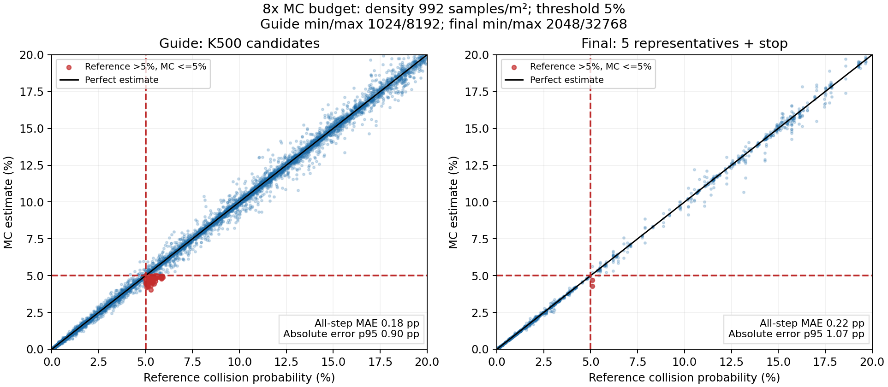

# MC 표본 예산과 Theta* 계산시간 — 2026-10-23

MC는 원형 충돌영역 안의 확률을 점으로 재는 방법이다. 지금 예산은 점이 적어
5% 근처 판정이 흔들린다. 점을 늘리면 오차가 줄지만 PDF 계산과 후보-표본 비교가
함께 늘어난다. 밀도와 최소·최대 표본 예산을 현재의 1/2/4/8/16/32배로 비교했다.
실험 당시에는 운용 YAML을 유지했다. 후속 사용자 요청으로 **운용 YAML과 설치본에 8배 예산을 적용했다**.

## 측정 범위

- 기존 `validate_current_mc.py`의 동일 분포와 후보 사용: 40개 확률 분포,
  5개 공유 영역 크기, 8개 scramble; 실제 K500 fan/최종5대표+Stop은 초기 yaw
  0/-70/180도, 횡단1/정면5/평행10/다중모드20, 4개 scramble, N10, dt.2.
  1배 결과도 같은 반복 수로 새로 계산했으므로 이전 8/16회 반복 보고서와 다르다.
- 기준값은 Gaussian 확률모델의 원형 영역 적분이다. 등방은 ncx2 CDF,
  이방은 독립 polar quadrature. 실제 사람의 미래 위치와 충돌 실측 정확도는 아니다.
- 각 배율에서 최소/최대 cap도 같은 배율로 증가시켰다. 따라서 guide가 허용하는
  최대 영역(cap/density)은 변하지 않는다. 큰 영역(span1/2m)에서 guide가 CP=1로
  reject되는 것은 표본 적분 성공이 아니다. `point` 요약은 reject 평가를 제외하고,
  `point_span`은 reject까지 포함해 별도 저장했다. 실제 K500 영역에서는 reject 없음.
- 정확도 수백만 개 candidate-step 값은 동일 환경의 반복값이며 독립적인 주행 횟수가 아니다.
  최종 대표는 위험비용 OFF로 형상을 고정해 평가했다. 실제 최적화·최종 선택 성공률 시험은 아니다.
- 시간은 실제 controller(정적 검사/최종 재평가 포함), K500/worker2,
  회전 이방 covariance `[[.05,.025],[.025,.025]]`, 2 modes, 장애물5/10/20.
  매번 nominal reset, 2 warmup+5 측정, BLAS/OMP threads1. 다른 CPU 실험과 겹치지 않았다.
  offline timeout10s로 완주 시간을 관찰했고 생산 timeout .18s와 구분한다.
  평균/최대만 보고하며 짧은 5개 값으로 p99 성능을 주장하지 않는다.

## 정확도와 계산시간

아래 오차는 실제 후보 형상에 대한 최종 대표/Stop의 step별 절대 오차다.
%p는 확률 차이다(5%→6%는 1%p).

| 예산 | 실제 guide 표본/step | 실제 final 표본/step | final 평균 오차 | final 오차 p95 | final 최대 오차 | 장애물20 전체 계산 평균 / 최대 |
|---|---:|---:|---:|---:|---:|---:|
| 1배 | 128~425 | 256~620 | 1.21%p | 5.77%p | 18.51%p | 33.7 / 35.5 ms |
| 2배 | 256~849 | 512~1,240 | 0.69%p | 3.15%p | 11.12%p | 44.7 / 44.9 ms |
| 4배 | 512~1,698 | 1,024~2,479 | 0.41%p | 2.01%p | 6.46%p | 68.3 / 69.6 ms |
| 8배 | 1,024~3,396 | 2,048~4,958 | 0.22%p | 1.07%p | 3.98%p | 124.1 / 127.0 ms |
| 16배 | 2,048~6,792 | 4,096~9,915 | 0.13%p | 0.61%p | 2.02%p | 251.6 / 269.6 ms |
| 32배 | 4,096~13,583 | 8,192~19,830 | 0.07%p | 0.35%p | 1.17%p | 508.2 / 525.2 ms |

Guide 1차의 오차 p95는 1/2/4/8/16/32배 순서로
5.15/2.92/1.60/0.91/0.52/0.30%p였다.
32배에서도 guide 최대 오차는 1.74%p, 별도 고정점 시험에서는 1.70%p였다.
오차는 표본 배율에 따라 모든 개별 사례에서 단조 감소하지 않으며 scramble에도 의존한다.

5% 초과를 5% 이하로 잘못 추정한 final step 수는 각 배율에서
12/12/5/2/3/0건(각각 위험 step1488개 중)이다.
기준≥6%인 경우만 보면 6/3/0/0/0/0건이었다.
이 수는 step 오류이고 전체 궤적의 잘못된 통과 횟수는 아니다.

## 어느 정도면 괜찮은가

사용자가 허용 오차를 정한 것은 아니므로 아래는 측정에 근거한 절충 해석이다.

- **8배는 속도와 정확도의 절충 후보**다. final p95 약1.07%p, 최대3.98%p;
  이번 평가에서 기준≥6%인 위험 step을 5% 이하로 낮게 추정한 경우는 0건이었지만,
  5% 바로 주변의 오분류는 남는다. 안전 정확도가 충분하다는 승인은 아니다.
- **오차 p95를 0.5%p 아래로 낮추려면 시험한 단계에서는 32배**가 필요했다.
  Guide p95 .30%p/final .35%p이고 final 최대1.17%p였다. 모든 경우의 오차를
  0.5%p 이하로 보장한다는 뜻은 아니며, 본 시험에 대한 결과다.
- 현 Python 구현에서 16배는 장애물20 계산만 약252ms, 32배는 약508ms로
  200ms 예산을 넘는다. 16배 장애물5도 최대180.3ms여서 실제 .18s timeout
  여유가 없다. 표본을 계속 늘리는 방법만으로 정확도와 5Hz를 모두 해결하기 어렵다.
- `mc_samples` 하나만 올려서는 adaptive 모드 예산이 바뀌지 않는다.
  밀도와 guide/final 최소·최대값을 같이 다뤄야 한다.

후속 요청으로 YAML에 적용한 8배 설정:

```yaml
dynamic_risk.mc_sample_density: 992.0
dynamic_risk.mc_samples_min: 4096
dynamic_risk.mc_samples_max: 32768
dynamic_risk.guide_mc_sample_density: 992.0
dynamic_risk.guide_mc_samples_min: 1024
dynamic_risk.guide_mc_samples_max: 8192
dynamic_risk.final_mc_sample_density: 992.0
dynamic_risk.final_mc_samples_min: 2048
dynamic_risk.final_mc_samples_max: 32768
```

Common(MC) 예산도 배율 적용하지만 현재 split guide 운용에서는 guide/final 예산이 주로 쓰인다.
위 값은 이번 실행한 영역의 값이며 guide cap은 영역 약8.26m²까지만 밀도를 수용한다.
넓은 영역은 cap 재설계 또는 기존 conservative reject 정책 확인이 필요하다.

짧은 ROS 검증: 8배, K500, 장애물20×2mode, 이방 분포, static ON,
운용 timeout .18s, warm10+측정50주기, 모든50 정상, timeout0, >200ms0.
콜백 평균130.25ms/p99 **137.16ms**/최대139.55ms,
예정시각→발행 p99146.14ms, 발행 간격 p99206.57ms.
Domain173 localhost, publish_cmd_vel=false, fixture/planner/subscriber만 실행했다.
50주기 결과로 장기/full perception/MPC 동시 부하를 보장하지 않는다.

실제 계산량(동일한 timing fixture 장애물20):

| 예산 | 1차 총 표본/주기 | 최종 총 표본/주기 | 1차 후보-표본 비교/주기 | 1차 Gaussian PDF 평가/주기 |
|---|---:|---:|---:|---:|
| 1배 | 12,121 | 3,803 | 1,212,100 | 484,840 |
| 2배 | 24,220 | 7,537 | 2,422,000 | 968,800 |
| 4배 | 48,419 | 15,046 | 4,841,900 | 1,936,760 |
| 8배 | 96,810 | 30,087 | 9,681,000 | 3,872,400 |
| 16배 | 193,594 | 60,170 | 19,359,400 | 7,743,760 |
| 32배 | 387,166 | 120,338 | 38,716,600 | 15,486,640 |

표본 수는 5guide×10step을 합친 주기 총합이다. 각 guide에 이동후보100개가 있으므로
1차 비교량은 총표본수×100이다. 최종 영역은 MC 오차로 대표가 바뀌면서 약간 달라진다.

## Theta*: 최초 전역 경로 생성과 재계획

실행 중인 전역 계획 노드/실제 pose·goal이 없어 **저장된 두 실제 지도에서 재현 측정**했다.
robot_size=.4m, resolution .05m, waypoint_interval .1m, 실제 node의
`_on_goal`과 `_validate_current_path`→`_attempt_replan` 콜백을 직접 호출했다.
현재 pose/사용 costmap은 fixture로 고정하고 TF 대기는 제외했다.
발행 메시지 생성/publish 호출까지 포함하되 DDS 수신·대기시간은 포함하지 않는다.
운용 노드 코드와 설정은 바꾸지 않았다.

각 지도에서 최대 free component의 재현 가능한 시작점과 3m/먼 목표를 선택했다.
8m 목표를 요청했지만 지도의 도달 가능한 최대 직선거리는 smoc6.89m/imu6.84m였다.
먼 경로는 장애물을 우회한다. 재계획은 원래 경로 중간에 반경.2m 장애물을 추가해 유발했다.
각 조건3회, 전부 성공. 아래는 평균(괄호는 최대)이다.

| 지도 / 목표 직선거리 | 최초 생성 | 막힌 경로 재계획 |
|---|---:|---:|
| smoc_lab / 3.0m | 18.9 (19.2) ms | 40.0 (40.4) ms |
| smoc_lab / 6.89m | 628.5 (636.4) ms | 758.7 (760.1) ms |
| test_imu_scan / 3.0m | 18.7 (18.9) ms | 39.7 (40.0) ms |
| test_imu_scan / 6.84m | 699.1 (699.4) ms | 766.8 (771.8) ms |

최초/재계획 모두 Theta*를 처음부터 탐색하며 이전 탐색 결과를 갱신하는 incremental
planner가 아니다. 먼 목표는 Theta* 탐색 자체에 약627~698ms,
재계획은 약757~765ms가 들었고 나머지 변환·검사·발행은 약1~2ms였다.
저장지도 읽기+초기 inflation 별도 시간: smoc12.05ms/imu2.87ms.
새 장애물 costmap inflation 시간은 theta_raw.json에 별도 기록했다.

**재계획 검사 주기가 현재1Hz**다. 따라서 지도에 장애물이 반영된 뒤 검사 시작까지
0~약1초가 추가될 수 있다. 먼 목표의 경우 이 대기와 계산을 합치면 약0.76~1.77초가
될 수 있지만, 실제 end-to-end 감지 지연을 측정한 수치는 아니다.
센서/지도 갱신·TF·ROS queue·다른 노드 부하는 추가 요인이다.
목표 거리뿐 아니라 벽/통로/막힌 경로 구조가 탐색시간을 크게 바꾼다.
3회로 운영 p99나 모든 지도의 최대시간을 주장하지 않는다.

## 원시 자료와 재현

- [정확도/표본/오분류](accuracy.json), [모듈 시간/계산량](timing.json)
- [8배 ROS 결과](ros_x8/summary.json), [Theta* 결과](theta/theta_summary.json), [Theta* raw](theta/theta_raw.json)
- accuracy_points_x*.csv / accuracy_candidates_x*.csv: 각 단계의 모든 원시 비교값
- parameters.yaml: 변경하지 않은 실행 당시 운영 YAML

패키지 tools/check_mc_budget.py의 `--stage accuracy`와 `--stage timing`을
별도 실행했다. Theta*는 global_planner/tools/check_theta_timing.py를 domain174에서
실행했다. 버전과 소스 hash는 manifest.json에 있다. 그림은 절충 추이를 요약한다.

## 후속 변경: 8배 적용과 비교 그림

기본 mode는 `monte_carlo`로 유지하고 밀도/guide/final/common 최소·최대 예산을
8배로 적용했다. adaptive 모드에서 사용하지 않는 fixed `mc_samples: 2048`은 유지했다.



가로축은 Gaussian 모델의 기준 확률, 세로축은 MC 추정이다.
검은 대각선에 가까울수록 정확하다. 대각선 아래는 낮게, 위는 높게 추정한 점이다.
빨간 점선은 5% 기준이다. 오른쪽 아래 빨간 점은 기준확률은 5%를 넘는데 MC는
5% 이하로 본 step이다. 전체 궤적의 최종 통과나 실제 충돌 횟수를 뜻하지 않는다.
왼쪽 패널은 guide 1차, 오른쪽은 최종 대표/Stop이다.
보기 쉽게 확률0~20%만 표시했고 guide 파란 점은 최대2만 개로 추렸다.
빨간 점은 표시 범위 내 해당 사례를 전부 겹쳐 그렸고, 오차 통계는 전체 값으로 계산했다.

기존 `docs/current_mc_accuracy_2026-10-22/probability_comparison.png`도 같은
8배 그림으로 교체했으며 1배 그림은 이름에 `_density124`를 붙여 보존했다.

## Theta* 추가 확인: 거리 대비 시간이 커진 이유

앞선 시간표는 같은 직선 통로의 거리만 늘린 비교가 아니었다.
3m 목표는 직선으로 연결됐고, 먼 목표는 벽/장애물을 우회해야 했다.
실제 알고리즘의 확장 처리·직선 시야 검사 작업량을 별도 계수했다.
계수용 wrapper는 운영 코드를 바꾸지 않았고, 이 계수 실행의 시간은 원래 성능 측정에 섞지 않았다.
확장 횟수는 get_neighbors 호출 횟수이며 동일 노드의 재처리 가능성을 포함한다.

| 지도·조건 | 목표 직선거리 | 결과 경로 길이 | 확장 처리 횟수 | 직선 시야 검사 호출 | 시야 검사 중 격자 확인 수 |
|---|---:|---:|---:|---:|---:|
| smoc_lab | 3.00m | 3.00m | 60 | 421 | 12,880 |
| smoc_lab | 6.89m | 7.95m | 4,304 | 15,916 | 407,384 |
| test_imu_scan | 3.00m | 3.00m | 60 | 421 | 12,880 |
| test_imu_scan | 6.84m | 8.07m | 4,940 | 17,691 | 468,893 |

smoc_lab의 거리비는 약2.30배지만 확장 횟수는71.7배,
시야 검사 중 격자 확인은31.6배로 늘었다. 측정시간이 약33배 늘어난 것과 맞는 양상이다.
같은 먼 시작·목표에서 장애물을 제거한 대조군은 확장279회였다
(장애물 있는 경우4304회). test_imu_scan도 장애물 제거 시448회, 원래 지도4940회였다.
즉 거리만으로 늘어난 계산이 아니라 장애물과 통로 구조가 탐색을 크게 늘렸다.

Theta*는 후보 노드를 확장할 때마다 parent에서 이웃까지 직선 연결이 가능한지
확인한다. 현 `utils.is_line_of_sight_clear`는 그 선 위 격자를 Python 반복문으로
차례로 확인하고, 벽 때문에 직선 후보가 실패하면 다른 경로 후보들을 더 탐색한다.
따라서 목표 거리에 선형 비례하는 실행시간을 기대할 수 없다.
이는 별도 단순 거리 sweep 결과가 아니라 이번 두 목표의 구조 차이를 설명하는 계수다.
원시 계수와 장애물 제거 대조군은 [search_work.json](theta/search_work.json)에 있다.
