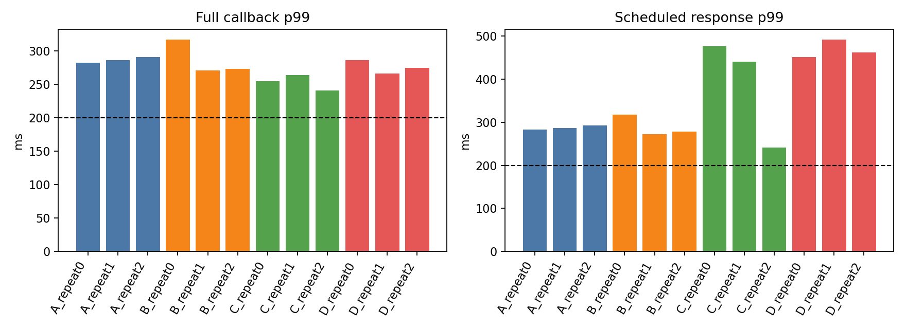
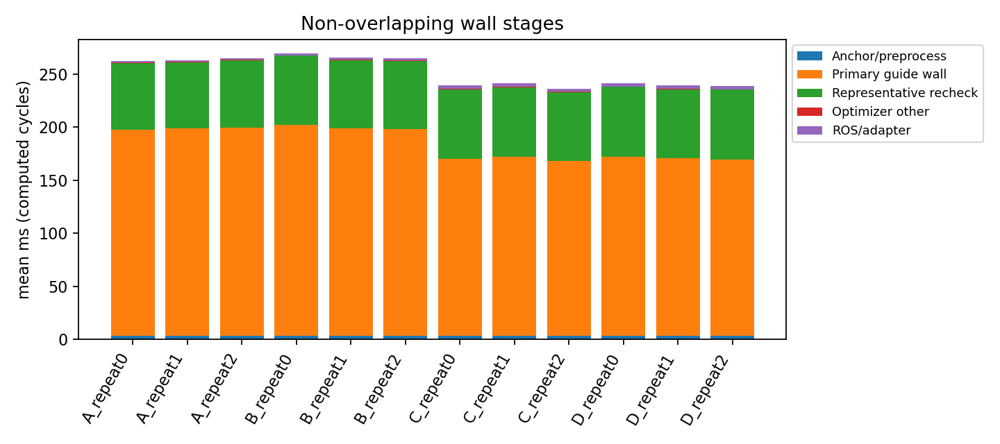
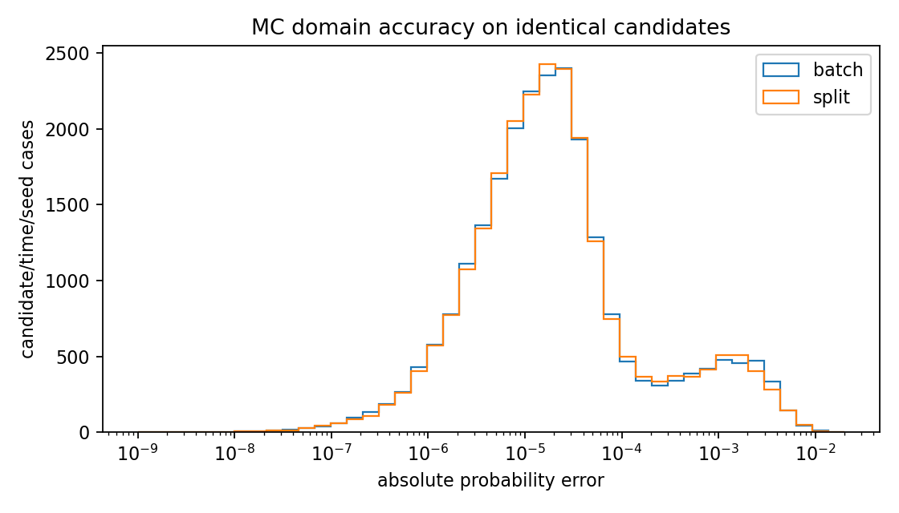
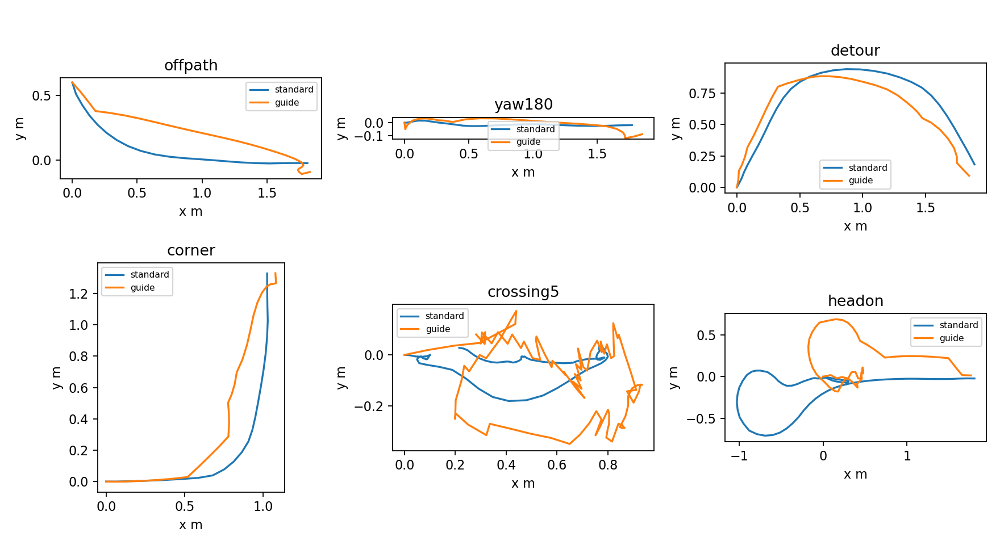

# NUC 검증 결과 — 2026-10-22

**Guide 5Hz 목표 미달.** 운영 설정의 장애물5개·3000 cycle은 callback p99
204.92ms, 예정 시각→발행 p99 372.93ms, timeout2992/stale hold8회였다.
정지 reference 발행을 주행 성공으로 세지 않았다. 빌드·178개 테스트는 통과했다.

원시 cycle의 NumPy `percentile(method="linear")`로 각 run을 따로 계산했다. 조기 반환·stale·timeout을 전체 callback 통계에서 제외하지 않았다. 계산이 실제 수행된 cycle의 callback 통계와 상태별 통계는 [timing_summary.json](timing_summary.json)에 별도로 있다.

| Run | 전체/MPPI 시도/결과 객체 | mean | p50 | p95 | p99 | max | >200 ms | timeout | skip |
|---|---:|---:|---:|---:|---:|---:|---:|---:|---:|
| guide_warm_dynamic10 | 100/70/70 | 165.49 | 234.71 | 239.94 | 245.72 | 249.69 | 70/100 | 0 | 0 |
| guide_warm_dynamic5 | 100/100/100 | 191.55 | 191.57 | 198.18 | 201.87 | 207.22 | 2/100 | 0 | 0 |
| production_dynamic10 | 100/71/0 | 167.42 | 233.99 | 238.82 | 244.14 | 244.50 | 71/100 | 71 | 0 |
| production_dynamic20 | 100/91/0 | 188.88 | 207.47 | 212.77 | 216.77 | 219.89 | 91/100 | 91 | 4 |
| production_dynamic5 | 3000/2992/0 | 195.45 | 195.79 | 200.55 | 204.92 | 238.54 | 197/3000 | 2992 | 0 |
| production_static | 300/300/300 | 14.42 | 14.23 | 15.50 | 16.65 | 25.72 | 0/300 | 0 | 0 |
| ros_abcd/A_repeat0 | 100/50/50 | 131.47 | 128.07 | 273.08 | 283.02 | 299.20 | 50/100 | 0 | 0 |
| ros_abcd/A_repeat1 | 100/50/50 | 131.79 | 127.48 | 272.87 | 286.72 | 297.96 | 50/100 | 0 | 0 |
| ros_abcd/A_repeat2 | 100/50/50 | 132.71 | 126.11 | 279.09 | 291.50 | 291.77 | 50/100 | 0 | 0 |
| ros_abcd/B_repeat0 | 100/50/50 | 134.97 | 130.09 | 284.95 | 317.19 | 321.12 | 50/100 | 0 | 0 |
| ros_abcd/B_repeat1 | 100/50/50 | 132.93 | 130.21 | 270.73 | 271.46 | 273.49 | 50/100 | 0 | 0 |
| ros_abcd/B_repeat2 | 100/50/50 | 132.67 | 128.86 | 269.50 | 273.20 | 277.91 | 50/100 | 0 | 0 |
| ros_abcd/C_repeat0 | 100/70/70 | 167.60 | 236.38 | 247.54 | 255.04 | 257.52 | 70/100 | 0 | 7 |
| ros_abcd/C_repeat1 | 100/66/66 | 159.34 | 238.04 | 246.85 | 263.91 | 289.29 | 66/100 | 0 | 6 |
| ros_abcd/C_repeat2 | 100/50/50 | 118.32 | 117.06 | 238.82 | 241.16 | 243.79 | 50/100 | 0 | 0 |
| ros_abcd/D_repeat0 | 100/73/73 | 176.19 | 235.63 | 275.60 | 286.46 | 295.89 | 73/100 | 0 | 8 |
| ros_abcd/D_repeat1 | 100/84/84 | 200.98 | 236.62 | 250.41 | 266.71 | 270.53 | 84/100 | 0 | 14 |
| ros_abcd/D_repeat2 | 100/77/77 | 183.93 | 234.73 | 246.63 | 274.68 | 285.55 | 77/100 | 0 | 9 |
| standard_dynamic10 | 100/100/100 | 142.17 | 140.98 | 150.10 | 152.21 | 153.02 | 0/100 | 0 | 0 |

단위 ms. 결과 객체 수에는 비용 평가를 마친 뒤 입력 만료로 폐기한 cycle을 포함한다. timeout은 MPPI 시도에 포함하지만 결과 객체는 없다. 전체 wall 통계와 timeout 수에 모두 포함하며, 결과 객체 0개를 계산을 하지 않았다는 뜻으로 해석하면 안 된다.

| Run | 시작 지연 p99 | 예정 시각→발행 p99 | 발행 간격 p99/max | 수신 간격 p99 | 상태 수 |
|---|---:|---:|---:|---:|---|
| guide_warm_dynamic10 | 130.11 | 328.12 | 394.96/395.25 | 395.21 | {'expired_input': 42, 'stale_odom': 30, 'normal': 28} |
| guide_warm_dynamic5 | 10.80 | 201.28 | 212.07/214.71 | 211.98 | {'normal': 95, 'expired_input': 5} |
| production_dynamic10 | 124.95 | 323.01 | 400.23/405.18 | 400.38 | {'timeout': 71, 'stale_odom': 29} |
| production_dynamic20 | 218.65 | 424.94 | 369.69/371.69 | 369.85 | {'timeout': 91, 'stale_odom': 9} |
| production_dynamic5 | 176.76 | 372.93 | 209.89/349.04 | 209.84 | {'timeout': 2992, 'stale_odom': 8} |
| production_static | 0.41 | 13.80 | 200.94/205.34 | 200.97 | {'normal': 300} |
| ros_abcd/A_repeat0 | 83.69 | 283.22 | 418.96/419.99 | 419.11 | {'stale_odom': 50, 'expired_input': 50} |
| ros_abcd/A_repeat1 | 87.46 | 286.92 | 424.46/429.66 | 424.51 | {'stale_odom': 50, 'expired_input': 50} |
| ros_abcd/A_repeat2 | 92.40 | 292.03 | 428.96/433.05 | 428.96 | {'stale_odom': 50, 'expired_input': 50} |
| ros_abcd/B_repeat0 | 118.00 | 317.31 | 456.40/458.19 | 456.49 | {'stale_odom': 50, 'expired_input': 50} |
| ros_abcd/B_repeat1 | 72.18 | 271.76 | 406.94/407.95 | 407.03 | {'stale_odom': 50, 'expired_input': 50} |
| ros_abcd/B_repeat2 | 78.72 | 278.19 | 410.84/414.34 | 410.96 | {'stale_odom': 50, 'expired_input': 50} |
| ros_abcd/C_repeat0 | 238.98 | 476.18 | 408.47/409.58 | 408.48 | {'expired_input': 33, 'normal': 37, 'stale_odom': 30} |
| ros_abcd/C_repeat1 | 216.75 | 440.64 | 429.01/444.57 | 428.99 | {'expired_input': 34, 'stale_odom': 34, 'normal': 32} |
| ros_abcd/C_repeat2 | 41.68 | 241.28 | 404.91/406.47 | 405.05 | {'stale_odom': 50, 'expired_input': 34, 'normal': 16} |
| ros_abcd/D_repeat0 | 229.55 | 451.39 | 437.04/439.71 | 436.99 | {'normal': 34, 'expired_input': 39, 'stale_odom': 27} |
| ros_abcd/D_repeat1 | 250.20 | 491.54 | 423.15/425.27 | 423.48 | {'normal': 44, 'stale_odom': 16, 'expired_input': 40} |
| ros_abcd/D_repeat2 | 239.37 | 461.69 | 427.10/432.80 | 427.23 | {'normal': 39, 'expired_input': 38, 'stale_odom': 23} |
| standard_dynamic10 | 11.83 | 150.74 | 210.59/222.05 | 210.62 | {'normal': 100} |

100-cycle pilot의 p99는 사실상 상위 두 표본에 좌우된다. 독립 표본을 가정해도 100개 표본의 max가 모집단 p99 아래일 확률은 0.99^100≈36.6%다. timer cycle에는 자기상관도 있으므로 이 표를 안정된 장기 tail 추정으로 해석하지 않는다. 3000-cycle 실행도 1회이며 조건별 3회 반복 및 실제 전체 stack 부하는 미완료다.

A=batch/common MC, B=split/1 worker, C=split/2, D=split/5. A/B/C/D는 timeout=10s로 전체 계산을 관측했고 입력이 만료된 결과는 폐기했다. production_*는 YAML의 0.18s timeout을 적용한다. K=100, N=10, dt=.2, 정적 검사/대표 재검사와 ε=.05를 유지했다. A/B/C/D 뒤 odom source stamp 및 moving prediction horizon 검사를 보강했다. 각 run의 source_sha256.json과 실제 parameter dump가 정확한 실행 버전이다.

ROS 입력은 고정 상태·경로·지도와 반복되는 합성 예측이며 header age의 DDS jitter는 남는다. 동일 snapshot의 B/C/D 수치 결정성은 별도 단위 테스트에서 검증했다. 실제 MPC·센서·인지 동시 부하, 실차 추종/충돌률은 측정하지 않았다.

단계 그래프는 계산 cycle의 mean wall time이다. worker별 시간 합을 stack에 더하지 않았다.

## MC 수치 정확도

최종 밀도 4096, 최소 4096, 최대 131072. 새 평가 seed 200..215. 등방 Gaussian은 비중심 χ² CDF, 이방 혼합은 독립 polar Gauss–Legendre 적분 (80/160 order 비교)을 기준으로 했다. 사전 기준은 [protocol.md](protocol.md).

| span m | MAE | 절대오차 p95 | max | false-safe / unsafe | margin false-safe / unsafe | empty |
|---:|---:|---:|---:|---:|---:|---:|
| 0.0 | 0.000357 | 0.001527 | 0.003230 | 0/160 | 0/128 | 0 |
| 0.5 | 0.000554 | 0.001920 | 0.005112 | 0/160 | 0/128 | 0 |
| 1.0 | 0.000534 | 0.001978 | 0.006552 | 0/160 | 0/128 | 0 |
| 2.0 | 0.000556 | 0.002223 | 0.004563 | 0/160 | 0/128 | 0 |

false-safe는 reference>.05인데 estimate≤.05, margin 분모는 reference≥.06이다. 분모는 수치 평가 사례 수이며 주행 사고 횟수가 아니다. 2048은 이전 평가에서 max=.01838로 사전 .015 기준을 실패해 제외했다. 4096의 최종 fixed-distribution suite는 기준을 통과했다.

| 실제 후보 yaw | MC 영역 | MAE | 절대오차 p95 | max | false-safe / unsafe | margin false-safe / unsafe |
|---:|---|---:|---:|---:|---:|---:|
| 0.0 | batch | 0.000398 | 0.002383 | 0.011774 | 4/2096 | 0/1920 |
| 0.0 | split | 0.000402 | 0.002283 | 0.009274 | 4/2096 | 0/1920 |
| -70.0 | batch | 0.000338 | 0.002248 | 0.011272 | 0/1408 | 0/1336 |
| -70.0 | split | 0.000310 | 0.002040 | 0.011809 | 0/1408 | 0/1336 |
| 180.0 | batch | 0.000023 | 0.000046 | 0.004521 | 0/56 | 0/40 |
| 180.0 | split | 0.000025 | 0.000044 | 0.007231 | 0/56 | 0/40 |

동일한 실제 rollout 후보, 서로 다른 장애물 반경·공분산 폭·2개 혼합모드를 사용했다. **ε 바로 근처 false-safe가 batch와 split 모두 4/2096 발생했다(yaw=0 조건).** margin .01 그룹에서는 관측하지 않았지만 안전 인증이 아니다. 추정 확률의 seed 변동과 유한 표본 오차가 남으며 calibration/폐루프 사고율은 별도다.

## 합성 폐루프

20개 기하/자세/예측 조건 × seed 101..103 × standard/guide. 실제 MPC를 포함하지 않은 ideal kinematic execution이며, 도달은 위치 오차<.15m로 판정한다. goal_near 결과가 최종 자세·속도 settle을 검증하는 것은 아니다. blocked는 도달 불가능한 대조 조건이다.

| 상황 | 방법 | 도달/시행 | 충돌 | 평균 도달/실패 시간 s | 평균 경로 오차 m | heading 오차 rad | guide 전환 |
|---|---|---:|---:|---:|---:|---:|---:|
| open | standard | 3/3 | 0 | 3.60 | 0.008 | 0.018 | 0 |
| open | guide | 3/3 | 0 | 3.73 | 0.028 | 0.055 | 2 |
| offpath | standard | 3/3 | 0 | 4.20 | 0.113 | 0.046 | 0 |
| offpath | guide | 3/3 | 0 | 4.40 | 0.202 | 0.109 | 4 |
| yaw_m70 | standard | 3/3 | 0 | 4.00 | 0.012 | 0.157 | 0 |
| yaw_m70 | guide | 3/3 | 0 | 4.20 | 0.027 | 0.156 | 8 |
| yaw_p90 | standard | 3/3 | 0 | 4.13 | 0.008 | 0.226 | 0 |
| yaw_p90 | guide | 3/3 | 0 | 4.20 | 0.031 | 0.213 | 8 |
| yaw180 | standard | 3/3 | 0 | 4.73 | 0.011 | 0.789 | 0 |
| yaw180 | guide | 3/3 | 0 | 4.80 | 0.039 | 0.544 | 9 |
| curve | standard | 3/3 | 0 | 4.40 | 0.016 | 0.039 | 0 |
| curve | guide | 3/3 | 0 | 4.87 | 0.045 | 0.124 | 3 |
| corner | standard | 3/3 | 0 | 4.60 | 0.030 | 0.182 | 0 |
| corner | guide | 3/3 | 0 | 4.93 | 0.106 | 0.302 | 14 |
| goal_near | standard | 3/3 | 0 | 0.67 | 0.004 | 0.018 | 0 |
| goal_near | guide | 3/3 | 0 | 0.20 | 0.002 | 0.008 | 0 |
| detour | standard | 3/3 | 0 | 6.13 | 0.049 | 0.238 | 0 |
| detour | guide | 3/3 | 0 | 6.67 | 0.119 | 0.280 | 16 |
| detour_right | standard | 3/3 | 0 | 6.20 | 0.036 | 0.241 | 0 |
| detour_right | guide | 3/3 | 0 | 7.00 | 0.115 | 0.322 | 14 |
| detour_large | standard | 3/3 | 0 | 8.33 | 0.043 | 0.264 | 0 |
| detour_large | guide | 3/3 | 0 | 9.47 | 0.095 | 0.279 | 19 |
| narrow | standard | 3/3 | 0 | 3.53 | 0.007 | 0.022 | 0 |
| narrow | guide | 3/3 | 0 | 3.80 | 0.023 | 0.064 | 0 |
| crossing5 | standard | 0/3 | 0 | 20.00 | 0.028 | 0.105 | 0 |
| crossing5 | guide | 1/3 | 0 | 19.73 | 0.128 | 0.194 | 165 |
| headon | standard | 3/3 | 0 | 15.40 | 0.269 | 0.213 | 0 |
| headon | guide | 3/3 | 0 | 11.67 | 0.227 | 0.137 | 72 |
| mixed | standard | 3/3 | 0 | 18.60 | 0.170 | 0.676 | 0 |
| mixed | guide | 3/3 | 0 | 17.53 | 0.259 | 0.455 | 71 |
| wide | standard | 0/3 | 0 | 20.00 | 0.056 | 0.141 | 0 |
| wide | guide | 0/3 | 0 | 20.00 | 0.114 | 0.185 | 183 |
| narrow_sigma | standard | 0/3 | 0 | 20.00 | 0.036 | 0.128 | 0 |
| narrow_sigma | guide | 2/3 | 0 | 18.73 | 0.371 | 0.213 | 124 |
| multimodal20 | standard | 0/3 | 0 | 20.00 | 0.029 | 0.103 | 0 |
| multimodal20 | guide | 0/3 | 0 | 20.00 | 0.173 | 0.242 | 166 |
| path_update | standard | 3/3 | 0 | 4.60 | 0.122 | 0.143 | 0 |
| path_update | guide | 3/3 | 0 | 4.80 | 0.175 | 0.234 | 14 |
| blocked | standard | 0/3 | 0 | 20.00 | 0.026 | 0.167 | 0 |
| blocked | guide | 0/3 | 0 | 20.00 | 0.037 | 0.107 | 219 |

최소 clearance, 입력 변화, 정지 시간, 위험 초과, 예외 사유는 [closed_loop_summary.json](navigation/closed_loop_summary.json), 실패 상세는 [failure_cases.json](navigation/failure_cases.json)에 있다. 튜닝 seed 3 및 상황 집합과 최종 seed 101..103을 분리했지만, 수동 scene의 전반적인 일반화·실차 성능 우월성을 주장할 수 없다.

## 해석과 재현

- A/B/C/D는 동일 guide 후보의 batch/split 비교이며 standard와 구별한다.
- C는 callback tail에서 유리했지만 scheduling 응답은 더 나빠진 반복도 있다.
- A repeat0 primary MC 표본186124/후보-표본 비교18612400, B/C/D repeat0
  표본340915/비교6818300이었다. 분할은 총 표본 수를 늘리고 비교량을 줄였다.
- production_dynamic20의 낮아진 시간은 primary worker timeout에서 중단된 결과다.
  최종 대표를 검사해 통과한 빠른 주행 결과가 아니다.
- standard는 MC 진단을 수정한 뒤 재측정했다. 수정 전 원본은 before_diagnostic_fix에 있다.
- Jazzy 설치본에 TimerInfo가 없어 예정 시각은 monotonic 초기 timer phase로 추정했다.
  커널 timer dispatch trace가 아니다.
- 온도/주파수/RSS/thread 추이는 run별 telemetry.json, 실행 환경은 environment.json이다.
- [파라미터 전후값과 선정 근거](parameters.md), [재현 스크립트](reproduce.sh),
  [원시/가중 비용 감사](cost_audit/cost_components.json).
- 전체 stack 동시 부하, 조건별3000회×3 반복, 실제 MPC/실차 폐루프는 미완료다.
