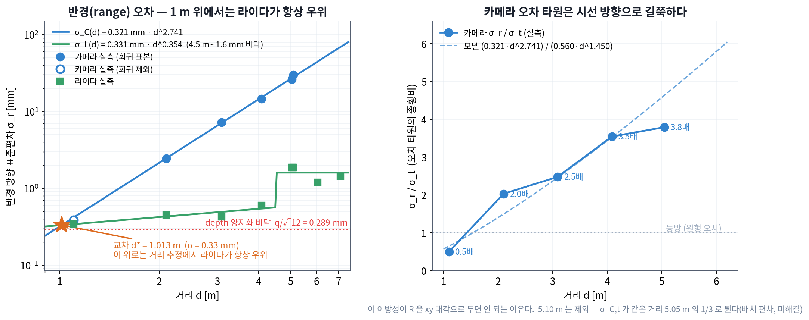
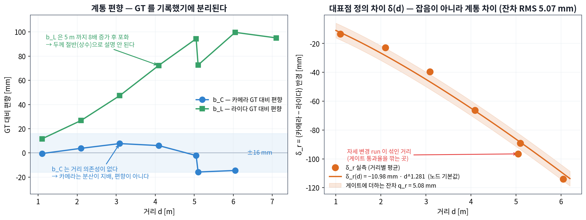
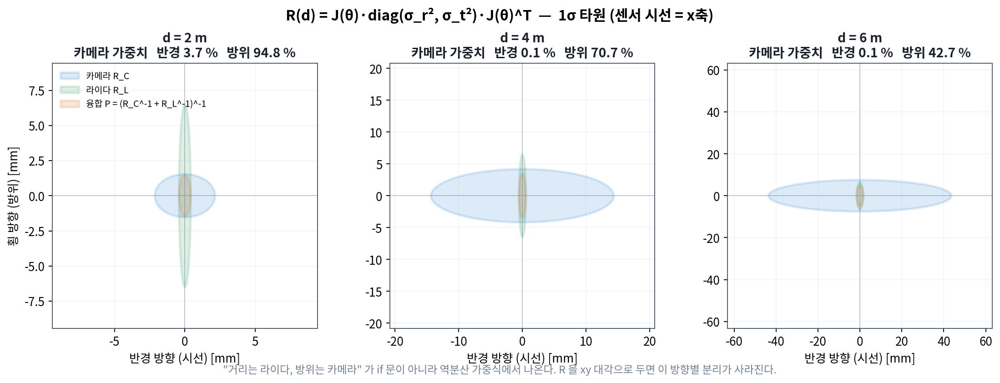
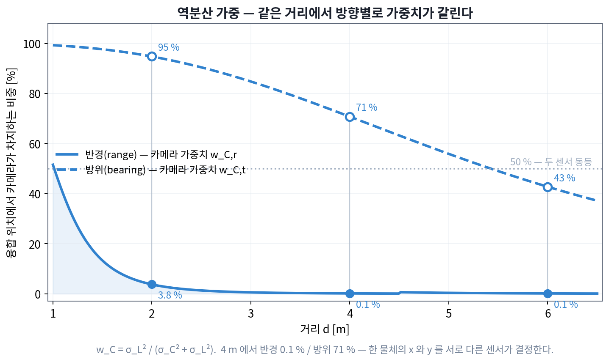
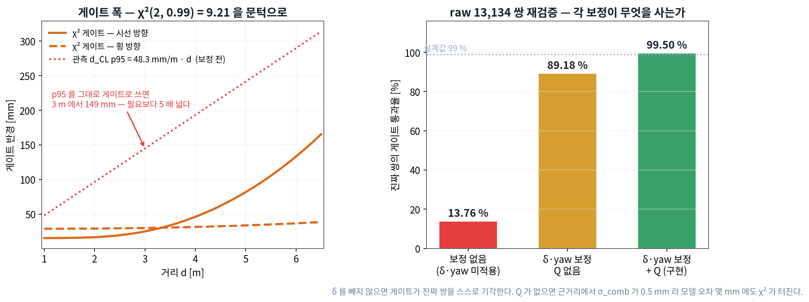
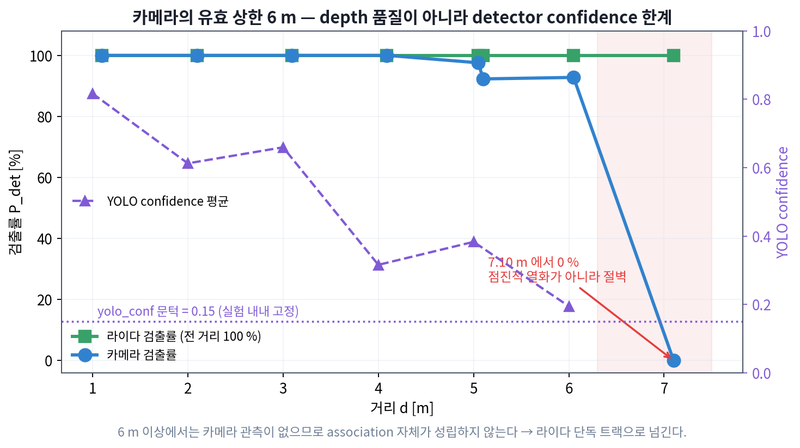
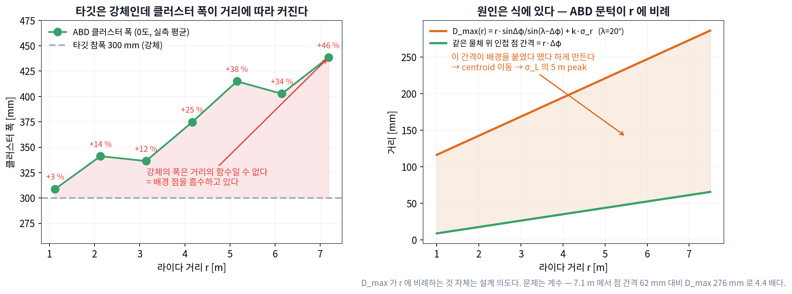
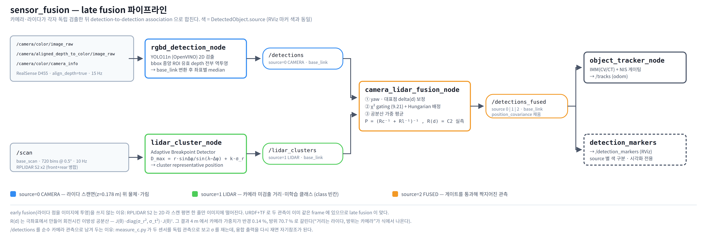

# 카메라·라이다 거리별 신뢰도 실측과 역분산 가중 융합

세미나 원고 — 슬라이드 단위. 청중은 동료 대학원생.

- 실험: **C2** (2026-09-04 02:51~05:14, 62 run). 정의 `stack_master/scripts/EXPERIMENT_C2.md`, 결과 `EXPERIMENT_C2_RESULTS.txt`
- 구현: `sensor_fusion/camera_lidar_fusion_node.py` (커밋 `edddcbe`)
- 데이터: `measure_c_results_c2.csv` (62행), `measure_c_raw_c2_*.csv` (59파일), `check_target_results_c2.csv` (113행)
- 그림: `docs/figures/c2_*.png` — 전부 `make_c2_figures.py` 가 위 CSV 에서 직접 생성한다

> 수식은 유니코드 + 코드블록으로 썼다. PowerPoint 에 그대로 붙여도 깨지지 않는다.

---

## 슬라이드 1 — 제목

**거리에 따라 믿을 센서가 바뀐다 — 실측 R(d) 로 만든 카메라·라이다 융합**

부제: object-level measurement uncertainty 실측 → χ² gating → inverse-variance weighting

---

## 슬라이드 2 — 문제

두 센서가 같은 물체를 **다른 위치**로 보고한다. 3 m 에서 두 관측의 반경 차이가 약 40 mm 다.

세 가지를 답해야 한다.

| 질문 | 이름 | 필요한 것 |
|---|---|---|
| 이 둘이 같은 물체인가? | data association | 차이를 정규화할 척도 |
| 물체가 여럿이면 누구와 누구인가? | assignment | 비용 행렬 + 최적 배정 |
| 짝지었으면 위치를 어떻게 합치나? | fusion | 방향별 가중치 |

세 질문의 답이 **전부 같은 양** 하나를 요구한다 — measurement covariance `R(d)`.

> 발표 노트: "거리는 라이다가 정확하고 방위는 카메라가 정확하다"는 건 다들 안다. 문제는 그걸 **몇 대 몇으로** 섞느냐다. 그 숫자가 없으면 if 문으로 때우게 된다.

---

## 슬라이드 3 — 개념 ①: measurement covariance R

관측 하나를 점이 아니라 **분포**로 본다.

```
z ~ N(x, R)        z: 관측,  x: 참값,  R: 2x2 공분산 [m²]
```

핵심은 두 센서 모두 **극좌표(polar)에서 측정**한다는 것이다. 카메라의 depth 오차는 시선 방향으로,
방위 오차는 횡 방향으로 생긴다. 두 오차는 극좌표에서 독립이지 xy 에서 독립이 아니다.

극좌표 → 직교좌표 변환의 Jacobian:

```
x = r·cosθ,  y = r·sinθ

J = ∂(x,y)/∂(r,θ) = | cosθ   −r·sinθ |  = rot(θ) · diag(1, r)
                    | sinθ    r·cosθ |

R_xy = J · diag(σ_r², σ_θ²) · J^T
     = rot(θ) · diag(σ_r², (r·σ_θ)²) · rot(θ)^T
```

구현은 횡방향 오차를 처음부터 미터로 둔다(`σ_t = r·σ_θ`), 그래서

```
R(d, θ) = rot(θ) · diag(σ_r², σ_t²) · rot(θ)^T
```

**R 을 xy 대각행렬로 두면 안 된다.** 그러면 오차 타원이 축 정렬 원/타원이 되어
"시선 방향으로 길쭉하다"는 정보가 사라지고, 방향별 가중치 분리가 나오지 않는다.

> 교재: Bar-Shalom, *Estimation with Applications to Tracking and Navigation*, §1.4 (좌표 변환과 공분산).
> 이 부분은 대부분 교재에 있다. **없는 것**은 σ_r, σ_t 의 실제 값이다 — 그게 이 실험이다.

---

## 슬라이드 4 — 개념 ②: inverse-variance weighting

같은 x 를 재는 unbiased 관측 두 개, 분산 σ₁², σ₂². 선형 결합으로 합친다.

```
x̂ = w·z₁ + (1−w)·z₂
Var(x̂) = w²σ₁² + (1−w)²σ₂²

d/dw = 2wσ₁² − 2(1−w)σ₂² = 0
  →   w = σ₂² / (σ₁² + σ₂²)          ← 상대의 분산에 비례한다
  →   1/Var(x̂) = 1/σ₁² + 1/σ₂²      ← information 이 더해진다
```

이것이 **BLUE**(Best Linear Unbiased Estimator)이고, Gaussian 가정에서는 MLE 와 같다.

행렬로 올리면 (information filter form):

```
P = (R₁⁻¹ + R₂⁻¹)⁻¹
x̂ = P · (R₁⁻¹ z₁ + R₂⁻¹ z₂)
```

**Kalman filter 와의 관계** — measurement update 에서 H = I 로 두면

```
P⁺ = (P⁻⁻¹ + R⁻¹)⁻¹
```

로 같은 형태다. 즉 **센서 융합은 prior 가 없는 Kalman update** 다. 새 이론이 아니다.

여기서 결정적인 점: `R` 이 **대각이 아니면** w 가 스칼라가 아니라 **행렬**이 된다.
그래서 같은 물체의 x 성분과 y 성분을 서로 다른 센서가 지배할 수 있다.

> 교재: Bar-Shalom §8.3 (track-to-track fusion). 학부 확률론의 "분산이 작은 쪽에 더 큰 가중"이 그대로 행렬로 올라간 것이다.

---

## 슬라이드 5 — 개념 ③: Mahalanobis distance 와 χ² gating

두 관측의 차이 `δ = z_C − z_L` 이 **잡음으로 설명되는가**를 묻는다.

```
δ ~ N(0, S),   S = R_C + R_L        (두 관측이 독립일 때)

d² = δ^T S⁻¹ δ       ← Mahalanobis distance (제곱)
d² ~ χ²_n,  n = 2    ← 2차원이므로 자유도 2
```

문턱은 유의수준 α 에서 `χ²_{2,α}`. 자유도 2 는 닫힌 형태가 있다:

```
χ²₂ 의 CDF = 1 − exp(−x/2)
  →  문턱 = −2·ln(1−α)
  →  α = 0.99  →  −2·ln(0.01) = 9.2103
```

**왜 "몇 mm 이내" 가 아니라 χ² 인가** — 고정 반경은 근거리에서 너무 헐겁고 원거리에서 너무 빡빡하다.
`S` 가 거리에 따라 커지므로 χ² 로 정규화하면 **하나의 문턱이 전 거리에 통한다**.

> 교재: Bar-Shalom & Fortmann, *Tracking and Data Association*, §2.3 (validation gate).

---

## 슬라이드 6 — 개념 ④: assignment (GNN + Hungarian)

게이팅은 "가능한가"만 답한다. 물체가 여럿이면 **누구와 누구인지**를 따로 정해야 한다.

```
비용 행렬  C[i][j] = χ²_ij         (게이팅에서 이미 계산한 값을 재사용)
게이트 초과 → C[i][j] = ∞         (금지된 짝)
Hungarian (Kuhn–Munkres) → 총 비용 최소인 일대일 배정,  O(n³)
```

greedy nearest-neighbor 와 다르다. greedy 는 순서에 따라 결과가 바뀌고 전역 최적이 아니다.
이 방식이 **GNN**(Global Nearest Neighbor)이다.

구현: `object_tracker/core/association.py` 의 `assign()` — `scipy.optimize.linear_sum_assignment`.
행마다 "짝 없음" 열을 명시적으로 붙여, 금지된 짝이 유효한 짝을 밀어내지 못하게 했다.

association 과 fusion 을 한 노드에 둔 이유: **게이팅에서 계산한 χ² 가 그대로 Hungarian 의 비용**이고,
배정이 끝나면 **같은 R 로 바로 융합**한다. 같은 값을 두 번 계산할 이유가 없다.

---

## 슬라이드 7 — 왜 데이터시트로 안 되는가

세 가지 모두 데이터시트에 **없다**.

| 필요한 것 | 데이터시트에 있는 것 | 왜 다른가 |
|---|---|---|
| `σ_C(d)` — 물체 대표점의 분산 | 픽셀 단위 depth RMS error | 우리가 재는 건 YOLO bbox → ROI median → TF 를 다 거친 **파이프라인 전체**의 변동 |
| `σ_L(d)` — 클러스터 대표점의 분산 | 단일 점의 range accuracy | ABD 클러스터의 centroid 는 점 하나가 아니라 **가변 개수 점들의 평균** |
| `δ(d)` — 두 센서 대표점 차이 | 없음 | 어느 센서의 성질도 아니다. **두 규약의 차이**다 |

즉 우리가 재는 것은 소자의 intrinsic noise 가 아니라 **object-level measurement uncertainty** 다.
(`rgbd_detection_node.py` 의 docstring 이 이 구분을 명시한다.)

**증거** — 같은 카메라, 같은 거리인데 대표점 정의만 바꾸면 지수가 바뀐다.

```
C1 (bbox 중심 11x11 median 1점) : σ_C = 1.33 mm · d^1.81
C2 (bbox 중앙 ROI 전체 median)  : σ_C = 0.321 mm · d^2.741
```

**두 데이터를 같은 회귀에 넣으면 안 된다.** 서로 다른 확률변수다.

---

## 슬라이드 8 — C1 이 남긴 교훈: GT 를 안 재면 끝이다

C1(2026-08-20)은 GT 거리를 기록하지 않고 `nominal_d` 만 남겼다. 그 결과:

| d [m] | 1.0 | 2.0 | 3.0 | 4.0 | 5.0 |
|---|---|---|---|---|---|
| `cam_r_mean − nominal_d` [mm] | +23.2 | −29.3 | −149.1 | −296.9 | −333.0 |

5 m 에서 −333 mm. 이게 **카메라 편향인지 타깃을 놓은 위치의 오차인지 구분할 방법이 없다.**
`gt_d` 없이는 영원히 알 수 없다.

C2 는 매 조건마다 줄자로 `base_link` 원점 → **타깃 앞면**을 재서 기록했다. 결과는 슬라이드 12 —
b_C 는 사실상 0 이었다. **C1 의 −333 mm 는 카메라가 아니라 배치 오차였다.**

> 발표 노트: 이 슬라이드가 실험 설계의 핵심이다. "측정 장비를 믿을 수 있나"가 아니라 "무엇을 기록해야 사후에 분리 가능한가"의 문제다.

---

## 슬라이드 9 — 실험 설계 C2

**타깃**: suitcase(강체). person 을 안 쓴 이유 — 호흡·자세 변동이 σ 에 섞이는데
그건 measurement uncertainty 가 아니다. 강체여야 **파이프라인 변동만** 남는다.

```
센서    : RealSense D455 (aligned depth, 15.0 Hz) + RPLIDAR S2 x2 병합 /scan (12.0 Hz)
대표점  : 카메라 = bbox 중앙 ROI(0.5) 유효 depth 전체 → 3D → base_link → 좌표별 median
          라이다 = ABD 클러스터의 mean_centroid
그리드  : 1.1 / 2.1 / 3.09 / 4.09 / 5.05 / 5.10 / 6.05 / 7.10 m  (줄자 실측 GT)
방위    : 0° 전 거리, ±20° 는 2·4 m 추가
run     : 30 s, 조건당 3~7 run,  총 62 run / 2시간 23분
```

**절대 변경 금지 설정** — σ 는 이 값들의 함수다. 중간에 하나라도 바꾸면 전후 데이터를 합칠 수 없다.

| 노드 | 파라미터 | C2 고정값 |
|---|---|---|
| `rgbd_detection_node` | `camera_position_method` | `roi_median_3d` |
| | `depth_roi_ratio` / `min_valid_depth_pixels` | `0.5` / `20` |
| | `yolo_conf` | `0.15` |
| `lidar_cluster_node` | `cluster_position_method` | `mean_centroid` |
| | `lambda_deg` / `sigma_mult` / `sigma_r` | `20` / `3` / `0.03` |

전부 launch 인자로 노출하고 **시작 시점에 못 박았다**. `measure_both.sh` 가 매 run 마다
`ros2 param get` 으로 읽어 CSV `note` 컬럼에 자동 기록한다.

**검증**: 62행의 `note` 고유값이 하나뿐이다. C1 에서 세션 중간에 `yolo_conf` 를 0.4 → 0.15 로
바꿔 데이터를 못 합치게 됐던 문제가 재발하지 않았다. **62행이 하나의 확률변수를 잰 표본이다.**

---

## 슬라이드 10 — 데이터 정제: 유효성은 행이 아니라 **열** 단위

라이다가 엉뚱한 물체를 잡은 run 도 **카메라 표본은 멀쩡하다.** 행을 통째로 버리면 멀쩡한
데이터가 같이 날아간다. (C1 에서 실제로 5 m 전체를 잃었다가 되찾으니 회귀 지수가
1.38 → 1.81 로 바뀌어 이론값 2 에 붙었다.)

| 구분 | run | 처리 |
|---|---|---|
| 양 센서 정상 | 41 | 전 항목 사용 |
| 카메라 0, 라이다 정상 (7.10 m 등) | 4 | `σ_L` / `b_L` 만 사용 |
| 라이다 0~1, 카메라 정상 (4.1 m −20°) | 2 | `σ_C` 만 사용 |
| 양 센서 0 (타깃 미배치) | 4 | 폐기 |
| nominal–GT 불일치 (배치 실수) | 11 | 폐기 |

**배치 실수는 σ 로 안 잡힌다.** `measure_both.sh` 가 nominal 근처 최근접 물체를 고르는데,
어긋나면 **다른 물체를 집는다**. 엉뚱한 물체도 안 움직이므로 σ 는 **오히려 작게** 나온다.
GT 대비 편향에서만 드러난다.

```
05:09~05:11 (nominal 4.0, GT 3.70) : b_C = −707.5 mm,  b_L = −291.3 mm
05:13~05:14 (nominal 2.0, GT 2.50) : b_C = +491.5 mm,  b_L = +234.0 mm
```

GT 가 3.70 m 와 2.50 m 로 다른데 **카메라가 양쪽 모두 2,992 mm 를 보고**했다 — 같은 제3의 물체다.

또 하나: `bias_CL_r` 은 정상 run 에서 **예외 없이 음수**다(카메라가 앞면, 라이다가 centroid).
**부호가 양수면 물리적으로 불가능** → 배치 실수 판별 지표.

> 발표 노트: 이 슬라이드에서 "데이터가 나빠서 뺐다"와 "어느 조건의 값인지 특정할 수 없어서 뺐다"의 차이를 강조한다. 후자만 정당하다.

---

## 슬라이드 11 — 결과 ①: σ_r(d) 와 교차 거리



```
σ_C(d) = 0.321 mm · d^2.741     (2.1~5.1 m, R²(log) = 0.9981, 최대잔차 6.2%)
σ_L(d) = 0.331 mm · d^0.354     (1.1~4.09 m, 최대잔차 15.6%)
         4.5 m 이상은 1.6 mm 상수 바닥 (실측 1.20~1.88 mm, 비단조)

교차 d* = 1.013 m  (σ = 0.33 mm)
```

**1 m 를 넘는 모든 거리에서 거리 추정은 라이다가 우위다.** 4 m 에서 26배, 6 m 에서 27배.

**1.1 m 를 회귀에서 뺀 이유** — depth 이미지가 `16UC1`(mm 정수)이라 양자화 스텝 q = 1 mm,
잡음 바닥이 `q/√12 = 0.289 mm`. 실측 σ_C 가 0.07~0.96 mm 로 **바닥을 걸친다**.
센서 잡음이 아니라 양자화가 지배하므로, 넣으면 지수를 끌어내린다.

**6.05 m 를 뺀 이유** — 실측 32.81 mm 인데 모델 외삽은 44.58 mm 로 실측이 26% 작다.
이 구간 `cam_hit` 이 92.8% 라 **검출에 성공한 프레임만 σ 에 들어가** 표본이 "쉬운 프레임"으로
치우친다. 실제로 hit=100% run 평균 26.2 mm vs hit<99% run 평균 28.6 mm 로 방향이 일치한다.
→ 6 m 대는 외삽값 44.6 mm 를 **보수적 상한**으로 쓴다.

---

## 슬라이드 12 — 지수 2.741 은 어디서 왔나

스테레오 깊이 오차의 교과서 값은 `d²` 다.

```
z = f·B / D            (D = disparity [px], f = 초점거리, B = baseline)
dz/dD = −f·B / D² = −z² / (f·B)
  →  σ_z = σ_D · z² / (f·B)        ← d² 항
```

그런데 실측은 **2.741** 이다. 0.741 이 더 붙었다. 이건 소자 잡음이 아니라
**`roi_median_3d` 라는 추정량의 성질**이다.

```
bbox 픽셀 폭       ∝ 1/d
ROI 안 픽셀 수 N   ∝ 1/d²
median 의 표준오차 ∝ 1/√N  ∝  d      ← 여기서 d 한 개가 더 붙는다

스테레오 d²  ×  추정량 d  =  d³
관측된 2.741 은 그 사이다.
```

검산: C1 은 `center_patch`(중심 11x11, **면적이 거리와 무관**)라 이 항이 없다 → 지수 1.81, 이론값 2 에 근접. **예측과 일치한다.**

> 발표 노트: 여기가 "이론 ↔ 실측" 연결의 핵심이다. 지수가 2 가 아닌 게 오류가 아니라, 추정량을 바꿨기 때문에 **예측대로** 바뀐 것이다.

---

## 슬라이드 13 — 결과 ②: bias 와 대표점 차이 δ(d)



**b_C**: 부호가 일정하지 않고 크기가 ±16 mm 를 넘지 않는다. **거리 의존성이 없다.**
→ 카메라의 절대 거리 정확도는 **편향이 아니라 분산이 지배**한다. (= C1 의 −333 mm 는 배치 오차였다)

**b_L**: 1.1 m 에서 5.05 m 까지 단조 증가(+11.7 → +94.4 mm) 후 포화.
대표점 정의(카메라=앞면, 라이다=앞면 호의 centroid)로는 **타깃 두께의 절반, 즉 상수**밖에 설명 못 한다.
8배 증가는 설명되지 않는다 → 원인은 슬라이드 18.

**δ_r(d) — 두 센서 대표점 차이**:

```
δ_r(d) = −10.28 mm · d^1.317      (재분석, 잔차 RMS 4.94 mm)
         −10.98 mm · d^1.281      (노드 기본값, 잔차 RMS 5.08 mm)
```

두 회귀의 차이는 표본을 거리별 평균으로 잡느냐 run 단위로 잡느냐이고, **잔차 범위 안에서 일치**한다.

**이건 잡음이 아니라 계통 차이다.** association 전에 라이다 관측을 카메라 규약(물체 앞면)으로
옮겨 **빼야 한다**. 카메라 규약으로 통일한 이유: 충돌 회피에 필요한 것은 **가장 가까운 표면**이지
centroid 가 아니다.

빼지 않으면 게이트가 **진짜 쌍을 스스로 기각**한다 (슬라이드 16에서 수치로).

---

## 슬라이드 14 — 결과 ③: 오차 타원의 이방성



카메라의 반경/횡 오차 비 `σ_r / σ_t`:

| d [m] | 1.1 | 2.1 | 3.09 | 4.09 | 5.05 |
|---|---|---|---|---|---|
| σ_C,r / σ_C,t | 0.5 | 2.0 | 2.5 | 3.5 | 3.8 |

**오차 타원이 시선 방향으로 길쭉하고, 그 길쭉함이 거리에 따라 심해진다.**

그림에서 읽을 것: 융합 타원(주황)은 **폭을 라이다에서, 높이를 카메라에서** 가져온다.
어느 쪽도 통째로 이기지 않는다.

```
σ_C,t(d) = 0.560 mm · d^1.450     (노드 기본값)
σ_L,t    = 6.5 mm 상수            (C2 관측 중앙값)
```

> **솔직히 말할 것**: `σ_C,t` 는 이 실험에서 **가장 약한 부분**이다. 재분석하면 `0.579·d^1.237`,
> `R²(log) = 0.49` 로 σ_r 의 0.998 에 비해 훨씬 나쁘다. 5.10 m 의 σ_C,t 가 2.10 mm 로
> 사실상 같은 거리인 5.05 m(6.90 mm)의 1/3 이라 회귀를 흔든다. 배치 편차로 보이고 미해결이다.

---

## 슬라이드 15 — 결과 ④: 가중치가 방향별로 갈린다



| d [m] | σ_C,r | σ_L,r | **카메라 반경가중** | σ_C,t | σ_L,t | **카메라 방위가중** |
|---|---|---|---|---|---|---|
| 1 | 0.32 | 0.33 | **51.6 %** | 0.56 | 6.50 | **99.2 %** |
| 2 | 2.15 | 0.42 | **3.7 %** | 1.53 | 6.50 | **94.8 %** |
| 4 | 14.35 | 0.54 | **0.1 %** | 4.18 | 6.50 | **70.7 %** |
| 6 | 43.58 | 1.60 | **0.1 %** | 7.53 | 6.50 | **42.7 %** |

4 m 에서 카메라 가중치가 **반경 0.1 % / 방위 70.7 %** 로 갈린다.
한 물체의 x 와 y 를 **서로 다른 센서가 결정**한다.

**"거리는 라이다, 방위는 카메라" 가 규칙이 아니라 식에서 나온다.** if 문이 하나도 없다.
`R` 을 xy 대각으로 두면 이 분리가 사라진다.

> **단서**: 방위 가중치가 5.5 m 부근에서 역전되는 것은 `σ_L,t = 6.5 mm` **상수 가정에 의존**한다.
> 실제로 σ_L,t 는 거리의 함수로 맞지 않았다(멱함수 회귀 R² 이 음수). 클러스터 폭의 시간 표준편차와
> 강하게 상관한다 — `σ_L,t = 0.974·(w_sd/2)`, r = 0.923, n = 42. 즉 **거리가 아니라 환경**(배경까지의
> 간격 대 D_max)의 함수다. 이 역전은 검증된 결과가 아니라 **가정의 결과**다.

---

## 슬라이드 16 — 게이트 설계와 검증



```
게이트 공분산  S = R_C + R_L + Q
Q = rot(θ) · diag(q_r², q_t²) · rot(θ)^T,   q_r = 5.08 mm, q_t = 6.95 mm
                                            ← δ 모델의 잔차
문턱 = χ²(2, 0.99) = 9.21
```

**Q 가 왜 필요한가** — 근거리에서 `σ_C² + σ_L²` 이 0.5 mm 수준이라, δ 모델이 몇 mm 만 틀려도
χ² 가 폭발한다. 모델 오차를 공분산에 명시적으로 넣어야 한다.

**raw 프레임 13,134 쌍으로 재검증** (`camera_lidar_fusion_node` 의 기본 파라미터를 그대로 적용):

| 단계 | 통과율 |
|---|---|
| 보정 없음 (δ·yaw 미적용) | **13.76 %** |
| δ·yaw 보정, Q 없음 | **89.18 %** |
| δ·yaw 보정 + Q **(구현)** | **99.50 %** |

설계값 99 % 와 일치한다.

**p95 를 그대로 게이트로 쓰면 안 된다** — 관측된 `d_CL_p95(d) = 48.3 mm/m · d` 인데,
이 값의 대부분은 **yaw misalignment 와 δ_r 이라는 계통 성분**이다. 계통을 먼저 보정하고
남는 잡음에 χ² 를 씌우는 게 옳다. p95 를 쓰면 3 m 에서 149 mm 로 **필요보다 5 배 넓다**.

---

## 슬라이드 17 — 검출률 절벽



| d [m] | 1.1 | 2.1 | 3.09 | 4.09 | 5.05 | 5.10 | 6.05 | 7.10 |
|---|---|---|---|---|---|---|---|---|
| cam_hit [%] | 100 | 100 | 100 | 100 | 97.6 | 92.3 | 92.8 | **0.0** |
| lid_hit [%] | 100 | 100 | 100 | 100 | 100 | 100 | 100 | 100 |

**점진적 열화가 아니라 절벽이다.** 이유는 confidence 분포에 있다.

```
6 m 의 conf 평균 = 0.195,  실험 내내 고정한 문턱 yolo_conf = 0.15
7 m 에서는 분포 전체가 문턱 아래로 내려간다
```

즉 카메라의 상한 6 m 는 **depth 품질의 한계가 아니라 detector confidence 의 한계**다.
(문턱을 낮추면 늘어나지만 false positive 를 사게 된다.)

**설계에 직접 들어간다**: 6 m 이상에서는 카메라 관측이 아예 없으므로 association 자체가
성립하지 않는다 → **라이다 단독 트랙**으로 넘긴다. 클래스가 비는데, 직전 카메라 확인값을
붙드는 것은 프레임 수준이 아니라 **트랙 수준의 상태**라 `object_tracker` 의 몫이다.

한편 라이다는 1.1~7.1 m 전 구간 100 % 다. C1 이 4 m 이상에서 σ_L 을 못 얻었던 것(24행 중
8행이 포착률 90% 미만)과의 차이는 **배치 조건 하나** — 타깃 뒤쪽 1 m 이상을 비웠다.

---

## 슬라이드 18 — 계획에 없던 발견: ABD 의 D_max



σ_L 의 5 m peak(슬라이드 11)와 b_L 의 포화(슬라이드 13)를 설명하려다 나왔다.

타깃은 **강체(참폭 300 mm)** 인데 클러스터 폭이 거리에 따라 커진다: 1.1 m +3 %, 5.2 m +38 %, 7.2 m +46 %.
**강체의 폭은 거리의 함수일 수 없다** → 클러스터가 타깃 아닌 점을 흡수하고 있다.

원인이 `lidar_cluster_node` 의 ABD(Adaptive Breakpoint Detector) 문턱 식에 그대로 있다:

```
D_max(r) = r·sin(Δφ) / sin(λ − Δφ) + k·σ_r
         = r·sin(0.5°) / sin(19.5°) + 3 × 0.03
         = 0.0261·r + 0.09   [m]

r = 1.1 m → D_max 118.8 mm   (인접 점 간격  9.6 mm)  — 12.4 배
r = 5.1 m → D_max 223.3 mm   (인접 점 간격 44.5 mm)  —  5.0 배
r = 7.1 m → D_max 275.6 mm   (인접 점 간격 62.0 mm)  —  4.4 배
```

D_max 가 r 에 비례하므로 원거리에서는 **타깃에서 20 cm 떨어진 배경 점도 같은 클러스터로 붙는다.**
붙었다 떨어졌다 하면 centroid 가 이동한다 → σ_L 의 5 m peak(1.86 mm), σ_L,t 의 10~13 mm,
b_L 의 포화가 전부 여기서 나온다.

**D_max 가 r 에 비례하는 것 자체는 설계 의도다** — 같은 물체 위 인접 점 간격도 r 에 비례해 벌어지기 때문이다.
문제는 **계수**다. 현재 λ = 20° 는 점 간격 대비 D_max 를 4.4 배로 잡는다. **λ 재튜닝의 근거가 이 데이터다.**

---

## 슬라이드 19 — 결과가 코드에 들어간 형태



| 실험 결과 | `camera_lidar_fusion_node` 파라미터 |
|---|---|
| `σ_C = 0.321 mm·d^2.741` | `cam_sigma_r_coef` / `cam_sigma_r_exp` |
| `σ_C,t = 0.560 mm·d^1.450` | `cam_sigma_t_coef` / `cam_sigma_t_exp` |
| `σ_L = 0.331 mm·d^0.354` | `lid_sigma_r_coef` / `lid_sigma_r_exp` |
| 4.5 m 이상 평탄 1.6 mm | `lid_sigma_r_floor` / `lid_sigma_r_break` |
| `σ_L,t` 중앙값 6.5 mm | `lid_sigma_t_const` |
| `δ_r = −10.98 mm·d^1.281` | `delta_r_coef` / `delta_r_exp` |
| δ 잔차 5.08 / 6.95 mm | `delta_resid_r` / `delta_resid_t` |
| `χ²(2,0.99) = 9.21` | `gate_chi2` |
| dt 평균 21.9 ms, 최대 67.0 ms | `sync_slop = 0.067` |
| yaw −38.90 mrad | `lidar_yaw_correction` |

**late fusion 을 쓴 이유**: 대안인 early fusion(라이다 점을 이미지에 투영해 bbox 안의 점만 선택)은
RPLIDAR S2 가 **2D** 라 스캔 평면 한 줄만 이미지에 떨어진다. 3D 라이다용 방식이고 extrinsic
캘리브레이션도 따로 필요하다. 여기서는 URDF + TF 로 이미 두 관측이 같은 frame 에 있다.

**`/detections` 를 순수 카메라 관측으로 남긴 이유**: `measure_c.py` 가 두 센서를 **독립 관측**으로
보고 σ 를 재는데, 융합 출력을 재면 **자기참조**가 되어 다시 측정할 수 없다.

---

## 슬라이드 20 — 한계와 다음 단계

정직하게 짚을 것 다섯 가지.

1. **`σ_θ` 의 각도 의존성은 못 얻었다.** off-axis 4배치의 카메라 σ_θ 가 0.35~2.21 mrad 인데
   각도 순서와 무관 — 배치 편차에 묻혔다. 다만 R(d) 구성에 필요한 **거리 의존성은 0° 데이터에
   전부 있어** 지장은 없다. 재측정한다면 nominal 을 실측 위치에 맞추고 ROI 를 0.6 으로 좁힐 것.

2. **`σ_L,t = 6.5 mm` 상수는 임시다.** 물리적으로 맞는 것은 클러스터 폭의 시간 변동으로
   적응 추정하는 것인데, **트랙 ID 가 있어야** 폭 이력을 쌓을 수 있어 `object_tracker` 이후로 미룬다.

3. **오배정률(false association rate)은 정당화되지 않았다.** C2 는 **단일 객체** 실험이라
   거짓 쌍의 분포 자체가 데이터에 없다. 통과율 99.50 % 는 **진짜 쌍에 대한 수치**이고,
   거짓 쌍을 얼마나 걸러내는지는 **다물체 실험**이 필요하다.

4. **yaw 보정값의 귀속이 미확정이다.** 실측 방위차는 `base_link` 기준 −38.90 mrad 인데
   노드는 `laser_front` 장착점 (86.3, −20.5) mm 를 중심으로 회전시키므로 적용값이 −43.67 mrad 로 다르다.
   회전 중심의 lever arm 으로 대부분 설명되지만 전부는 아니다. θ 의 변동계수(12 %)가 y 의
   변동계수(43 %)보다 작은 쪽이 라이다여서 라이다 yaw 로 귀속했으나 **카메라 쪽일 가능성이 남아 있다.**
   근본 해결은 **URDF(`laser_front` rpy_offset) 수정**이고 — 그래야 `/scan` 을 쓰는 SLAM·코스트맵도
   같이 맞는다 — 고친 뒤에는 이 파라미터를 반드시 **0.0 으로 되돌려야** 이중 보정이 되지 않는다.

5. **`σ_C` 모델의 유효 범위는 2~5 m 다.** 아래로는 depth 양자화 바닥, 위로는 검출 편향이 지배한다.
   6 m 대는 외삽값 44.6 mm 를 보수적 상한으로, 7 m 이상에서는 카메라 관측이 없다.

**바로 할 수 있는 것**: ABD 의 `λ` 재튜닝 (슬라이드 18 이 근거).

---

## 부록 A — 재현 방법

```bash
# 그림 생성 (CSV 에서 직접, 상수 하드코딩 없음)
python3 src/amr_basic_stack/stack_master/docs/figures/make_c2_figures.py

# 실험 설정을 못 박고 스택 기동
./run_stack.sh \
  yolo_conf:=0.15 \
  camera_position_method:=roi_median_3d \
  depth_roi_ratio:=0.5 \
  min_valid_depth_pixels:=20 \
  cluster_position_method:=mean_centroid

# 조건 하나당 절차
python3 check_target.py --distance 4.0 --duration 10 --label suitcase   # ok=1 확인
GT=4.021 CLASS=suitcase ./measure_both.sh 4.0 0 suitcase 30             # 본측정 3회
```

---

## 부록 B — 실험에서 밟은 함정 (질문 대비)

1. **`--class-name` 문자열 정확일치.** YOLO 가 이 타깃을 `suitcase` 로 분류하는데
   `--class-name backpack` 을 주면 카메라 표본이 **전 거리에서 0**이 된다. 이걸 "원거리에서
   검출이 안 된다"로 오독해 몇 시간을 헛돌았다. 먼저 클래스 필터 없이 `top_class` 를 확인할 것.
   (check_target 113행의 top_class 분포: suitcase 83 / backpack 4)

2. **`yolo_conf` 는 런타임 변경이 무시된다.** 파라미터 콜백이 다른 셋만 처리한다.
   `ros2 param set` 은 성공했다고 보고하고 `ros2 param get` 도 새 값을 보여주지만
   검출기의 `self.conf` 는 안 바뀐다(생성자에서 1회 읽음). **launch 시점에 넘겨야 한다.**

3. **nominal 을 타깃과 같이 옮겨야 한다.** 1 m 어긋나면 `_pick()` 이 **다른 물체를 집는다**.

4. **자세를 바꾸면 σ 가 바뀐다.** 5 m 에서 타깃을 옮긴 3 run 의 δ 잔차가 −13~−25 mm 로
   `q_r = 5.08 mm` 를 크게 넘는다. 이 3 run 을 포함하면 게이트 통과율이 99.50 % → **97.78 %** 로
   떨어진다. `lid_r̄` 산포가 판별 지표(단일 자세면 0.4~0.6 mm, 5 m 는 12.8 mm).

5. **근거리 σ_C 는 depth 양자화 한계** (슬라이드 11).

6. **`cam_hit<100%` 면 σ_C 가 아래로 편향된다** (슬라이드 11).

7. **`check_target` 의 `ok` 는 카메라 클래스가 잡혀야 1.** 카메라가 0인 원거리에서는
   구조적으로 항상 0이니 `lid_hit_pct` 를 직접 봐야 한다.

---

## 부록 C — 예상 질문

**Q. 왜 Kalman filter 를 안 쓰고 정적 융합을 하나?**
A. 이 노드는 **프레임 단위 관측 융합**이다. 시간축 필터링(트랙 유지, ID, 속도 추정)은
`object_tracker` 가 IMM(CV/CT)으로 따로 한다. 역할을 나눈 이유 — 융합 단계에서 시간 상태를
가지면 σ 를 재측정할 때 자기참조가 생긴다.

**Q. 두 관측이 정말 독립인가? `S = R_C + R_L` 이 성립하나?**
A. 센서가 물리적으로 분리돼 있어 잡음원은 독립이다. 다만 **δ 모델 오차는 공통**이므로
그 부분을 `Q` 로 따로 더했다. 그게 슬라이드 16 의 89 % → 99.5 % 차이다.

**Q. 게이트 통과율 99.5 % 면 false association 은?**
A. 답할 수 없다. 단일 객체 실험이라 거짓 쌍의 분포가 데이터에 없다 (슬라이드 20-3).

**Q. σ 를 다시 재야 하는 때는?**
A. 대표점 정의(`camera_position_method`, `depth_roi_ratio`), ABD 파라미터(`lambda_deg`),
센서 배치(URDF) 중 하나라도 바뀌면. σ 는 **파이프라인의 함수**이지 소자의 함수가 아니다.
C1 → C2 에서 지수가 1.81 → 2.741 로 바뀐 것이 그 증거다.
